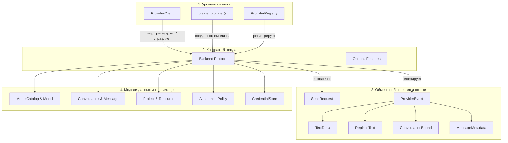
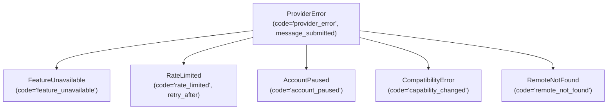

[![Версия: v1.2-beta][version-shield]](CHANGELOG.md)
[![Python 3.10+][python-shield]](https://www.python.org/downloads/)
[![GPL-3.0-only][license-shield]](LICENSE)

[English](README.md) | [Türkçe](README-TR.md) | **Русский**

# webai-provider

### Высокопроизводительный Python-клиент на основе контрактов для веб-сессий ChatGPT, Gemini, Claude и Grok.

`webai-provider` подключает ваши Python-приложения напрямую к веб-сессиям ведущих ИИ-провайдеров — ChatGPT, Gemini, Claude и Grok — без необходимости использования ключей API разработчика, предоплаченных кредитных балансов или сторонних прокси-серверов. Библиотека работает на чистом Python без headless-браузеров (таких как Playwright или Selenium), предоставляя унифицированный асинхронный интерфейс для многошагового диалога, потоковой передачи токенов в реальном времени, динамического обнаружения моделей и уровней рассуждений, вложений файлов, управления проектами и рабочими пространствами, редактирования сообщений и ветвления переписки.

---

<a id="oglavlenie"></a>
## Оглавление

- [1. Обзор и ключевые особенности](#1-обзор-и-ключевые-особенности)
- [2. Установка и требования](#2-установка-и-требования)
- [3. Поддерживаемые провайдеры и матрица возможностей](#3-поддерживаемые-провайдеры-и-матрица-возможностей)
- [4. Полный справочник API (От общего к частному)](#4-полный-справочник-api-от-общего-к-частному)
  - [4.1. Высокоуровневый координатор: `ProviderClient`](#41-высокоуровневый-координатор-providerclient)
  - [4.2. Создание провайдеров: `create_provider` и `ProviderRegistry`](#42-создание-провайдеров-create_provider-и-providerregistry)
  - [4.3. Базовый контракт: протокол `Backend`](#43-базовый-контракт-протокол-backend)
  - [4.4. Запросы и потоковые события: `SendRequest` и `ProviderEvent`](#44-запросы-и-потоковые-события-sendrequest-и-providerevent)
  - [4.5. Модели предметной области: `ModelCatalog`, `Conversation`, `Project` и др.](#45-модели-предметной-области-modelcatalog-conversation-project-и-др)
  - [4.6. Политики вложений и загрузка файлов: `AttachmentPolicy` и `DownloadSource`](#46-политики-вложений-и-загрузка-файлов-attachmentpolicy-и-downloadsource)
  - [4.7. Сессии, хранение учетных данных и синхронизация истории](#47-сессии-хранение-учетных-данных-и-синхронизация-истории)
  - [4.8. Браузерные профили и инструменты CDP: `profiles` и `cdp`](#48-браузерные-профили-и-инструменты-cdp-profiles-и-cdp)
  - [4.9. Телеметрия и профилирование задержек отправки: `timing`](#49-телеметрия-и-профилирование-задержек-отправки-timing)
  - [4.10. Обработка ошибок и коды состояния: `ProviderError`](#410-обработка-ошибок-и-коды-состояния-providererror)
- [5. Практические примеры (от простого к сложному)](#5-практические-примеры-от-простого-к-сложному)
  - [5.1. Пример 1: Базовый потоковый вывод токенов](#51-пример-1-базовый-потоковый-вывод-токенов)
  - [5.2. Пример 2: Динамическое обнаружение моделей, уровень рассуждений и многошаговый диалог](#52-пример-2-динамическое-обнаружение-моделей-уровень-рассуждений-и-многошаговый-диалог)
  - [5.3. Пример 3: Загрузка файлов и анализ вложений](#53-пример-3-загрузка-файлов-и-анализ-вложений)
  - [5.4. Пример 4: Мультипровайдерное параллельное сравнение ответов](#54-пример-4-мультипровайдерное-параллельное-сравнение-ответов)
  - [5.5. Пример 5: Управление ресурсами проектов и рабочих пространств](#55-пример-5-управление-ресурсами-проектов-и-рабочих-пространств)
  - [5.6. Пример 6: Редактирование сообщений, повторы и ветвление диалога](#56-пример-6-редактирование-сообщений-повторы-и-ветвление-диалога)
  - [5.7. Пример 7: Кастомное зашифрованное хранилище сессий](#57-пример-7-кастомное-зашифрованное-хранилище-сессий)
- [6. Архитектура времени выполнения и безопасность](#6-архитектура-времени-выполнения-и-безопасность)
- [7. Разработка, тестирование и контроль качества](#7-разработка-тестирование-и-контроль-качества)
- [8. Интеграция с SiopeChat](#8-интеграция-с-siopechat)
- [9. История версий и лицензия](#9-история-версий-и-лицензия)

---

## 1. Обзор и ключевые особенности

Современные веб-платформы искусственного интеллекта функционируют на базе различных проприетарных и недокументированных транспортных протоколов: от мультиплексирования HTTP/2 и потоков Server-Sent Events (SSE) до внутреннего RPC-формата Google `batchexecute` и специализированных антибот-механизмов. `webai-provider` абстрагирует эти различия в строгие типизированные контракты Python и гарантирует:

- **Отсутствие зависимостей от Node.js и Headless-браузеров:** Вся среда выполнения ChatGPT Sentinel (снятие цифровых отпечатков, вычисление Proof of Work и поддерживаемая валидация Turnstile) реализована исключительно средствами нативного Python (`chatgpt/sentinel/`).
- **Ленивая (Lazy) инициализация аккаунтов:** Импорт библиотеки или регистрация аккаунтов не выполняют сетевых запросов и не запускают фоновых процессов. Соединения открываются только в момент фактической отправки операций.
- **Строгая отмена операций и безопасность соединений:** При прерывании генерации или выходе из цикла `async for` нижележащий сокет транспорта незамедлительно закрывается. Запросы с неоднозначным статусом сбоя (POST) никогда не повторяются автоматически.
- **Полная изоляция учетных записей:** Каждый аккаунт изолированно управляет собственным хранилищем cookie, пулом HTTP-соединений и блокировками параллелизма. Утечка сессионных данных между аккаунтами исключена.
- **Типизированный многоканальный вывод:** Разделение видимого ответа ассистента (`None`), скрытых цепочек рассуждений (`analysis`), инкрементальных правок текста (`ReplaceText`) и ссылок на источники цитирования (`MessageMetadata.sources`).

[↑ К оглавлению](#oglavlenie)

---

## 2. Установка и требования

Требуется Python 3.10 или выше. Регулярно тестируется на Python 3.10, 3.11, 3.12, 3.13 и 3.14 в операционных системах Ubuntu, macOS и Windows.

```sh
# Клонирование и стандартная установка
git clone https://github.com/TahsinCr/webai-provider.git
cd webai-provider
python -m pip install .

# Установка с дополнительными инструментами разработки и тестирования
python -m pip install -e ".[dev]"
```

[↑ К оглавлению](#oglavlenie)

---

## 3. Поддерживаемые провайдеры и матрица возможностей

Возможности предоставляются через перечисление `Capability`. Поскольку такие параметры, как бюджет рассуждений или допустимые форматы вложений, зависят от конкретной модели и уровня подписки аккаунта, динамический каталог моделей, возвращаемый методом `await account.models()`, всегда является определяющим.

| Возможность (`Capability`) | ChatGPT | Gemini | Claude | Grok | Особенности и поведение |
| :--- | :---: | :---: | :---: | :---: | :--- |
| `CHAT` | ✅ | ✅ | ✅ | ✅ | Асинхронная отправка промптов и потоковая обработка событий SSE. |
| `TEMPORARY` | ✅ | ✅ | ✅ | ✅ | Приватный (инкогнито) режим (диалоги не сохраняются в истории на сервере). |
| `HISTORY` | ✅ | ✅ | ✅ | ✅ | Постраничное получение списка диалогов и полной истории реплик. |
| `RENAME` | ✅ | ✅ | ✅ | ✅ | Обновление заголовков диалогов на сервере. |
| `DELETE` | ✅ | ✅ | ✅ | ✅ | Безвозвратное удаление диалогов с сервера. |
| `AUTH` | ✅ | ✅ | ✅ | ✅ | Проверка валидности сессии и статуса авторизации. |
| `ATTACHMENTS` | ✅ | ✅ | ✅ | ✅ | Загрузка документов, изображений и медиафайлов перед отправкой сообщения. |
| `RESOURCES` | ✅ | ✅ | ✅ | ✅ | Управление текстовыми ресурсами и файлами, привязанными к проектам. |
| `PROJECTS` | ✅ | ✅ | ✅ | ✅ | Обнаружение и просмотр проектов (Notebooks в Gemini, Workspaces в Grok). |
| `PROJECT_CREATE` | ✅ | ✅ | ✅ | ✅ | Создание новых проектов или рабочих пространств. |
| `PROJECT_UPDATE` | ✅ | ✅ | ✅ | ✅ | Редактирование названия, системных инструкций или параметров проекта. |
| `PROJECT_DELETE` | ✅ | ✅ | ✅ | ✅ | Удаление проектов или рабочих пространств на сервере. |
| `PROJECT_MEMBERSHIP` | ✅ | ❌ | ✅ | ✅ | Перемещение чатов в проект или из него (в Gemini Notebook чаты жестко фиксированы). |
| `MODELS` | ✅ | ✅ | ✅ | ✅ | Динамическое обнаружение доступных аккаунту моделей. |
| `EFFORT` | ✅ | ✅ | ✅ | ✅ | Уровень глубины рассуждений (зависит от модели; настраивается в `Model.efforts`). |
| `MESSAGE_EDIT` | ✅ | ✅ | ✅ | ✅ | Редактирование предыдущей реплики пользователя с созданием новой ветки. |
| `MESSAGE_RETRY` | ✅ | ✅* | ✅ | ✅ | Перегенерация ответа ассистента (*в Gemini выполняется через редактирование родительского промпта). |
| `CHAT_BRANCH` | ✅ | ✅ | ❌ | ❌ | Ответвление реплики в новый независимый диалог (не поддерживается веб-API Claude и Grok). |

> **Примечание:** Возврат пустого списка из метода запроса означает лишь отсутствие данных на стороне сервера, а не отсутствие поддержки функции. Неподдерживаемые операции вызывают исключение `FeatureUnavailable`.

[↑ К оглавлению](#oglavlenie)

---

## 4. Полный справочник API (От общего к частному)



---

### 4.1. Высокоуровневый координатор: `ProviderClient`

`providers.client.ProviderClient`

Центральный координатор жизненного цикла для мультипровайдерных и мультиаккаунтных окружений. Рассчитан на запуск в одном экземпляре на событийный цикл `asyncio`.

#### Методы
- **`__init__() -> None`**<br>
  Инициализирует реестры бэкендов, активные потоковые задачи и защитные барьеры завершения.
- **`connect(provider_id: str, account_id: str = "default", **configuration) -> Backend`**<br>
  Создает ленивый бэкенд провайдера через `create_provider` и регистрирует его. Не выполняет сетевых вызовов и не создает процессов браузера.
- **`add(backend: Backend) -> Backend`**<br>
  Напрямую регистрирует предварительно созданный бэкенд. Гарантирует уникальность и непустоту пары `(backend.id, backend.account_id)`.
- **`account(provider_id: str, account_id: str = "default") -> Backend`**<br>
  Возвращает зарегистрированный бэкенд по идентификаторам. Возбуждает `KeyError`, если бэкенд не найден.
- **`prepare(provider_id: str, account_id: str = "default", *, for_send: bool = False) -> Backend`**<br>
  Инициализирует транспортное состояние аккаунта в фоновом режиме. Если `for_send=True`, запускает предварительный прогрев транспорта (например, получение токенов).
- **`stream(request: SendRequest) -> AsyncIterator[ProviderEvent]`**<br>
  Направляет запрос целевому бэкенду, валидирует возможности, отслеживает исполнение задачи и передает типизированные события. При выходе из цикла или отмене задачи транспортный итератор незамедлительно закрывается.
- **`close() -> None`**<br>
  Отменяет все выполняющиеся потоки, освобождает занятые транспортные ресурсы и корректно закрывает все бэкенды. Метод идемпотентен и безопасен при повторных вызовах в случае временных сбоев завершения.
- **`async with ProviderClient() as client:`**<br>
  Реализует протоколы `__aenter__` и `__aexit__` для безопасного управления контекстом.

#### Свойства (Properties)
- **`accounts -> tuple[tuple[str, str], ...]`**<br>
  Возвращает кортеж всех зарегистрированных пар `(provider_id, account_id)`.

[↑ К оглавлению](#oglavlenie)

---

### 4.2. Создание провайдеров: `create_provider` и `ProviderRegistry`

`providers.registry.create_provider`

Создает изолированный экземпляр бэкенда аккаунта без привязки к глобальному состоянию приложения.

```python
def create_provider(
    provider_id: str,
    account_id: str = "default",
    *,
    credential_file: str | Path | CredentialStore | None = None,
    session: BrowserSession | None = None,
    profile_directory: str | Path | None = None,
    **options,
) -> Backend:
```

#### Параметры
- **`provider_id`** (`str`): Идентификатор целевого провайдера: `"chatgpt"`, `"gemini"`, `"claude"` или `"grok"`.
- **`account_id`** (`str`): Локальный идентификатор аккаунта (по умолчанию `"default"`).
- **`credential_file`** (`str | Path | CredentialStore | None`): Путь к файлу сессии JSON или пользовательская реализация `CredentialStore`. Обязателен для всех провайдеров, если не передан `session`.
- **`session`** (`BrowserSession | None`): Готовый объект `BrowserSession` (только для ChatGPT).
- **`profile_directory`** (`str | Path | None`): Каталог профиля браузера для хранения данных Sentinel ChatGPT. По умолчанию используется каталог `chrome-profile/` рядом с файлом сессии.
- **`**options`**: Дополнительные параметры адаптера, например `client_factory`.

#### Класс `ProviderRegistry`
- **`register(provider: Provider, *, account_factory: Callable | None = None) -> None`**: Регистрирует прототип провайдера и конструктор аккаунта.
- **`create_account(provider_id: str, account_id: str, **configuration) -> Backend`**: Создает экземпляр аккаунта через зарегистрированную фабрику.
- **`set_enabled(provider_id: str, enabled: bool) -> None`**: Включает или выключает прием запросов данным провайдером.
- **`require(provider_id: str, capability: Capability) -> Provider`**: Проверяет поддержку возможности и возвращает объект провайдера.
- **`describe(provider_id: str) -> Coroutine[ProviderDescription]`**: Запрашивает текущее состояние возможностей провайдера.
- **`mark_unavailable(provider_id: str, capability: Capability) -> None`**: Временно помечает возможность как недоступную.
- **`restore(provider_id: str, capability: Capability) -> None`**: Восстанавливает ранее отключенную возможность.
- **`get(provider_id: str) -> Provider`**: Возвращает зарегистрированный прототип провайдера.
- **`ids() -> tuple[str, ...]`**: Возвращает список всех зарегистрированных идентификаторов провайдеров.

[↑ К оглавлению](#oglavlenie)

---

### 4.3. Базовый контракт: протокол `Backend`

`providers.contracts.Backend`

Единый протокол, реализованный всеми четырьмя адаптерами провайдеров.

#### Идентификация и жизненный цикл
- **`id: str`**: Идентификатор провайдера (`"chatgpt"`, `"gemini"`, `"claude"`, `"grok"`).
- **`account_id: str`**: Идентификатор аккаунта.
- **`capabilities: frozenset[Capability]`**: Набор возможностей, поддерживаемых адаптером.
- **`async def prepare() -> None`**: Инициализирует изолированное состояние транспорта аккаунта.
- **`async def close() -> None`**: Закрывает пулы сетевых соединений и рабочие потоки.

#### Аутентификация и диагностика
- **`async def authenticate() -> SessionStatus`**: Проверяет и при необходимости обновляет сессионные cookie/токены.
- **`async def login() -> SessionStatus`**: Запускает интерактивный или профильный процесс авторизации.
- **`async def session_status() -> SessionStatus`**: Возвращает текущий кэшированный статус без удаленных запросов.
- **`async def forget_session() -> SessionStatus`**: Удаляет сохраненные учетные данные и сбрасывает состояние.
- **`async def describe() -> ProviderDescription`**: Предоставляет информацию о поддерживаемых возможностях.

#### Модели и генерация текста
- **`async def models(*, force: bool = False) -> ModelCatalog`**: Возвращает каталог доступных моделей. Кэшируется на 5 минут, если не указано `force=True`.
- **`def stream(request: SendRequest) -> AsyncGenerator[ProviderEvent, None]`**: Отправляет запрос и генерирует поток событий.

#### Диалоги и история
- **`async def list_chats(cursor: str | None = None, limit: int = 28) -> Page[Conversation]`**: Возвращает список диалогов с поддержкой пагинации.
- **`async def get_chat(conversation_id: str) -> Conversation`**: Загружает полную историю реплик и метаданные диалога.
- **`async def rename_chat(conversation_id: str, title: str) -> None`**: Переименовывает диалог на сервере.
- **`async def delete_chat(conversation_id: str) -> None`**: Безвозвратно удаляет диалог с сервера.
- **`async def branch_chat(conversation_id: str, message_id: str) -> Conversation`**: Создает новую ветку диалога от указанной реплики.
- **`async def conversation_attachment_count(conversation_id: str) -> int | None`**: Возвращает число загруженных файлов в переписке.

#### Проекты и рабочие пространства
- **`async def list_projects(cursor: str | None = None) -> Page[Project]`**: Возвращает список проектов/рабочих пространств.
- **`async def get_project(project_id: str) -> Project`**: Возвращает подробную информацию о проекте и прикрепленных ресурсах.
- **`async def list_project_chats(project_id: str, cursor: str | None = None) -> Page[Conversation]`**: Возвращает диалоги, привязанные к проекту.
- **`async def create_project(name: str, instructions: str = "", *, visibility="private", memory="default") -> Project`**: Создает новый проект.
- **`async def update_project(project: Project) -> Project`**: Обновляет название или инструкции проекта.
- **`async def delete_project(project_id: str) -> None`**: Удаляет проект на сервере.
- **`async def project_options(project_id: str | None = None) -> ProjectOptions`**: Возвращает поддерживаемые поля конфигурации проекта.
- **`async def add_project_resource(project_id: str, kind: str, **values) -> Project`**: Добавляет документ или текст к проекту.
- **`async def remove_project_resource(project_id: str, resource_id: str) -> Project`**: Удаляет ресурс из проекта.
- **`async def move_chat(conversation_id: str, project_id: str | None) -> None`**: Перемещает чат в проект или извлекает из него.

#### Вложения и файлы
- **`def attachment_policy() -> dict | None`**: Возвращает ограничения на размер, количество и форматы файлов.
- **`async def upload_file(path: str | Path) -> dict`**: Загружает локальный файл в облачное хранилище провайдера.
- **`async def resolve_download(url: str, conversation_id: str | None = None, message_id: str | None = None) -> DownloadSource | None`**: Формирует авторизованную ссылку и заголовки для скачивания файла.

#### Утилита `confirm_deleted`
- **`async def confirm_deleted(read: Callable, missing: Callable = lambda value: False) -> None`**: Выполняет повторную проверку с экспоненциальной задержкой (`0s`, `0.2s`, `0.5s`, `1s`) для подтверждения удаления без повторной отправки деструктивных запросов.

[↑ К оглавлению](#oglavlenie)

---

### 4.4. Запросы и потоковые события: `SendRequest` и `ProviderEvent`

#### Параметры `SendRequest`
`providers.api.SendRequest(frozen=True)`

| Поле | Тип | По умолчанию | Назначение |
| :--- | :--- | :--- | :--- |
| **`provider_id`** | `str` | *Обязательно* | Идентификатор провайдера (`"chatgpt"`, `"gemini"`, `"claude"`, `"grok"`). |
| **`account_id`** | `str` | *Обязательно* | Идентификатор аккаунта. |
| **`chat_id`** | `str` | *Обязательно* | Стабильный локальный ID чата (для отслеживания черновиков между репликами). |
| **`prompt`** | `str` | *Обязательно* | Текст запроса или отредактированное сообщение. |
| **`conversation_id`** | `str \| None` | `None` | Удаленный ID диалога (на первом шаге `None`, далее заполняется). |
| **`model`** | `str \| None` | `None` | Идентификатор выбранной модели (`Model.id`). |
| **`effort`** | `str \| None` | `None` | Уровень рассуждений (`"low"`, `"medium"`, `"high"`). |
| **`project_id`** | `str \| None` | `None` | Удаленный ID проекта, если диалог ведется в контексте проекта. |
| **`temporary`** | `bool` | `False` | Если `True`, диалог выполняется в приватном режиме без сохранения. |
| **`attachments`** | `tuple[dict, ...]` | `()` | Дескрипторы загруженных файлов из `upload_file()`. |
| **`action`** | `MessageAction \| None` | `None` | `MessageAction.EDIT` или `MessageAction.RETRY`. |
| **`message_id`** | `str \| None` | `None` | ID целевого сообщения при редактировании или повторе. |
| **`branch`** | `BranchContext \| None` | `None` | Контекст продолжения диалога в новой ветке. |

#### Валидация запроса: `validate_request`
`providers.api.validate_request(provider, request: SendRequest)` проверяет:
- Соответствие запроса целевому провайдеру и аккаунту.
- При наличии `action` (`EDIT` или `RETRY`) обязательное присутствие `conversation_id` и `message_id`.
- При наличии контекста `branch` наличие исходных `conversation_id` и `message_id`, а также отсутствие конфликтующих параметров `action` и `temporary`.

#### Типы событий (`ProviderEvent`)
`ProviderEvent = TextDelta | ReplaceText | ResponseComplete | ConversationBound | MessageMetadata`

1. **`TextDelta(text: str, channel: str | None = None)`**<br>
   Инкрементальный фрагмент токенов.<br>
   - `channel=None`: Основной текст ответа ассистента.<br>
   - `channel="analysis"`: Текст размышлений и логических цепочек модели.
2. **`ReplaceText(text: str, channel: str | None = None)`**<br>
   Полностью замещает ранее накопленный текст в канале (используется для динамических сводок рассуждений).
3. **`ResponseComplete()`**<br>
   Сигнализирует об успешном завершении генерации ответа.
4. **`ConversationBound(conversation_id: str)`**<br>
   Срабатывает на первой реплике, когда сервер присваивает постоянный идентификатор диалога.
5. **`MessageMetadata(...)`**<br>
   Передается по завершении генерации с финальными метаданными:<br>
   - `message_id: str | None`: Идентификатор сообщения ассистента.<br>
   - `user_message_id: str | None`: Подтвержденный сервером ID реплики пользователя.<br>
   - `model: str | None`: Фактическая модель, сформировавшая ответ.<br>
   - `effort: str | None`: Подтвержденный уровень рассуждений.<br>
   - `sources: tuple[dict, ...]`: Источники из веб-поиска и ссылки на цитирования.<br>
   - `actions: tuple[str, ...]`: Допустимые операции для этой реплики (`"edit"`, `"retry"`).<br>
   - `files: tuple[dict, ...]`: Файлы, сгенерированные моделью в процессе ответа.

[↑ К оглавлению](#oglavlenie)

---

### 4.5. Модели предметной области: `ModelCatalog`, `Conversation`, `Project` и др.

`providers.models`

- **`ModelCatalog`**:
  - `state: FeatureState`: `AVAILABLE`, `UNAVAILABLE`, `UNKNOWN`, `LOGIN_REQUIRED`.
  - `models: tuple[Model, ...]`: Список доступных моделей.
  - `default_model: str | None`: ID модели по умолчанию для провайдера.
  - `chat_models -> tuple[Model, ...]`: Модели, доступные для диалога с пользователем.
  - `chat_model(model_id: str | None) -> Model | None`: Поиск модели по идентификатору.
  - `default_chat_model -> Model | None`: Модель чата по умолчанию.
  - `effort(model_id: str, preferred: str = "medium") -> str | None`: Подбор поддерживаемого уровня рассуждений.
  - `from_dict(value: dict) -> ModelCatalog`: Десериализация каталога из словаря.
- **`Model`**:
  - `id: str`, `title: str`, `efforts: tuple[Choice, ...]`, `default_effort: str | None`, `chat_selectable: bool`, `chat_title: str | None`.
- **`Choice`**:
  - `id: str`, `title: str`.
- **`Conversation`**:
  - `origin: Origin`: `(provider_id, account_id, remote_id)`.
  - `title: str`: Заголовок диалога.
  - `messages: tuple[Message, ...]`: Последовательность реплик.
  - `project_id: str | None`: ID привязанного проекта.
- **`Message`**:
  - `id: str`, `role: str` (`"user"`, `"assistant"`), `content: tuple[Content, ...]`, `channel: str | None`, `actions: tuple[str, ...]`.
- **`Content`**:
  - `kind: str` (`"text"`, `"resource"`), `text: str | None`, `resource: Resource | None`.
- **`Resource`**:
  - `id: str`, `name: str`, `media_type: str | None`, `remote_url: str | None`.
- **`Project`**:
  - `origin: Origin`, `name: str`, `instructions: str | None`, `resources: tuple[Resource, ...]`.
- **`ProjectOptions`**:
  - `fields: tuple[str, ...]`, `visibility: tuple[Choice, ...]`, `memory: tuple[Choice, ...]`, `sources: tuple[dict, ...]`, `remove_sources: bool`, `source_error: str | None`.
- **`Origin`**:
  - `provider_id: str`, `account_id: str`, `remote_id: str`.
- **`Page[T]`**:
  - `items: tuple[T, ...]`, `next_cursor: str | None`.
- **`SessionStatus`**:
  - `state: SessionState`: `UNKNOWN`, `LOGIN_REQUIRED`, `AUTHENTICATED`.
  - `saved_snapshot: bool`, `reason: str | None`.
- **`Feature`**:
  - `capability: Capability`, `state: FeatureState`, `reason: str | None`.
- **`ProviderDescription`**:
  - `id: str`, `features: tuple[Feature, ...]`.
  - `feature(capability: Capability) -> Feature`: Запрос состояния отдельной возможности.

[↑ К оглавлению](#oglavlenie)

---

### 4.6. Политики вложений и загрузка файлов: `AttachmentPolicy` и `DownloadSource`

`providers.attachments` & `providers.files`

#### `AttachmentPolicy`
Определяет лимиты на загрузку файлов:
- `max_files: int`: Максимальное количество файлов.
- `max_bytes: int`: Максимальный размер одного файла в байтах.
- `max_image_bytes: int | None`: Лимит размера для изображений.
- `max_spreadsheet_bytes: int | None`: Лимит размера для таблиц.
- `max_video_bytes: int | None`: Лимит размера для видеофайлов.
- `max_total_bytes: int | None`: Суммарный лимит объема файлов в одном запросе.
- `allowed_extensions: tuple[str, ...]`: Белый список разрешенных расширений.
- `max_files_scope: str`: Область действия лимита (`"prompt"` или `"conversation"`).
- `source: str`: Описание источника политики для человека.
- `as_dict() -> dict`: Сериализация политики в словарь.

#### Предустановленные политики
- **`CHATGPT_ATTACHMENTS`**: 512 МиБ на файл, 20 МиБ на изображения, 50 МиБ на таблицы, до 10 файлов на запрос.
- **`GEMINI_ATTACHMENTS`**: 100 МиБ на файл (2 ГиБ для видео), до 10 файлов на запрос.
- **`CLAUDE_ATTACHMENTS`**: 30 МиБ на файл, не более 20 файлов на весь диалог, строгий белый список форматов.
- **`GROK_ATTACHMENTS`**: 3 МиБ на файл, суммарно до 10 МиБ на запрос, до 10 файлов на запрос.

#### `DownloadSource`
Дескриптор, возвращаемый методом `resolve_download()`:
- `url: str`: Адрес для скачивания файла.
- `filename: str | None`: Рекомендуемое локальное имя файла.
- `force_download: bool`: Флаг принудительной загрузки вложения.
- `headers: dict[str, str]`: Заголовки авторизованного HTTP-запроса.
- `client_factory: Callable | None`: Фабрика клиента HTTP-транспорта.

#### `NativeDownloadClient`
Контекстный менеджер для потоковой загрузки байтов через эмуляцию Chrome (`curl_cffi`):
- `stream(method, url, *, headers, resolved_address=None)`: Контекстный менеджер, возвращающий активный HTTP-ответ с блокировкой автоматических перенаправлений.

[↑ К оглавлению](#oglavlenie)

---

### 4.7. Сессии, хранение учетных данных и синхронизация истории

`providers.session` & `providers.history`

Учетные данные сессий сохраняются атомарно с использованием файловых блокировок и временных файлов с правами доступа `0o600`.

#### Протокол `CredentialStore`
```python
class CredentialStore(Protocol):
    def load(self) -> dict: ...
    def save(self, value: dict) -> None: ...
    def exists(self) -> bool: ...
    def delete(self) -> None: ...
```

#### Вспомогательные функции
- **`read_session(path: str | Path | CredentialStore) -> dict`**: Загружает данные сессии; возбуждает `AccountPaused` при повреждении или отсутствии данных.
- **`save_session(path: str | Path | CredentialStore, value: dict) -> None`**: Атомарно сохраняет сессию с правами `0o600`.
- **`session_exists(source: str | Path | CredentialStore) -> bool`**: Проверяет наличие сохраненной сессии.
- **`delete_session(source: str | Path | CredentialStore) -> None`**: Безопасно удаляет данные сессии.
- **`cookie_header(values: dict, names: set[str]) -> str`**: Формирует заголовок HTTP Cookie из словаря cookie.

#### Форматы файлов сессий
```json
// ChatGPT (~/.config/siopechat/chatgpt-session.json)
{
  "cookies": {
    "__Secure-next-auth.session-token": "eyJhbGciOi...",
    "oai-did": "12345678-..."
  }
}

// Gemini (~/.config/siopechat/gemini-session.json)
{
  "cookies": {
    "__Secure-1PSID": "g.a000...",
    "__Secure-1PSIDTS": "sidts-...",
    "SID": "..."
  }
}

// Claude (~/.config/siopechat/claude-session.json)
{
  "cookies": {
    "sessionKey": "sk-ant-sid01-...",
    "lastActiveOrg": "12345678-..."
  }
}

// Grok (~/.config/siopechat/grok-session.json)
{
  "cookies": {
    "sso": "...",
    "sso-rw": "..."
  }
}
```

#### Синхронизация истории: `merge_conversation`
Функция `providers.history.merge_conversation(remote: dict, local: dict) -> dict` согласовывает локальные незавершенные реплики с подтвержденной сервером историей диалога с помощью `difflib.SequenceMatcher`:
- Сохраняет исходную подтвержденную историю сервера без изменений.
- Заменяет временные локальные ID сообщений на подтвержденные постоянные ID сервера.
- Сохраняет локальные неподтвержденные размышления и прикрепленные ресурсы.
- Предотвращает случайное восстановление удаленных или отредактированных веток.

[↑ К оглавлению](#oglavlenie)

---

### 4.8. Браузерные профили и инструменты CDP: `profiles` и `cdp`

`providers.profiles` & `providers.cdp`

Позволяет осуществлять вход в учетные записи без ввода логина и пароля путем прямого импорта активных cookie из профилей установленных браузеров.

#### Функции профилей (`profiles.py`)
- **`default_profile() -> BrowserProfile | None`**: Определяет путь к данным cookie браузера по умолчанию (Chrome, Brave, Edge, Firefox, Safari).
- **`import_cookies(provider: str) -> tuple[str, dict]`**: Извлекает и расшифровывает cookie для `"chatgpt"`, `"gemini"`, `"claude"` или `"grok"`. Возвращает `(семейство_браузера, словарь_cookie)`.

#### Chrome DevTools Protocol (`cdp.py`)
- **`is_devtools_available(cdp_url: str, timeout: float = 1.0) -> bool`**: Проверяет доступность удаленного порта отладки.
- **`open_provider_page(cdp_url: str, provider_url: str) -> None`**: Открывает страницу провайдера во вкладке браузера.
- **`read_provider_cookies(cdp_url: str, provider_url: str) -> list[dict]`**: Считывает текущие cookie через CDP.
- **`capture_chatgpt_auth(cdp_url: str, timeout: float = 15.0) -> tuple[str, dict]`**: Перехватывает токен авторизации и заголовки запросов ChatGPT.

[↑ К оглавлению](#oglavlenie)

---

### 4.9. Телеметрия и профилирование задержек отправки: `timing`

`providers.timing`

Предоставляет подключаемое профилирование задержек транспортных этапов без записи содержимого сообщений.

- **`use_send_timing(timing: SendTiming | None)`**: Контекстный менеджер, привязывающий трекер времени к контексту `asyncio`.
- **`current_send_timing() -> SendTiming | None`**: Возвращает активный трекер задержек.
- **`record_send_timing(name: str, elapsed_ns: int) -> None`**: Записывает длительность конкретного этапа в наносекундах.
- **`collect_send_timing(timing: SendTiming | None) -> None`**: Помещает замер в кольцевой буфер (до 256 замеров).
- **`send_timing_report(*, clear: bool = True) -> str`**: Формирует текстовый отчет с медианой и 95-м процентилем (p95) задержек в миллисекундах по каждому этапу.
- **Переменная окружения:** Задайте `SIOPECHAT_SEND_TIMINGS=1` для активации хуков замера.

[↑ К оглавлению](#oglavlenie)

---

### 4.10. Обработка ошибок и коды состояния: `ProviderError`

`providers.errors`

Все пользовательские исключения наследуются от базового класса `ProviderError`.



| Исключение | Значение `code` | Дополнительные поля | Семантическое значение |
| :--- | :--- | :--- | :--- |
| **`ProviderError`** | `"provider_error"` | `message_submitted: bool \| None` | Базовое исключение. При `message_submitted=False` гарантируется, что промпт не достиг сервера. `None` указывает на неопределенный сбой (повторять автоматически запрещено). |
| **`FeatureUnavailable`** | `"feature_unavailable"` | `capability: Capability`<br>`reason: str` | Запрашиваемая операция не поддерживается провайдером или тарифом аккаунта. |
| **`RateLimited`** | `"rate_limited"` | `retry_after: float \| None` | Превышен лимит запросов. Если сервер передал задержку, `retry_after` содержит паузу в секундах. |
| **`AccountPaused`** | `"account_paused"` | - | Истек срок действия сессии или требуется прохождение защитного барьера. |
| **`CompatibilityError`** | `"capability_changed"` | `capability: Capability` | Протокол веб-интерфейса провайдера изменился. |
| **`RemoteNotFound`** | `"remote_not_found"` | - | Указанный диалог, проект или ресурс не найден на сервере. |

[↑ К оглавлению](#oglavlenie)

---

## 5. Практические примеры (от простого к сложному)

### 5.1. Пример 1: Базовый потоковый вывод токенов

Отправляет промпт в Claude и выводит генерируемые токены в стандартный вывод в реальном времени.

```python
import asyncio
from providers import ProviderClient, ResponseComplete, SendRequest, TextDelta


async def main():
    async with ProviderClient() as client:
        account = client.connect(
            provider_id="claude",
            account_id="personal",
            credential_file="~/.config/siopechat/claude-session.json",
        )
        await account.authenticate()

        request = SendRequest(
            provider_id="claude",
            account_id="personal",
            chat_id="draft-001",
            prompt="Explain Python 3.13 free-threaded execution in two concise sentences.",
        )

        async for event in client.stream(request):
            if isinstance(event, TextDelta):
                print(event.text, end="", flush=True)
            elif isinstance(event, ResponseComplete):
                print("\n[Поток завершен]")


if __name__ == "__main__":
    asyncio.run(main())
```

[↑ К оглавлению](#oglavlenie)

---

### 5.2. Пример 2: Динамическое обнаружение моделей, уровень рассуждений и многошаговый диалог

Считывает актуальный каталог моделей аккаунта, задает повышенный уровень рассуждений, фиксирует постоянный ID диалога по событию `ConversationBound` и продолжает беседу на следующем шаге.

```python
import asyncio
from providers import (
    ConversationBound,
    MessageMetadata,
    ProviderClient,
    ReplaceText,
    SendRequest,
    TextDelta,
)


async def main():
    async with ProviderClient() as client:
        account = client.connect(
            "chatgpt",
            "work",
            credential_file="~/.config/siopechat/chatgpt-session.json",
        )
        await account.authenticate()

        catalog = await account.models()
        target_model = catalog.chat_model("o3-mini") or catalog.default_chat_model
        effort = catalog.effort(target_model.id, preferred="high")

        print(f"Модель: {target_model.title} | Уровень рассуждений: {effort}")

        remote_conv_id = None
        req1 = SendRequest(
            provider_id="chatgpt",
            account_id="work",
            chat_id="turn-1",
            prompt="Write an O(log n) matrix exponentiation algorithm for Fibonacci numbers in Python.",
            model=target_model.id,
            effort=effort,
        )

        async for event in client.stream(req1):
            if isinstance(event, ConversationBound):
                remote_conv_id = event.conversation_id
            elif isinstance(event, TextDelta):
                if event.channel == "analysis":
                    print(f"[Рассуждения]: {event.text}", end="", flush=True)
                else:
                    print(event.text, end="", flush=True)
            elif isinstance(event, ReplaceText):
                print(f"\n[Обновленные рассуждения]: {event.text}\n")
            elif isinstance(event, MessageMetadata):
                print(f"\nID сообщения ассистента: {event.message_id}")

        print("\n--- ШАГ 2 ---")
        req2 = SendRequest(
            provider_id="chatgpt",
            account_id="work",
            chat_id="turn-2",
            conversation_id=remote_conv_id,
            prompt="Now add complete type hints and docstrings to the matrix code.",
            model=target_model.id,
        )

        async for event in client.stream(req2):
            if isinstance(event, TextDelta) and not event.channel:
                print(event.text, end="", flush=True)


if __name__ == "__main__":
    asyncio.run(main())
```

[↑ К оглавлению](#oglavlenie)

---

### 5.3. Пример 3: Загрузка файлов и анализ вложений

Выполняет валидацию локального файла по правилам `AttachmentPolicy`, загружает его в Gemini и запускает анализ.

```python
import asyncio
from pathlib import Path
from providers import AttachmentPolicy, ProviderClient, SendRequest, TextDelta


async def main():
    report_file = Path("./report.pdf")
    if not report_file.exists():
        report_file.write_text("Отчет об архитектуре: план миграции на v2.0 утвержден.")

    async with ProviderClient() as client:
        account = client.connect(
            "gemini",
            "analyst",
            credential_file="~/.config/siopechat/gemini-session.json",
        )
        await account.authenticate()

        policy_dict = account.attachment_policy()
        if policy_dict:
            policy = AttachmentPolicy(**policy_dict)
            if report_file.stat().st_size > policy.max_bytes:
                raise ValueError("Размер файла превышает лимиты провайдера!")

        upload_payload = await account.upload_file(report_file)

        request = SendRequest(
            provider_id="gemini",
            account_id="analyst",
            chat_id="doc-chat-1",
            prompt="Summarize the key architectural decisions from this report.",
            attachments=(upload_payload,),
        )

        async for event in client.stream(request):
            if isinstance(event, TextDelta):
                print(event.text, end="", flush=True)


if __name__ == "__main__":
    asyncio.run(main())
```

[↑ К оглавлению](#oglavlenie)

---

### 5.4. Пример 4: Мультипровайдерное параллельное сравнение ответов

Демонстрирует одновременную параллельную отправку одного промпта в ChatGPT, Claude, Gemini и Grok в рамках одного экземпляра `ProviderClient`.

```python
import asyncio
from providers import ProviderClient, SendRequest, TextDelta


async def query_provider(client, provider_id, cred_path, prompt):
    account = client.connect(provider_id, "default", credential_file=cred_path)
    await account.authenticate()

    req = SendRequest(
        provider_id=provider_id,
        account_id="default",
        chat_id=f"bench-{provider_id}",
        prompt=prompt,
    )

    full_text = []
    async for event in client.stream(req):
        if isinstance(event, TextDelta) and not event.channel:
            full_text.append(event.text)
    return provider_id, "".join(full_text)


async def main():
    prompt = "Explain the principle of Quantum Entanglement in a single concise paragraph."
    configs = [
        ("chatgpt", "~/.config/siopechat/chatgpt-session.json"),
        ("claude", "~/.config/siopechat/claude-session.json"),
        ("gemini", "~/.config/siopechat/gemini-session.json"),
        ("grok", "~/.config/siopechat/grok-session.json"),
    ]

    async with ProviderClient() as client:
        tasks = [query_provider(client, pid, path, prompt) for pid, path in configs]
        results = await asyncio.gather(*tasks, return_exceptions=True)

        for item in results:
            if isinstance(item, Exception):
                print(f"\nОШИБКА: {item}")
            else:
                pid, text = item
                print(f"\n{'=' * 20} {pid.upper()} {'=' * 20}\n{text.strip()}\n")


if __name__ == "__main__":
    asyncio.run(main())
```

[↑ К оглавлению](#oglavlenie)

---

### 5.5. Пример 5: Управление ресурсами проектов и рабочих пространств

Создает проект, задает системные инструкции, прикрепляет текстовый ресурс и начинает диалог в контексте созданного проекта.

```python
import asyncio
from providers import ProviderClient, SendRequest, TextDelta


async def main():
    async with ProviderClient() as client:
        account = client.connect(
            "claude",
            "lead",
            credential_file="~/.config/siopechat/claude-session.json",
        )
        await account.authenticate()

        project = await account.create_project(
            name="WebAI Provider R&D",
            instructions="You are a principal systems engineer. All code must be strictly typed.",
        )
        print(f"Создан проект: {project.name} (Удаленный ID: {project.origin.remote_id})")

        project = await account.add_project_resource(
            project_id=project.origin.remote_id,
            kind="text",
            name="guidelines.txt",
            text="Rule 1: Pure Python sentinel execution. Rule 2: Dedicated transport pools.",
        )
        print(f"Ресурс добавлен. Всего ресурсов: {len(project.resources)}")

        req = SendRequest(
            provider_id="claude",
            account_id="lead",
            chat_id="proj-chat-1",
            project_id=project.origin.remote_id,
            prompt="What are our core architectural guidelines?",
        )

        async for event in client.stream(req):
            if isinstance(event, TextDelta):
                print(event.text, end="", flush=True)


if __name__ == "__main__":
    asyncio.run(main())
```

[↑ К оглавлению](#oglavlenie)

---

### 5.6. Пример 6: Редактирование сообщений, повторы и ветвление диалога

Демонстрирует повторную генерацию ответа ассистента, редактирование ранее отправленного промпта и создание новой ветки переписки.

```python
import asyncio
from providers import (
    BranchContext,
    ConversationBound,
    MessageAction,
    ProviderClient,
    SendRequest,
    TextDelta,
)


async def main():
    async with ProviderClient() as client:
        account = client.connect(
            "chatgpt",
            "dev",
            credential_file="~/.config/siopechat/chatgpt-session.json",
        )
        await account.authenticate()

        conv = await account.get_chat("remote-conv-123")
        last_asst_msg = next(m for m in reversed(conv.messages) if m.role == "assistant")

        # 1. Повторная генерация ответа ассистента
        retry_req = SendRequest(
            provider_id="chatgpt",
            account_id="dev",
            chat_id="retry-turn",
            conversation_id=conv.origin.remote_id,
            prompt="",
            action=MessageAction.RETRY,
            message_id=last_asst_msg.id,
        )
        async for event in client.stream(retry_req):
            if isinstance(event, TextDelta):
                print(event.text, end="", flush=True)

        # 2. Создание новой ветки диалога от конкретной реплики
        new_branch = await account.branch_chat(
            conversation_id=conv.origin.remote_id,
            message_id=last_asst_msg.id,
        )

        branch_ctx = None
        if "pending_branch" in new_branch.metadata:
            branch_ctx = BranchContext(**new_branch.metadata["pending_branch"])

        branch_req = SendRequest(
            provider_id="chatgpt",
            account_id="dev",
            chat_id="branch-first-turn",
            prompt="Continuing on new branch: implement the alternative algorithm.",
            branch=branch_ctx,
        )
        async for event in client.stream(branch_req):
            if isinstance(event, ConversationBound):
                print(f"\nУдаленный ID новой ветки: {event.conversation_id}")
            elif isinstance(event, TextDelta):
                print(event.text, end="", flush=True)


if __name__ == "__main__":
    asyncio.run(main())
```

[↑ К оглавлению](#oglavlenie)

---

### 5.7. Пример 7: Кастомное зашифрованное хранилище сессий

Реализует интерфейс `CredentialStore` для сохранения cookie сессий в зашифрованной оперативной памяти или системном защищенном хранилище ключей вместо открытых JSON-файлов.

```python
import asyncio
import json
from providers import CredentialStore, ProviderClient


class EncryptedMemoryStore(CredentialStore):
    def __init__(self, initial_data: dict | None = None):
        self._blob = json.dumps(initial_data or {}).encode("utf-8")

    def load(self) -> dict:
        return json.loads(self._blob.decode("utf-8"))

    def save(self, value: dict) -> None:
        self._blob = json.dumps(value).encode("utf-8")
        print("[Store] Данные сессии надежно запечатаны в памяти.")

    def exists(self) -> bool:
        return bool(self._blob and self._blob != b"{}")

    def delete(self) -> None:
        self._blob = b"{}"


async def main():
    vault_store = EncryptedMemoryStore({"cookies": {"session-token": "secret_abc123"}})

    async with ProviderClient() as client:
        account = client.connect(
            provider_id="claude",
            account_id="vault-user",
            credential_file=vault_store,
        )
        status = await account.session_status()
        print(f"Статус сессии: {status.state.value}")


if __name__ == "__main__":
    asyncio.run(main())
```

[↑ К оглавлению](#oglavlenie)

---

## 6. Архитектура времени выполнения и безопасность

1. **Отсутствие хранения паролей:** Библиотека не запрашивает, не передает и не сохраняет пароли от аккаунтов. Все операции производятся исключительно через сессионные cookie и короткоживущие служебные токены.
2. **Очистка конфиденциальных данных:** Тексты исключений, вывод `repr()` и журналы логирования никогда не содержат сырых токенов авторизации, cookie или секретов антибот-проверок.
3. **Защита от SSRF и небезопасных перенаправлений:** Загрузка бинарных файлов блокирует произвольные перенаправления HTTP (`follow_redirects=False`) и доверяет только проверенным доменным зонам провайдеров.
4. **Гарантии идемпотентности:** Неидемпотентные запросы `POST send` никогда не повторяются автоматически при сетевых сбоях, что исключает появление дубликатов реплик.

[↑ К оглавлению](#oglavlenie)

---

## 7. Разработка, тестирование и контроль качества

В репозитории приняты строгие требования к качеству исходного кода и проверке модульными тестами:

```sh
# Проверка стиля кода и линтинг
ruff check .
ruff format --check .

# Запуск набора тестов
python -m unittest discover -s tests -t . -p 'test_*.py' -v

# Проверка сборки пакета
python -m build --sdist --wheel
python -m twine check dist/*
```

[↑ К оглавлению](#oglavlenie)

---

## 8. Интеграция с SiopeChat

SiopeChat использует `webai-provider` как внешнюю зависимость времени выполнения PyPI:
- В SiopeChat не требуются субмодули Git.
- Версии зафиксированы в файлах `pyproject.toml` и `uv.lock`.

Для локального тестирования изменений в SiopeChat:
```sh
git pull --ff-only
python -m pip install --upgrade .
```

[↑ К оглавлению](#oglavlenie)

---

## 9. История версий и лицензия

- **Текущая версия:** `v1.2-beta` (`1.2.0b0`)
- **Последние изменения:** Добавлена поддержка веб-сессий Grok (обнаружение моделей, потоки SSE, редактирование сообщений пользователя, сводки размышлений, ресурсы рабочих пространств и цитирование веб-поиска). Подробности в [CHANGELOG.md](CHANGELOG.md).
- **Лицензия:** GNU General Public License v3.0 ([GPL-3.0-only](LICENSE)). Уведомления об авторских правах в [COPYRIGHT](COPYRIGHT).

[↑ К оглавлению](#oglavlenie)

[version-shield]: https://img.shields.io/badge/version-v1.2--beta-b7a3e3.svg?style=for-the-badge
[python-shield]: https://img.shields.io/badge/Python-3.10%2B-3776AB.svg?style=for-the-badge&logo=python&logoColor=white
[license-shield]: https://img.shields.io/badge/license-GPL--3.0--only-blue.svg?style=for-the-badge
