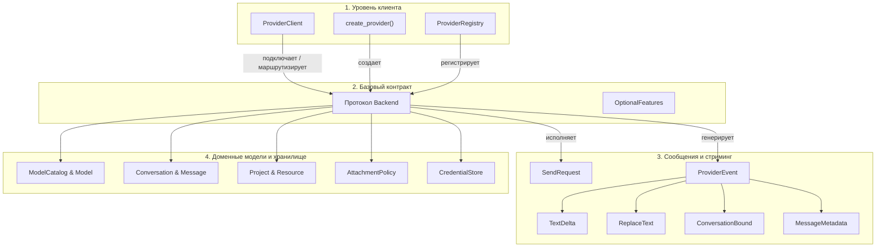
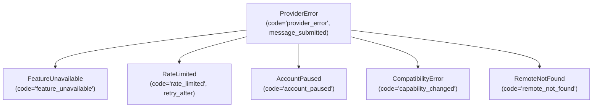

[![Python 3.10+][python-shield]](https://www.python.org/downloads/)
[![Версия: v1.1-beta][version-shield]](CHANGELOG.md)
[![GPL-3.0-only][license-shield]](LICENSE)

[English](README.md) | [Türkçe](README-TR.md) | **Русский**

# webai-provider

### Высокопроизводительный Python-клиент на основе контрактов для веб-сессий ChatGPT, Gemini, Claude и Grok.

`webai-provider` подключает ваши Python-приложения напрямую к веб-сессиям ведущих ИИ-сервисов — ChatGPT, Gemini, Claude и Grok — без необходимости использования платных API-ключей разработчика, баланса на кредитных картах или сторонних прокси-серверов. Библиотека работает полностью на чистом Python, предоставляя многошаговый диалог, потоковую передачу токенов (streaming), динамическое обнаружение моделей и управление уровнем рассуждений (reasoning effort), загрузку вложений, управление проектами, редактирование сообщений и ветвление диалогов (branching) за единым и предсказуемым асинхронным интерфейсом.

---

## Оглавление

- [1. Обзор и ключевые особенности](#1-обзор-и-ключевые-особенности)
- [2. Установка и требования](#2-установка-и-требования)
- [3. Поддерживаемые провайдеры и матрица возможностей](#3-поддерживаемые-провайдеры-и-матрица-возможностей)
- [4. Полный справочник API (От общего к частному)](#4-полный-справочник-api-от-общего-к-частному)
  - [4.1. Клиент и жизненный цикл: `ProviderClient`](#41-клиент-и-жизненный-цикл-providerclient)
  - [4.2. Создание провайдеров: `create_provider` и `ProviderRegistry`](#42-создание-провайдеров-create_provider-и-providerregistry)
  - [4.3. Базовый контракт: протокол `Backend`](#43-базовый-контракт-протокол-backend)
  - [4.4. Запросы и потоковые события: `SendRequest` и `ProviderEvent`](#44-запросы-и-потоковые-события-sendrequest-и-providerevent)
  - [4.5. Модели предметной области: `ModelCatalog`, `Conversation`, `Project` и др.](#45-модели-предметной-области-modelcatalog-conversation-project-и-др)
  - [4.6. Политики вложений и загрузка файлов: `AttachmentPolicy` и `DownloadSource`](#46-политики-вложений-и-загрузка-файлов-attachmentpolicy-и-downloadsource)
  - [4.7. Сессии и атомарное хранение учетных данных: `CredentialStore`](#47-сессии-и-атомарное-хранение-учетных-данных-credentialstore)
  - [4.8. Браузерные профили и инструменты CDP: `profiles` и `cdp`](#48-браузерные-профили-и-инструменты-cdp-profiles-и-cdp)
  - [4.9. Обработка ошибок и коды состояния: `ProviderError`](#49-обработка-ошибок-и-коды-состояния-providererror)
- [5. Практические примеры (от простого к сложному)](#5-практические-примеры-от-простого-к-сложному)
  - [5.1. Пример 1: Базовый потоковый вывод токенов](#51-пример-1-базовый-потоковый-вывод-токенов)
  - [5.2. Пример 2: Динамическое обнаружение моделей, уровень рассуждений и многошаговый диалог](#52-пример-2-динамическое-обнаружение-моделей-уровень-рассуждений-и-многошаговый-диалог)
  - [5.3. Пример 3: Загрузка файлов и анализ вложений](#53-пример-3-загрузка-файлов-и-анализ-вложений)
  - [5.4. Пример 4: Мультипровайдерное параллельное сравнение ответов](#54-пример-4-мультипровайдерное-параллельное-сравнение-ответов)
  - [5.5. Пример 5: Управление ресурсами проектов и рабочих пространств](#55-пример-5-управление-ресурсами-проектов-и-рабочих-пространств)
  - [5.6. Пример 6: Редактирование сообщений, повторы и ветвление диалога](#56-пример-6-редактирование-сообщений-повторы-и-ветвление-диалога)
  - [5.7. Пример 7: Кастомное зашифрованное хранилище сессий](#57-пример-7-кастомное-зашифрованное-хранилище-сессий)
- [6. Архитектура времени выполнения и безопасность](#6-архитектура-времени-выполнения-и-безопасность)
- [7. Разработка, тестирование и контроль качества](#7-разработка-тестирование-и-контроль-качества)
- [8. Интеграция с SiopeChat](#8-интеграция-с-siopechat)
- [9. История версий и лицензия](#9-история-версий-и-лицензия)

---

## 1. Обзор и ключевые особенности

Современные веб-интерфейсы искусственного интеллекта работают на разнообразных и недокументированных транспортных протоколах: мультиплексирование HTTP/2, Server-Sent Events (SSE), внутренний формат Google `batchexecute` RPC и кастомные антибот-проверки. `webai-provider` берет на себя всю сложность работы с этими протоколами, гарантируя:

- **Отсутствие зависимостей от Node.js или внешних JS-движков:** Генерация отпечатков Sentinel ChatGPT, вычисление Proof of Work (PoW) и поддерживаемые проверки Turnstile реализованы на чистом Python (`chatgpt/sentinel/`).
- **Ленивая (Lazy) инициализация аккаунтов:** Импорт библиотеки или конфигурация учетных записей не совершают сетевых запросов и не создают фоновых процессов до фактического старта операции.
- **Строгая семантика отмены стриминга:** Прерывание цикла `async for` или отмена асинхронной задачи мгновенно и безопасно закрывает сетевой сокет. Неопределенные обрывы сети при вызовах `POST send` никогда не вызывают автоматических повторов.
- **Полная изоляция учетных записей:** Каждый аккаунт владеет собственным изолированным пулом соединений, хранилищем cookie и блокировками параллелизма.
- **Типизированный многоканальный вывод:** Основной текст ответа (`None`), цепочки рассуждений (`analysis`), заменяющие блоки (`ReplaceText`) и источники поиска (`MessageMetadata.sources`) разделены на уровне типов.

[↑ К оглавлению](#оглавление)

---

## 2. Установка и требования

Для работы требуется Python версии 3.10 или выше (протестировано на Python 3.10, 3.11, 3.12, 3.13 и 3.14 под Linux, macOS и Windows).

```sh
# Клонирование и стандартная установка
git clone https://github.com/TahsinCr/webai-provider.git
cd webai-provider
python -m pip install .

# Установка с дополнительными инструментами разработки и тестирования
python -m pip install -e ".[dev]"
```

[↑ К оглавлению](#оглавление)

---

## 3. Поддерживаемые провайдеры и матрица возможностей

Возможности описываются перечислением `Capability`. Поскольку доступность уровней рассуждений или загрузки файлов зависит от выбранной модели и тарифного плана аккаунта, живой каталог моделей, возвращаемый методом `await account.models()`, всегда является определяющим.

| Возможность (`Capability`) | ChatGPT | Gemini | Claude | Grok | Поведение и примечания |
| :--- | :---: | :---: | :---: | :---: | :--- |
| `CHAT` | ✅ | ✅ | ✅ | ✅ | Асинхронная отправка запросов и стриминг SSE-событий. |
| `TEMPORARY` | ✅ | ✅ | ✅ | ✅ | Режим инкогнито / временные диалоги (не сохраняются в удаленную историю). |
| `HISTORY` | ✅ | ✅ | ✅ | ✅ | Постраничное обнаружение чатов и получение истории сообщений. |
| `RENAME` | ✅ | ✅ | ✅ | ✅ | Обновление заголовка диалога на стороне сервера. |
| `DELETE` | ✅ | ✅ | ✅ | ✅ | Безвозвратное удаление диалога на сервере. |
| `AUTH` | ✅ | ✅ | ✅ | ✅ | Проверка валидности сессии и статуса входа. |
| `ATTACHMENTS` | ✅ | ✅ | ✅ | ✅ | Загрузка документов, изображений, аудио- и видеофайлов к сообщению. |
| `RESOURCES` | ✅ | ✅ | ✅ | ✅ | Управление документами и текстами, привязанными к проектам. |
| `PROJECTS` | ✅ | ✅ | ✅ | ✅ | Обнаружение и список проектов (Notebooks для Gemini, Workspaces для Grok). |
| `PROJECT_CREATE` | ✅ | ✅ | ✅ | ✅ | Создание новых проектов или рабочих пространств. |
| `PROJECT_UPDATE` | ✅ | ✅ | ✅ | ✅ | Изменение названия, системных инструкций или параметров проекта. |
| `PROJECT_DELETE` | ✅ | ✅ | ✅ | ✅ | Удаление проектов с сервера. |
| `PROJECT_MEMBERSHIP` | ✅ | ❌ | ✅ | ✅ | Перемещение диалогов в проект и из него (в Gemini Notebooks чат фиксируется при создании). |
| `MODELS` | ✅ | ✅ | ✅ | ✅ | Динамическое получение моделей, доступных текущему аккаунту. |
| `EFFORT` | ✅ | ✅ | ✅ | ✅ | Уровень рассуждений / бюджет размышлений (зависит от модели; настраивается через `Model.efforts`). |
| `MESSAGE_EDIT` | ✅ | ✅ | ✅ | ❌ | Редактирование пользовательского сообщения с генерацией новой ветки (Grok использует retry ответа). |
| `MESSAGE_RETRY` | ✅ | ✅* | ✅ | ✅ | Повторная генерация ответа ассистента (*в Gemini выполняется через редактирование родительского запроса). |
| `CHAT_BRANCH` | ✅ | ✅ | ❌ | ❌ | Создание отдельного диалога от указанного сообщения (в веб-API Claude и Grok ветвление отсутствует). |

> **Примечание:** Пустой список, возвращенный операцией поиска, означает отсутствие записей на сервере, а не отсутствие поддержки функции. Неподдерживаемые операции явно вызывают исключение `FeatureUnavailable`.

[↑ К оглавлению](#оглавление)

---

## 4. Полный справочник API (От общего к частному)



---

### 4.1. Клиент и жизненный цикл: `ProviderClient`

`providers.client.ProviderClient`

Главный диспетчер, управляющий жизненным циклом бэкендов, параллельными потоками и корректным завершением сессий. Рассчитан на один экземпляр на каждый цикл событий `asyncio`.

#### Методы
- **`__init__() -> None`**  
  Инициализирует внутренние реестры бэкендов, активных задач стриминга и объектов закрытия.
- **`connect(provider_id: str, account_id: str = "default", **configuration) -> Backend`**  
  Лениво создает адаптер провайдера с помощью `create_provider` и регистрирует его. Не совершает сетевых вызовов и не запускает браузер.
- **`add(backend: Backend) -> Backend`**  
  Напрямую привязывает готовый объект `Backend`. Проверяет непустоту и уникальность пары `(backend.id, backend.account_id)`.
- **`account(provider_id: str, account_id: str = "default") -> Backend`**  
  Возвращает зарегистрированный бэкенд. Если не найден, вызывает `KeyError`.
- **`prepare(provider_id: str, account_id: str = "default", *, for_send: bool = False) -> Backend`**  
  Разогревает сетевой транспорт аккаунта в фоновом режиме. Если `for_send=True`, запускает подготовительные процедуры отправки.
- **`stream(request: SendRequest) -> AsyncIterator[ProviderEvent]`**  
  Направляет запрос к целевому бэкенду, валидирует возможности, регистрирует задачу и возвращает поток типизированных событий. При выходе из цикла или отмене задачи соединение мгновенно закрывается.
- **`close() -> None`**  
  Отменяет активные потоки, освобождает сетевые соединения и безопасно закрывает все аккаунты. Метод идемпотентен и безопасен для повторного вызова.

#### Свойства (Properties)
- **`accounts -> tuple[tuple[str, str], ...]`**  
  Возвращает кортеж всех зарегистрированных пар `(provider_id, account_id)`.

[↑ К оглавлению](#оглавление)

---

### 4.2. Создание провайдеров: `create_provider` и `ProviderRegistry`

`providers.registry.create_provider`

Создает изолированный адаптер провайдера (`Backend`) без зависимости от глобального состояния приложения.

```python
def create_provider(
    provider_id: str,
    account_id: str = "default",
    *,
    credential_file: str | Path | CredentialStore | None = None,
    session: BrowserSession | None = None,
    profile_directory: str | Path | None = None,
    **options,
) -> Backend:
```

#### Параметры
- **`provider_id`** (`str`): Идентификатор провайдера: `"chatgpt"`, `"gemini"`, `"claude"` или `"grok"`.
- **`account_id`** (`str`): Локальный строковый ID аккаунта (по умолчанию `"default"`).
- **`credential_file`** (`str | Path | CredentialStore | None`): Путь к файлу сессии JSON или объект `CredentialStore`. Обязателен, если не передан `session`.
- **`session`** (`BrowserSession | None`): Готовый объект браузерной сессии (только для ChatGPT).
- **`profile_directory`** (`str | Path | None`): Каталог профиля браузера для данных ChatGPT Sentinel. По умолчанию каталог `chrome-profile/` рядом с файлом сессии.
- **`**options`**: Дополнительные параметры адаптера, например `client_factory`.

#### Класс `ProviderRegistry`
- **`register(provider: Provider, *, account_factory: Callable | None = None) -> None`**: Регистрирует тип провайдера и фабрику аккаунтов.
- **`create_account(provider_id: str, account_id: str, **configuration) -> Backend`**: Создает аккаунт из зарегистрированной фабрики.
- **`set_enabled(provider_id: str, enabled: bool) -> None`**: Глобально включает или отключает провайдер.
- **`require(provider_id: str, capability: Capability) -> Provider`**: Проверяет наличие возможности и возвращает провайдер.
- **`describe(provider_id: str) -> Coroutine[ProviderDescription]`**: Формирует динамический отчет о возможностях.

[↑ К оглавлению](#оглавление)

---

### 4.3. Базовый контракт: протокол `Backend`

`providers.contracts.Backend`

Единый контракт, реализуемый адаптерами всех четырех провайдеров.

#### Идентификация и жизненный цикл
- **`id: str`**: Идентификатор провайдера (`"chatgpt"`, `"gemini"`, `"claude"`, `"grok"`).
- **`account_id: str`**: Идентификатор учетной записи.
- **`capabilities: frozenset[Capability]`**: Набор поддерживаемых возможностей.
- **`async def prepare() -> None`**: Настраивает транспортное состояние аккаунта.
- **`async def close() -> None`**: Закрывает пулы соединений и останавливает фоновые потоки.

#### Аутентификация и диагностика
- **`async def authenticate() -> SessionStatus`**: Проверяет и обновляет токены авторизации.
- **`async def login() -> SessionStatus`**: Запускает интерактивный или профильный вход.
- **`async def session_status() -> SessionStatus`**: Возвращает кэшированное состояние сессии без сетевых вызовов.
- **`async def forget_session() -> SessionStatus`**: Удаляет сохраненные учетные данные и сбрасывает состояние.
- **`async def describe() -> ProviderDescription`**: Возвращает отчет о доступных возможностях.

#### Модели и генерация текста
- **`async def models(*, force: bool = False) -> ModelCatalog`**: Запрашивает каталог моделей (кэш на 5 минут; принудительно при `force=True`).
- **`def stream(request: SendRequest) -> AsyncGenerator[ProviderEvent, None]`**: Отправляет запрос и возвращает генератор потоковых событий.

#### Диалоги и история
- **`async def list_chats(cursor: str | None = None, limit: int = 28) -> Page[Conversation]`**: Постраничный список диалогов.
- **`async def get_chat(conversation_id: str) -> Conversation`**: Получение всех сообщений и метаданных диалога.
- **`async def rename_chat(conversation_id: str, title: str) -> None`**: Переименование диалога.
- **`async def delete_chat(conversation_id: str) -> None`**: Безвозвратное удаление диалога на сервере.
- **`async def branch_chat(conversation_id: str, message_id: str) -> Conversation`**: Создание новой ветки от указанного сообщения.
- **`async def conversation_attachment_count(conversation_id: str) -> int | None`**: Число прикрепленных файлов в диалоге.

#### Проекты и рабочие пространства
- **`async def list_projects(cursor: str | None = None) -> Page[Project]`**: Список проектов.
- **`async def get_project(project_id: str) -> Project`**: Детали проекта и его ресурсы.
- **`async def list_project_chats(project_id: str, cursor: str | None = None) -> Page[Conversation]`**: Список диалогов проекта.
- **`async def create_project(name: str, instructions: str = "", *, visibility="private", memory="default") -> Project`**: Создание проекта.
- **`async def update_project(project: Project) -> Project`**: Обновление названия или инструкций проекта.
- **`async def delete_project(project_id: str) -> None`**: Удаление проекта.
- **`async def project_options(project_id: str | None = None) -> ProjectOptions`**: Поддерживаемые параметры проекта.
- **`async def add_project_resource(project_id: str, kind: str, **values) -> Project`**: Добавление документа или текстового ресурса в проект.
- **`async def remove_project_resource(project_id: str, resource_id: str) -> Project`**: Удаление ресурса из проекта.
- **`async def move_chat(conversation_id: str, project_id: str | None) -> None`**: Перемещение диалога в/из проекта.

#### Вложения и файлы
- **`def attachment_policy() -> dict | None`**: Лимиты размера, типов и количества файлов.
- **`async def upload_file(path: str | Path) -> dict`**: Загрузка файла в облачное хранилище провайдера.
- **`async def resolve_download(url: str, conversation_id: str | None = None, message_id: str | None = None) -> DownloadSource | None`**: Получение авторизованного URL и заголовков для скачивания файла.

[↑ К оглавлению](#оглавление)

---

### 4.4. Запросы и потоковые события: `SendRequest` и `ProviderEvent`

#### Параметры `SendRequest`
`providers.api.SendRequest(frozen=True)`

| Поле | Тип | По умолчанию | Назначение |
| :--- | :--- | :--- | :--- |
| **`provider_id`** | `str` | *Обязательно* | Идентификатор провайдера (`"chatgpt"`, `"gemini"`, `"claude"`, `"grok"`). |
| **`account_id`** | `str` | *Обязательно* | Идентификатор учетной записи. |
| **`chat_id`** | `str` | *Обязательно* | Локальный стабильный ID диалога (для отслеживания черновиков). |
| **`prompt`** | `str` | *Обязательно* | Текст запроса или тело отредактированного сообщения. |
| **`conversation_id`** | `str \| None` | `None` | Удаленный ID существующего диалога (`None` при первом запросе). |
| **`model`** | `str \| None` | `None` | Идентификатор модели (`Model.id`). |
| **`effort`** | `str \| None` | `None` | Уровень рассуждений (`"low"`, `"medium"`, `"high"`). |
| **`project_id`** | `str \| None` | `None` | Удаленный ID проекта, если диалог относится к проекту. |
| **`temporary`** | `bool` | `False` | Режим инкогнито (не сохранять историю на сервере). |
| **`attachments`** | `tuple[dict, ...]` | `()` | Кортеж дескрипторов загруженных файлов из `upload_file()`. |
| **`action`** | `MessageAction \| None` | `None` | `MessageAction.EDIT` или `MessageAction.RETRY`. |
| **`message_id`** | `str \| None` | `None` | ID целевого сообщения при редактировании или повторе. |
| **`branch`** | `BranchContext \| None` | `None` | Метаданные продолжения ветки при переходе из превью. |

#### Типы событий (`ProviderEvent`)
`ProviderEvent = TextDelta | ReplaceText | ResponseComplete | ConversationBound | MessageMetadata`

1. **`TextDelta(text: str, channel: str | None = None)`**  
   Инкрементальный текстовый фрагмент (токен).  
   - `channel=None`: Основной текст ответа ассистента.  
   - `channel="analysis"`: Трассировка мыслей / рассуждений (reasoning).
2. **`ReplaceText(text: str, channel: str | None = None)`**  
   Заменяет весь накопленный в канале текст (для динамически уточняемых сводок).
3. **`ResponseComplete()`**  
   Сигнализирует о завершении генерации текста на сервере.
4. **`ConversationBound(conversation_id: str)`**  
   Генерируется на первом шаге диалога, сообщая постоянный ID, присвоенный сервером.
5. **`MessageMetadata(...)`**  
   Метаданные завершенного ответа:  
   - `message_id: str | None`: ID сообщения ассистента.  
   - `user_message_id: str | None`: ID принятого сообщения пользователя.  
   - `model: str | None`: Фактическая модель, сгенерировавшая ответ.  
   - `effort: str | None`: Примененный уровень рассуждений.  
   - `sources: tuple[dict, ...]`: Источники поиска и цитаты.  
   - `actions: tuple[str, ...]`: Допустимые действия над сообщением (`"edit"`, `"retry"`).  
   - `files: tuple[dict, ...]`: Дескрипторы сгенерированных файлов или медиа.

[↑ К оглавлению](#оглавление)

---

### 4.5. Модели предметной области: `ModelCatalog`, `Conversation`, `Project` и др.

`providers.models`

- **`ModelCatalog`**:
  - `state: FeatureState`: `AVAILABLE`, `UNAVAILABLE`, `UNKNOWN`, `LOGIN_REQUIRED`.
  - `models: tuple[Model, ...]`: Доступные модели.
  - `default_model: str | None`: Рекомендуемая модель по умолчанию.
  - `chat_models -> tuple[Model, ...]`: Модели, доступные для выбора в чате.
  - `chat_model(model_id: str | None) -> Model | None`: Поиск модели по ID.
  - `effort(model_id: str, preferred: str = "medium") -> str | None`: Определение поддерживаемого уровня рассуждений.
- **`Model`**:
  - `id: str`, `title: str`, `efforts: tuple[Choice, ...]`, `default_effort: str | None`, `chat_selectable: bool`.
- **`Conversation`**:
  - `origin: Origin`: `(provider_id, account_id, remote_id)`.
  - `title: str`: Заголовок диалога.
  - `messages: tuple[Message, ...]`: Последовательность сообщений.
  - `project_id: str | None`: ID связанного проекта.
- **`Message`**:
  - `id: str`, `role: str` (`"user"`, `"assistant"`), `content: tuple[Content, ...]`, `actions: tuple[str, ...]`.
- **`Content`**:
  - `kind: str` (`"text"`, `"resource"`), `text: str | None`, `resource: Resource | None`.
- **`Project`**:
  - `origin: Origin`, `name: str`, `instructions: str | None`, `resources: tuple[Resource, ...]`.
- **`Page[T]`**:
  - `items: tuple[T, ...]`, `next_cursor: str | None`.

[↑ К оглавлению](#оглавление)

---

### 4.6. Политики вложений и загрузка файлов: `AttachmentPolicy` и `DownloadSource`

`providers.attachments` & `providers.files`

#### `AttachmentPolicy`
Задает правила загрузки файлов:
- `max_files: int`: Максимальное количество файлов.
- `max_bytes: int`: Лимит в байтах на один файл.
- `max_image_bytes: int | None`: Лимит размера изображений.
- `max_video_bytes: int | None`: Лимит размера видеофайлов.
- `allowed_extensions: tuple[str, ...]`: Список разрешенных расширений.
- `max_files_scope: str`: Область действия квоты (`"prompt"` или `"conversation"`).

#### Предустановленные политики
- **`CHATGPT_ATTACHMENTS`**: До 512 МиБ на файл, 20 МиБ для картинок, 50 МиБ для таблиц, 10 файлов на запрос.
- **`GEMINI_ATTACHMENTS`**: До 100 МиБ на файл (2 ГиБ для видео), 10 файлов на запрос.
- **`CLAUDE_ATTACHMENTS`**: До 30 МиБ на файл, не более 20 файлов на весь диалог, строгий список расширений.
- **`GROK_ATTACHMENTS`**: До 3 МиБ на файл, 10 МиБ суммарно на запрос, 10 файлов на запрос.

#### `DownloadSource`
Дескриптор, возвращаемый методом `resolve_download()`:
- `url: str`: URL для скачивания.
- `filename: str | None`: Рекомендуемое имя файла.
- `force_download: bool`: Флаг принудительной загрузки вложения.
- `headers: dict[str, str]`: Авторизационные заголовки запроса.
- `client_factory: Callable | None`: Фабрика HTTP-клиента.

[↑ К оглавлению](#оглавление)

---

### 4.7. Сессии и атомарное хранение учетных данных: `CredentialStore`

`providers.session`

Данные сессий записываются на диск атомарно с использованием блокировок потоков и безопасной замены временных файлов с правами доступа `0o600`.

#### Протокол `CredentialStore`
```python
class CredentialStore(Protocol):
    def load(self) -> dict: ...
    def save(self, value: dict) -> None: ...
    def exists(self) -> bool: ...
    def delete(self) -> None: ...
```

#### Вспомогательные функции
- **`read_session(path: str | Path | CredentialStore) -> dict`**: Чтение сессии; при повреждении вызывает `AccountPaused`.
- **`save_session(path: str | Path | CredentialStore, value: dict) -> None`**: Атомарная запись с правами `0o600`.
- **`session_exists(source: str | Path | CredentialStore) -> bool`**: Проверка наличия сохраненной сессии.
- **`delete_session(source: str | Path | CredentialStore) -> None`**: Безопасное удаление сессии.

[↑ К оглавлению](#оглавление)

---

### 4.8. Браузерные профили и инструменты CDP: `profiles` и `cdp`

`providers.profiles` & `providers.cdp`

Позволяет подключаться к аккаунтам без ввода паролей путем чтения cookie из системного профиля браузера.

#### Функции профилей (`profiles.py`)
- **`default_profile() -> BrowserProfile | None`**: Определяет путь к cookie браузера по умолчанию (Chrome, Brave, Edge, Firefox, Safari).
- **`import_cookies(provider: str) -> dict`**: Расшифровывает и импортирует cookie для `"chatgpt"`, `"gemini"`, `"claude"` или `"grok"`.

#### Chrome DevTools Protocol (`cdp.py`)
- **`is_devtools_available(cdp_url: str, timeout: float = 1.0) -> bool`**: Проверяет доступность порта удаленной отладки.
- **`open_provider_page(cdp_url: str, provider_url: str) -> None`**: Открывает адрес провайдера во вкладке.
- **`read_provider_cookies(cdp_url: str, provider_url: str) -> list[dict]`**: Читает активные cookie через протокол CDP.
- **`capture_chatgpt_auth(cdp_url: str, timeout: float = 15.0) -> tuple[str, dict]`**: Перехватывает токен доступа ChatGPT и заголовки браузера.

[↑ К оглавлению](#оглавление)

---

### 4.9. Обработка ошибок и коды состояния: `ProviderError`

`providers.errors`

Все ошибки библиотеки наследуются от базового класса `ProviderError`.



| Исключение | Значение `code` | Дополнительные поля | Семантическое значение |
| :--- | :--- | :--- | :--- |
| **`ProviderError`** | `"provider_error"` | `message_submitted: bool \| None` | Базовое исключение. `message_submitted=False` гарантирует, что запрос не достиг сервера. `None` означает неопределенность (автоматический повтор запрещен). |
| **`FeatureUnavailable`** | `"feature_unavailable"` | `capability: Capability`<br>`reason: str` | Возможность не поддерживается провайдером или тарифом аккаунта. |
| **`RateLimited`** | `"rate_limited"` | `retry_after: float \| None` | Превышен лимит запросов. Содержит время ожидания в секундах, если указано. |
| **`AccountPaused`** | `"account_paused"` | - | Истек срок действия сессии или требуется капча/проверка в браузере. |
| **`CompatibilityError`** | `"capability_changed"` | `capability: Capability` | Изменился веб-контракт провайдера. |
| **`RemoteNotFound`** | `"remote_not_found"` | - | Запрашиваемый диалог, проект или ресурс не найден на сервере. |

[↑ К оглавлению](#оглавление)

---

## 5. Практические примеры (от простого к сложному)

### 5.1. Пример 1: Базовый потоковый вывод токенов

Отправка запроса в сессию Claude и вывод токенов в stdout в реальном времени.

```python
import asyncio
from providers import ProviderClient, ResponseComplete, SendRequest, TextDelta


async def main():
    async with ProviderClient() as client:
        account = client.connect(
            provider_id="claude",
            account_id="personal",
            credential_file="~/.config/siopechat/claude-session.json",
        )
        await account.authenticate()

        request = SendRequest(
            provider_id="claude",
            account_id="personal",
            chat_id="draft-001",
            prompt="Объясни в двух предложениях принцип свободных потоков (free-threaded execution) в Python 3.13.",
        )

        async for event in client.stream(request):
            if isinstance(event, TextDelta):
                print(event.text, end="", flush=True)
            elif isinstance(event, ResponseComplete):
                print("\n[Поток завершен]")


if __name__ == "__main__":
    asyncio.run(main())
```

[↑ К оглавлению](#оглавление)

---

### 5.2. Пример 2: Динамическое обнаружение моделей, уровень рассуждений и многошаговый диалог

Запрашивает доступные модели, выбирает уровень рассуждений, фиксирует `ConversationBound` на первом шаге и продолжает диалог на втором шаге.

```python
import asyncio
from providers import (
    ConversationBound,
    MessageMetadata,
    ProviderClient,
    ReplaceText,
    SendRequest,
    TextDelta,
)


async def main():
    async with ProviderClient() as client:
        account = client.connect(
            "chatgpt",
            "work",
            credential_file="~/.config/siopechat/chatgpt-session.json",
        )
        await account.authenticate()

        catalog = await account.models()
        target_model = catalog.chat_model("o3-mini") or catalog.default_chat_model
        effort = catalog.effort(target_model.id, preferred="high")

        print(f"Модель: {target_model.title} | Уровень рассуждений: {effort}")

        remote_conv_id = None
        req1 = SendRequest(
            provider_id="chatgpt",
            account_id="work",
            chat_id="turn-1",
            prompt="Напиши алгоритм возведения матрицы в степень для чисел Фибоначчи O(log n) на Python.",
            model=target_model.id,
            effort=effort,
        )

        async for event in client.stream(req1):
            if isinstance(event, ConversationBound):
                remote_conv_id = event.conversation_id
            elif isinstance(event, TextDelta):
                if event.channel == "analysis":
                    print(f"[Рассуждения]: {event.text}", end="", flush=True)
                else:
                    print(event.text, end="", flush=True)
            elif isinstance(event, ReplaceText):
                print(f"\n[Обновленная сводка]: {event.text}\n")
            elif isinstance(event, MessageMetadata):
                print(f"\nID сообщения ассистента: {event.message_id}")

        print("\n--- ШАГ 2 ---")
        req2 = SendRequest(
            provider_id="chatgpt",
            account_id="work",
            chat_id="turn-2",
            conversation_id=remote_conv_id,
            prompt="Добавь полные аннотации типов (type hints) и docstring к коду матрицы.",
            model=target_model.id,
        )

        async for event in client.stream(req2):
            if isinstance(event, TextDelta) and not event.channel:
                print(event.text, end="", flush=True)


if __name__ == "__main__":
    asyncio.run(main())
```

[↑ К оглавлению](#оглавление)

---

### 5.3. Пример 3: Загрузка файлов и анализ вложений

Проверяет файл по лимитам `AttachmentPolicy`, загружает его в Gemini и запускает анализ содержимого.

```python
import asyncio
from pathlib import Path
from providers import AttachmentPolicy, ProviderClient, SendRequest, TextDelta


async def main():
    report_file = Path("./report.pdf")
    if not report_file.exists():
        report_file.write_text("Отчет по архитектуре системы: план миграции v2.0 утвержден.")

    async with ProviderClient() as client:
        account = client.connect(
            "gemini",
            "analyst",
            credential_file="~/.config/siopechat/gemini-session.json",
        )
        await account.authenticate()

        policy_dict = account.attachment_policy()
        if policy_dict:
            policy = AttachmentPolicy(**policy_dict)
            if report_file.stat().st_size > policy.max_bytes:
                raise ValueError("Размер файла превышает лимиты провайдера!")

        upload_payload = await account.upload_file(report_file)

        request = SendRequest(
            provider_id="gemini",
            account_id="analyst",
            chat_id="doc-chat-1",
            prompt="Сделай краткое резюме ключевых архитектурных решений из этого отчета.",
            attachments=(upload_payload,),
        )

        async for event in client.stream(request):
            if isinstance(event, TextDelta):
                print(event.text, end="", flush=True)


if __name__ == "__main__":
    asyncio.run(main())
```

[↑ К оглавлению](#оглавление)

---

### 5.4. Пример 4: Мультипровайдерное параллельное сравнение ответов

Параллельный опрос ChatGPT, Claude, Gemini и Grok в рамках одного экземпляра `ProviderClient`.

```python
import asyncio
from providers import ProviderClient, SendRequest, TextDelta


async def query_provider(client, provider_id, cred_path, prompt):
    account = client.connect(provider_id, "default", credential_file=cred_path)
    await account.authenticate()

    req = SendRequest(
        provider_id=provider_id,
        account_id="default",
        chat_id=f"bench-{provider_id}",
        prompt=prompt,
    )

    full_text = []
    async for event in client.stream(req):
        if isinstance(event, TextDelta) and not event.channel:
            full_text.append(event.text)
    return provider_id, "".join(full_text)


async def main():
    prompt = "Объясни явление квантовой запутанности одним кратким и емким абзацем."
    configs = [
        ("chatgpt", "~/.config/siopechat/chatgpt-session.json"),
        ("claude", "~/.config/siopechat/claude-session.json"),
        ("gemini", "~/.config/siopechat/gemini-session.json"),
        ("grok", "~/.config/siopechat/grok-session.json"),
    ]

    async with ProviderClient() as client:
        tasks = [query_provider(client, pid, path, prompt) for pid, path in configs]
        results = await asyncio.gather(*tasks, return_exceptions=True)

        for item in results:
            if isinstance(item, Exception):
                print(f"\nОШИБКА: {item}")
            else:
                pid, text = item
                print(f"\n{'=' * 20} {pid.upper()} {'=' * 20}\n{text.strip()}\n")


if __name__ == "__main__":
    asyncio.run(main())
```

[↑ К оглавлению](#оглавление)

---

### 5.5. Пример 5: Управление ресурсами проектов и рабочих пространств

Создает проект, задает системные инструкции, прикрепляет текстовый ресурс и начинает диалог в контексте проекта.

```python
import asyncio
from providers import ProviderClient, SendRequest, TextDelta


async def main():
    async with ProviderClient() as client:
        account = client.connect(
            "claude",
            "lead",
            credential_file="~/.config/siopechat/claude-session.json",
        )
        await account.authenticate()

        project = await account.create_project(
            name="Исследования WebAI Provider",
            instructions="Ты ведущий системный архитектор. Весь код должен быть строго типизирован.",
        )
        print(f"Создан проект: {project.name} (Удаленный ID: {project.origin.remote_id})")

        project = await account.add_project_resource(
            project_id=project.origin.remote_id,
            kind="text",
            name="rules.txt",
            text="Правило 1: Только чистый Python без Node.js. Правило 2: Изолированные пулы соединений.",
        )
        print(f"Ресурс добавлен. Всего ресурсов: {len(project.resources)}")

        req = SendRequest(
            provider_id="claude",
            account_id="lead",
            chat_id="proj-chat-1",
            project_id=project.origin.remote_id,
            prompt="Каковы наши главные архитектурные правила?",
        )

        async for event in client.stream(req):
            if isinstance(event, TextDelta):
                print(event.text, end="", flush=True)


if __name__ == "__main__":
    asyncio.run(main())
```

[↑ К оглавлению](#оглавление)

---

### 5.6. Пример 6: Редактирование сообщений, повторы и ветвление диалога

Повтор ответа ассистента, редактирование запроса и создание отдельной ветки диалога.

```python
import asyncio
from providers import (
    BranchContext,
    ConversationBound,
    MessageAction,
    ProviderClient,
    SendRequest,
    TextDelta,
)


async def main():
    async with ProviderClient() as client:
        account = client.connect(
            "chatgpt",
            "dev",
            credential_file="~/.config/siopechat/chatgpt-session.json",
        )
        await account.authenticate()

        conv = await account.get_chat("remote-conv-123")
        last_asst_msg = next(m for m in reversed(conv.messages) if m.role == "assistant")

        # 1. Повторная генерация ответа ассистента (RETRY)
        retry_req = SendRequest(
            provider_id="chatgpt",
            account_id="dev",
            chat_id="retry-turn",
            conversation_id=conv.origin.remote_id,
            prompt="",
            action=MessageAction.RETRY,
            message_id=last_asst_msg.id,
        )
        async for event in client.stream(retry_req):
            if isinstance(event, TextDelta):
                print(event.text, end="", flush=True)

        # 2. Создание новой ветки диалога (Branching)
        new_branch = await account.branch_chat(
            conversation_id=conv.origin.remote_id,
            message_id=last_asst_msg.id,
        )

        branch_ctx = None
        if "pending_branch" in new_branch.metadata:
            branch_ctx = BranchContext(**new_branch.metadata["pending_branch"])

        branch_req = SendRequest(
            provider_id="chatgpt",
            account_id="dev",
            chat_id="branch-first-turn",
            prompt="Продолжаем в новой ветке: реализуй альтернативный алгоритм.",
            branch=branch_ctx,
        )
        async for event in client.stream(branch_req):
            if isinstance(event, ConversationBound):
                print(f"\nID новой ветки: {event.conversation_id}")
            elif isinstance(event, TextDelta):
                print(event.text, end="", flush=True)


if __name__ == "__main__":
    asyncio.run(main())
```

[↑ К оглавлению](#оглавление)

---

### 5.7. Пример 7: Кастомное зашифрованное хранилище сессий

Хранение cookie сессии в зашифрованной памяти или безопасном хранилище вместо обычных JSON-файлов.

```python
import asyncio
import json
from providers import CredentialStore, ProviderClient


class EncryptedMemoryStore(CredentialStore):
    def __init__(self, initial_data: dict | None = None):
        self._blob = json.dumps(initial_data or {}).encode("utf-8")

    def load(self) -> dict:
        return json.loads(self._blob.decode("utf-8"))

    def save(self, value: dict) -> None:
        self._blob = json.dumps(value).encode("utf-8")
        print("[Store] Сессия надежно зашифрована в памяти.")

    def exists(self) -> bool:
        return bool(self._blob and self._blob != b"{}")

    def delete(self) -> None:
        self._blob = b"{}"


async def main():
    vault_store = EncryptedMemoryStore({"cookies": {"session-token": "secret_abc123"}})

    async with ProviderClient() as client:
        account = client.connect(
            provider_id="claude",
            account_id="vault-user",
            credential_file=vault_store,
        )
        status = await account.session_status()
        print(f"Статус сессии: {status.state.value}")


if __name__ == "__main__":
    asyncio.run(main())
```

[↑ К оглавлению](#оглавление)

---

## 6. Архитектура времени выполнения и безопасность

1. **Никакого хранения паролей:** Библиотека не запрашивает, не передает и не хранит пароли учетных записей. Все операции производятся исключительно по cookie сессии и временным токенам.
2. **Защита учетных данных от утечек:** В выводы `repr()`, логи и тексты ошибок никогда не попадают сырые cookie, секретные ключи или токены.
3. **Защита от SSRF и перенаправлений:** При скачивании файлов редиректы блокируются (`follow_redirects=False`), запросы отправляются только к доверенным доменам CDN провайдеров.
4. **Гарантии идемпотентности:** Вызовы `POST send` никогда автоматически не повторяются при сетевых сбоях, чтобы исключить дублирование сообщений.

[↑ К оглавлению](#оглавление)

---

## 7. Разработка, тестирование и контроль качества

В репозитории поддерживается строгий контроль качества кода:

```sh
# Проверка стиля кода и линтинг
ruff check .
ruff format --check .

# Запуск набора тестов
python -m unittest discover -s tests -t . -p 'test_*.py' -v

# Проверка сборки пакета
python -m build --sdist --wheel
python -m twine check dist/*
```

[↑ К оглавлению](#оглавление)

---

## 8. Интеграция с SiopeChat

SiopeChat использует `webai-provider` как внешнюю PyPI-зависимость времени выполнения:
- SiopeChat не требует Git-подмодулей.
- Версии фиксируются через `pyproject.toml` и `uv.lock`.

Для локального тестирования правок провайдера:
```sh
git pull --ff-only
python -m pip install --upgrade .
```

[↑ К оглавлению](#оглавление)

---

## 9. История версий и лицензия

- **Текущая версия:** `v1.1-beta` (`1.1.0b0`)
- **Последние изменения:** Добавлена поддержка веб-сессий Grok (обнаружение моделей, стриминг SSE, сводки рассуждений, ресурсы проектов и поисковые цитаты). См. [CHANGELOG.md](CHANGELOG.md).
- **Лицензия:** GNU General Public License v3.0 ([GPL-3.0-only](LICENSE)). Уведомление об авторских правах в [COPYRIGHT](COPYRIGHT).

[↑ К оглавлению](#оглавление)

[version-shield]: https://img.shields.io/badge/%D0%B2%D0%B5%D1%80%D1%81%D0%B8%D1%8F-v1.1--beta-b7a3e3.svg?style=for-the-badge
[python-shield]: https://img.shields.io/badge/Python-3.10%2B-3776AB.svg?style=for-the-badge&logo=python&logoColor=white
[license-shield]: https://img.shields.io/badge/%D0%9B%D0%B8%D1%86%D0%B5%D0%BD%D0%B7%D0%B8%D1%8F-GPL--3.0--only-2F6F4E.svg?style=for-the-badge
