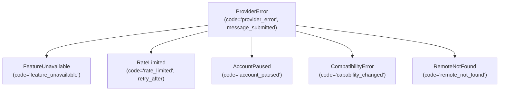

[![Python 3.10+][python-shield]](https://www.python.org/downloads/)
[![Sürüm: v1.1-beta][version-shield]](CHANGELOG.md)
[![GPL-3.0-only][license-shield]](LICENSE)

[English](README.md) | **Türkçe** | [Русский](README-RU.md)

# webai-provider

### ChatGPT, Gemini, Claude ve Grok web oturumları için yüksek performanslı ve sözleşme odaklı Python istemcisi.

`webai-provider`, Python uygulamalarınızı önde gelen yapay zekâ sağlayıcılarının (ChatGPT, Gemini, Claude ve Grok) web oturumlarına bağlayan bağımsız bir kütüphanedir. Resmî API anahtarlarına, ön ödemeli bakiye veya kredi kartlarına, harici proxy sunucularına ihtiyaç duymaz. Tamamen saf Python üzerinde çalışır; çok turlu sohbetleri, canlı jeton akışını (streaming), dinamik model ve düşünme eforu keşfini, dosya eklerini, proje ve çalışma alanı yönetimini, mesaj düzenleme ve sohbet dallandırma (branching) işlevlerini tek ve tutarlı bir asenkron arayüz arkasında sunar.

---

## İçindekiler

- [1. Genel Bakış ve Öne Çıkanlar](#1-genel-bakış-ve-öne-çıkanlar)
- [2. Kurulum ve Gereksinimler](#2-kurulum-ve-gereksinimler)
- [3. Desteklenen Sağlayıcılar ve Yetenek Matrisi](#3-desteklenen-sağlayıcılar-ve-yetenek-matrisi)
- [4. Eksiksiz API Referansı (Genelden Özele)](#4-eksiksiz-api-referansı-genelden-özele)
  - [4.1. İstemci ve Yaşam Döngüsü: `ProviderClient`](#41-istemci-ve-yaşam-döngüsü-providerclient)
  - [4.2. Sağlayıcı İnşası: `create_provider` ve `ProviderRegistry`](#42-sağlayıcı-i̇nşası-create_provider-ve-providerregistry)
  - [4.3. Temel Backend Sözleşmesi: `Backend` Protokolü](#43-temel-backend-sözleşmesi-backend-protokolü)
  - [4.4. İstekler ve Akış Olayları: `SendRequest` ve `ProviderEvent`](#44-i̇stekler-ve-akış-olayları-sendrequest-ve-providerevent)
  - [4.5. Alan ve Durum Modelleri: `ModelCatalog`, `Conversation`, `Project` vb.](#45-alan-ve-durum-modelleri-modelcatalog-conversation-project-vb)
  - [4.6. Dosya Politikaları ve İndirme Tanımlayıcıları: `AttachmentPolicy` ve `DownloadSource`](#46-dosya-politikaları-ve-i̇ndirme-tanımlayıcıları-attachmentpolicy-ve-downloadsource)
  - [4.7. Oturumlar ve Atomik Kimlik Depolama: `CredentialStore`](#47-oturumlar-ve-atomik-kimlik-depolama-credentialstore)
  - [4.8. Tarayıcı Profili İçe Aktarma ve CDP Araçları: `profiles` ve `cdp`](#48-tarayıcı-profili-i̇çe-aktarma-ve-cdp-araçları-profiles-ve-cdp)
  - [4.9. Hata Yönetimi ve Hata Kodları: `ProviderError`](#49-hata-yönetimi-ve-hata-kodları-providererror)
- [5. Pratik Örnekler (Basitten İleri Düzeye)](#5-pratik-örnekler-basitten-i̇leri-düzeye)
  - [5.1. Örnek 1: Temel Jeton Akışı](#51-örnek-1-temel-jeton-akışı)
  - [5.2. Örnek 2: Dinamik Model Keşfi, Düşünme Eforu ve Çok Turlu Sohbet](#52-örnek-2-dinamik-model-keşfi-düşünme-eforu-ve-çok-turlu-sohbet)
  - [5.3. Örnek 3: Dosya Yükleme ve Ek Analizi](#53-örnek-3-dosya-yükleme-ve-ek-analizi)
  - [5.4. Örnek 4: Çoklu Sağlayıcı Eşzamanlı Karşılaştırma CLI](#54-örnek-4-çoklu-sağlayıcı-eşzamanlı-karşılaştırma-cli)
  - [5.5. Örnek 5: Proje ve Çalışma Alanı Kaynak Yönetimi](#55-örnek-5-proje-ve-çalışma-alanı-kaynak-yönetimi)
  - [5.6. Örnek 6: Mesaj Düzenleme, Yeniden Deneme ve Sohbet Dallandırma](#56-örnek-6-mesaj-düzenleme-yeniden-deneme-ve-sohbet-dallandırma)
  - [5.7. Örnek 7: Özel Şifrelenmiş Kimlik Depolama](#57-örnek-7-özel-şifrelenmiş-kimlik-depolama)
- [6. Çalışma Zamanı Mimarisi ve Güvenlik Garantileri](#6-çalışma-zamanı-mimarisi-ve-güvenlik-garantileri)
- [7. Geliştirme, Kalite Kontrol ve Testler](#7-geliştirme-kalite-kontrol-ve-testler)
- [8. SiopeChat ile Entegrasyon](#8-siopechat-ile-entegrasyon)
- [9. Sürüm Geçmişi ve Lisans](#9-sürüm-geçmişi-ve-lisans)

---

## 1. Genel Bakış ve Öne Çıkanlar

Web yapay zekâ servisleri, HTTP/2 çoklama, Server-Sent Events (SSE), Google'ın iç `batchexecute` RPC formatı ve özel bot koruma mekanizmaları gibi farklı taşıma katmanları kullanır. `webai-provider`, tüm bu karmaşıklığı geliştirici dostu Python sözleşmelerine dönüştürürken şu garantileri sağlar:

- **Sıfır Node.js / Harici JS Motoru Bağımlılığı:** ChatGPT'nin Sentinel parmak izi, PoW (Proof of Work) çözümü ve desteklenen Turnstile doğrulama adımları saf Python üzerinde çalışır (`chatgpt/sentinel/`).
- **Tembel (Lazy) Hesap İlklendirmesi:** Kütüphaneyi içe aktarmak veya hesap tanımlamak ağ trafiği oluşturmaz ve arka planda gereksiz süreç başlatmaz. Taşıma bağlantıları yalnızca istek anında açılır.
- **Sıkı İptal ve Bağlantı Güvenliği:** Bir akış görevinden çıkıldığında veya görev iptal edildiğinde HTTP soketi anında güvenle kapatılır. Belirsiz ağ kopmalarında `POST send` çağrıları asla otomatik tekrarlanmaz.
- **Eksiksiz Hesap İzolasyonu:** Her hesap kendi çerez deposuna, HTTP bağlantı havuzuna ve kilit mekanizmasına sahiptir. Hesaplar arası oturum veya önbellek sızıntısı yaşanmaz.
- **Tipli Çok Kanallı Çıktı:** Kullanıcıya görünen metin (`None`), düşünme süreçleri (`analysis`), dinamik metin güncellemeleri (`ReplaceText`) ve web kaynakları (`MessageMetadata.sources`) birbirinden ayrık tipler olarak sunulur.

[↑ İçindekilere Dön](#i̇çindekiler)

---

## 2. Kurulum ve Gereksinimler

Python 3.10 veya üzeri gereklidir. Linux, macOS ve Windows ortamlarında Python 3.10, 3.11, 3.12, 3.13 ve 3.14 üzerinde düzenli olarak doğrulanmaktadır.

```sh
# Klonlama ve doğrudan kurulum
git clone https://github.com/TahsinCr/webai-provider.git
cd webai-provider
python -m pip install .

# İsteğe bağlı geliştirme ve test araçlarıyla kurulum
python -m pip install -e ".[dev]"
```

[↑ İçindekilere Dön](#i̇çindekiler)

---

## 3. Desteklenen Sağlayıcılar ve Yetenek Matrisi

Kütüphane, özellikleri `Capability` numaralandırmasıyla bildirir. Düşünme eforu veya dosya yükleme gibi özellikler seçilen modele ve hesap aboneliğine bağlı olduğundan, `await account.models()` ile dönen canlı katalog her zaman belirleyicidir.

| Yetenek (`Capability`) | ChatGPT | Gemini | Claude | Grok | Davranış ve Detaylar |
| :--- | :---: | :---: | :---: | :---: | :--- |
| `CHAT` | ✅ | ✅ | ✅ | ✅ | Asenkron metin üretimi ve SSE akışı. |
| `TEMPORARY` | ✅ | ✅ | ✅ | ✅ | Gizli/geçici sekme modu (sohbetler sunucu geçmişine kaydedilmez). |
| `HISTORY` | ✅ | ✅ | ✅ | ✅ | Sayfalı sohbet keşfi ve mesaj geçmişi alma. |
| `RENAME` | ✅ | ✅ | ✅ | ✅ | Sunucudaki sohbet başlığını güncelleme. |
| `DELETE` | ✅ | ✅ | ✅ | ✅ | Sohbeti sunucudan kalıcı olarak silme. |
| `AUTH` | ✅ | ✅ | ✅ | ✅ | Oturum geçerliliğini ve giriş durumunu denetleme. |
| `ATTACHMENTS` | ✅ | ✅ | ✅ | ✅ | Doküman, resim, ses ve video dosyalarını mesaja ekleme. |
| `RESOURCES` | ✅ | ✅ | ✅ | ✅ | Projelere ve çalışma alanlarına bağlı dosya/metin yönetimi. |
| `PROJECTS` | ✅ | ✅ | ✅ | ✅ | Projeleri / çalışma alanlarını listeleme (Gemini için Notebooks). |
| `PROJECT_CREATE` | ✅ | ✅ | ✅ | ✅ | Yeni proje veya çalışma alanı oluşturma. |
| `PROJECT_UPDATE` | ✅ | ✅ | ✅ | ✅ | Proje başlığını, talimatlarını ve ayarlarını düzenleme. |
| `PROJECT_DELETE` | ✅ | ✅ | ✅ | ✅ | Projeyi sunucudan silme. |
| `PROJECT_MEMBERSHIP` | ✅ | ❌ | ✅ | ✅ | Sohbetleri projeye taşıma veya çıkarma (Gemini Defter sohbetleri açılış anında sabitlenir). |
| `MODELS` | ✅ | ✅ | ✅ | ✅ | Hesaba açık modelleri dinamik keşfetme. |
| `EFFORT` | ✅ | ✅ | ✅ | ✅ | Modele bağlı düşünme eforu / bütçesi (`Model.efforts` üzerinden dinamik). |
| `MESSAGE_EDIT` | ✅ | ✅ | ✅ | ❌ | Kullanıcı mesajını düzenleyip yeni yoldan devam etme (Grok asistan mesajı üzerinde retry kullanır). |
| `MESSAGE_RETRY` | ✅ | ✅* | ✅ | ✅ | Asistan cevabını yeniden üretme (*Gemini bunu üst kullanıcı mesajını düzenleme biçiminde yürütür). |
| `CHAT_BRANCH` | ✅ | ✅ | ❌ | ❌ | Mesajdan bağımsız yeni bir sohbet dalı türetme (Claude ve Grok web arayüzünde dal türetme API'si bulunmaz). |

> **Not:** Bir sorgudan boş liste dönmesi o özelliğin desteklenmediği anlamına gelmez; sunucuda henüz kayıt olmadığını gösterir. Desteklenmeyen işlemler açıkça `FeatureUnavailable` istisnası fırlatır.

[↑ İçindekilere Dön](#i̇çindekiler)

---

## 4. Eksiksiz API Referansı (Genelden Özele)


---

### 4.1. İstemci ve Yaşam Döngüsü: `ProviderClient`

`providers.client.ProviderClient`

Birden çok sağlayıcı ve hesabın yaşam döngüsünü, akışlarını ve kapatılmasını yöneten ana sınıftır. Her `asyncio` olay döngüsünde tek bir örnek çalışacak şekilde tasarlanmıştır.

#### Metotlar
- **`__init__() -> None`**  
  İç tabloları, hesap kayıtlarını ve akış görev takipçilerini ilklendirir.
- **`connect(provider_id: str, account_id: str = "default", **configuration) -> Backend`**  
  `create_provider` kullanarak tembel bir sağlayıcı adaptörü oluşturur ve kaydeder. Ağ veya tarayıcı çağrısı yapmaz.
- **`add(backend: Backend) -> Backend`**  
  Doğrudan oluşturulmuş bir `Backend` nesnesini bağlar. `(backend.id, backend.account_id)` çiftinin boş olmamasını ve benzersizliğini denetler.
- **`account(provider_id: str, account_id: str = "default") -> Backend`**  
  Kayıtlı arka uç nesnesini döndürür. Kayıt bulunamazsa `KeyError` verir.
- **`prepare(provider_id: str, account_id: str = "default", *, for_send: bool = False) -> Backend`**  
  Hesabın taşıma bağlantısını arka planda ısıtır. `for_send=True` ise sağlayıcıya özel gönderim öncesi hazırlığı tetikler.
- **`stream(request: SendRequest) -> AsyncIterator[ProviderEvent]`**  
  İsteği hedef hesaba iletir, yetenekleri doğrular, görevi kaydeder ve tipli olayları akıtır. Döngü sonlandırıldığında veya iptal edildiğinde bağlantı hemen kapatılır.
- **`close() -> None`**  
  Devam eden tüm akışları iptal eder, bağlantı havuzlarını ve tüm hesap arka uçlarını temizce kapatır. Güvenle tekrar çağrılabilir (idempotent).

#### Özellikler (Properties)
- **`accounts -> tuple[tuple[str, str], ...]`**  
  Tüm kayıtlı `(provider_id, account_id)` çiftlerini demet olarak döndürür.

[↑ İçindekilere Dön](#i̇çindekiler)

---

### 4.2. Sağlayıcı İnşası: `create_provider` ve `ProviderRegistry`

`providers.registry.create_provider`

Genel uygulama durumuna bağımlı olmadan bağımsız bir arka uç adaptörü (`Backend`) inşa eder.

```python
def create_provider(
    provider_id: str,
    account_id: str = "default",
    *,
    credential_file: str | Path | CredentialStore | None = None,
    session: BrowserSession | None = None,
    profile_directory: str | Path | None = None,
    **options,
) -> Backend:
```

#### Parametreler
- **`provider_id`** (`str`): `"chatgpt"`, `"gemini"`, `"claude"` veya `"grok"`.
- **`account_id`** (`str`): Hesabın yerel kimliği (varsayılan: `"default"`).
- **`credential_file`** (`str | Path | CredentialStore | None`): Oturum JSON dosya yolu veya özel `CredentialStore` nesnesi. `session` verilmediğinde zorunludur.
- **`session`** (`BrowserSession | None`): Yalnızca ChatGPT için hazır `BrowserSession` nesnesi.
- **`profile_directory`** (`str | Path | None`): ChatGPT Sentinel verileri için profil dizini. Varsayılan olarak kimlik dosyasının yanındaki `chrome-profile/` dizinidir.
- **`**options`**: Adaptör yapılandırıcısına iletilecek ek anahtar kelimeler (örn: `client_factory`).

#### `ProviderRegistry` Sınıfı
- **`register(provider: Provider, *, account_factory: Callable | None = None) -> None`**: Yeni sağlayıcı türünü ve hesap fabrikasını kaydeder.
- **`create_account(provider_id: str, account_id: str, **configuration) -> Backend`**: Kayıtlı fabrikadan hesap üretir.
- **`set_enabled(provider_id: str, enabled: bool) -> None`**: Sağlayıcıyı genel olarak etkinleştirir veya askıya alır.
- **`require(provider_id: str, capability: Capability) -> Provider`**: Yeteneğin varlığını denetler ve sağlayıcıyı döndürür.
- **`describe(provider_id: str) -> Coroutine[ProviderDescription]`**: Dinamik yetenek durumlarını raporlar.

[↑ İçindekilere Dön](#i̇çindekiler)

---

### 4.3. Temel Backend Sözleşmesi: `Backend` Protokolü

`providers.contracts.Backend`

Dört sağlayıcı adaptörünün de uyguladığı ortak protokol.

#### Kimlik ve Yaşam Döngüsü
- **`id: str`**: Sağlayıcı kimliği (`"chatgpt"`, `"gemini"`, `"claude"`, `"grok"`).
- **`account_id: str`**: Hesap kimliği.
- **`capabilities: frozenset[Capability]`**: Desteklenen yetenekler kümesi.
- **`async def prepare() -> None`**: Hesabın taşıma durumunu hazırlar.
- **`async def close() -> None`**: Bağlantı havuzlarını ve arka plan iş parçacıklarını kapatır.

#### Oturum ve Sağlık
- **`async def authenticate() -> SessionStatus`**: Çerezleri ve oturum jetonlarını doğrular/yeniler.
- **`async def login() -> SessionStatus`**: Etkileşimli veya profilden oturum açma sürecini başlatır.
- **`async def session_status() -> SessionStatus`**: Ağ isteği yapmadan bellekteki oturum durumunu döner.
- **`async def forget_session() -> SessionStatus`**: Kayıtlı kimlikleri siler ve durumu sıfırlar.
- **`async def describe() -> ProviderDescription`**: Yetenek durumlarını (`AVAILABLE`, `UNSUPPORTED` vb.) raporlar.

#### Modeller ve Üretim
- **`async def models(*, force: bool = False) -> ModelCatalog`**: Modelleri döner. 5 dakika önbelleklenir; `force=True` ile zorla yenilenir.
- **`def stream(request: SendRequest) -> AsyncGenerator[ProviderEvent, None]`**: İstek gönderir ve akış olayları üretir.

#### Sohbetler ve Geçmiş
- **`async def list_chats(cursor: str | None = None, limit: int = 28) -> Page[Conversation]`**: Sohbetleri sayfalı listeler.
- **`async def get_chat(conversation_id: str) -> Conversation`**: Sohbetin mesaj geçmişini ve meta verilerini alır.
- **`async def rename_chat(conversation_id: str, title: str) -> None`**: Sohbet başlığını değiştirir.
- **`async def delete_chat(conversation_id: str) -> None`**: Sohbeti sunucudan kalıcı olarak siler.
- **`async def branch_chat(conversation_id: str, message_id: str) -> Conversation`**: Mesajdan yeni dal türetir.
- **`async def conversation_attachment_count(conversation_id: str) -> int | None`**: Sohbetteki bilinen ek dosya sayısını verir.

#### Projeler ve Çalışma Alanları
- **`async def list_projects(cursor: str | None = None) -> Page[Project]`**: Projeleri listeler.
- **`async def get_project(project_id: str) -> Project`**: Proje detaylarını ve kaynaklarını döndürür.
- **`async def list_project_chats(project_id: str, cursor: str | None = None) -> Page[Conversation]`**: Projedeki sohbetleri listeler.
- **`async def create_project(name: str, instructions: str = "", *, visibility="private", memory="default") -> Project`**: Proje oluşturur.
- **`async def update_project(project: Project) -> Project`**: Proje adını veya sistem talimatını günceller.
- **`async def delete_project(project_id: str) -> None`**: Projeyi siler.
- **`async def project_options(project_id: str | None = None) -> ProjectOptions`**: Desteklenen proje ayarlarını döner.
- **`async def add_project_resource(project_id: str, kind: str, **values) -> Project`**: Projeye doküman veya metin ekler.
- **`async def remove_project_resource(project_id: str, resource_id: str) -> Project`**: Projeden kaynak siler.
- **`async def move_chat(conversation_id: str, project_id: str | None) -> None`**: Sohbeti projeye taşır veya çıkarır.

#### Dosya Ekleri ve İndirme
- **`def attachment_policy() -> dict | None`**: Dosya boyutu, formatı ve adet sınırlarını verir.
- **`async def upload_file(path: str | Path) -> dict`**: Dosyayı sağlayıcı sunucusuna yükler.
- **`async def resolve_download(url: str, conversation_id: str | None = None, message_id: str | None = None) -> DownloadSource | None`**: Yetkilendirilmiş indirme bağlantısı ve başlıklarını döner.

[↑ İçindekilere Dön](#i̇çindekiler)

---

### 4.4. İstekler ve Akış Olayları: `SendRequest` ve `ProviderEvent`

#### `SendRequest` Parametreleri
`providers.api.SendRequest(frozen=True)`

| Alan | Tip | Varsayılan | Amacı |
| :--- | :--- | :--- | :--- |
| **`provider_id`** | `str` | *Zorunlu* | Hedef sağlayıcı (`"chatgpt"`, `"gemini"`, `"claude"`, `"grok"`). |
| **`account_id`** | `str` | *Zorunlu* | Hedef hesap kimliği. |
| **`chat_id`** | `str` | *Zorunlu* | İstemci tarafındaki yerel sohbet kimliği (taslak takibi). |
| **`prompt`** | `str` | *Zorunlu* | İstem metni veya düzenlenen mesaj gövdesi. |
| **`conversation_id`** | `str \| None` | `None` | Devam eden uzak sohbet kimliği (ilk mesajda `None`). |
| **`model`** | `str \| None` | `None` | Model kimliği (`Model.id`). |
| **`effort`** | `str \| None` | `None` | Düşünme eforu seviyesi (`"low"`, `"medium"`, `"high"`). |
| **`project_id`** | `str \| None` | `None` | Mesaj bir projeye aitse uzak proje kimliği. |
| **`temporary`** | `bool` | `False` | `True` ise geçmişe kaydedilmeyen gizli/geçici oturum açar. |
| **`attachments`** | `tuple[dict, ...]` | `()` | `upload_file()` çıktısı olan dosya ekleri demeti. |
| **`action`** | `MessageAction \| None` | `None` | `MessageAction.EDIT` veya `MessageAction.RETRY`. |
| **`message_id`** | `str \| None` | `None` | Düzenlenecek veya tekrarlanacak hedef mesaj kimliği. |
| **`branch`** | `BranchContext \| None` | `None` | Yeni daldan devam edilirken kullanılan başlangıç bağlamı. |

#### Olay Türleri (`ProviderEvent`)
`ProviderEvent = TextDelta | ReplaceText | ResponseComplete | ConversationBound | MessageMetadata`

1. **`TextDelta(text: str, channel: str | None = None)`**  
   Gelen anlık metin parçacığı.  
   - `channel=None`: Asistanın görünen ana yanıtı.  
   - `channel="analysis"`: Düşünme / mantık yürütme süreci (reasoning trace).
2. **`ReplaceText(text: str, channel: str | None = None)`**  
   Belirtilen kanaldaki tüm birikmiş metnin yerini alır (canlı özet güncellemeleri için).
3. **`ResponseComplete()`**  
   Sunucu tarafında metin üretiminin bittiğini belirtir.
4. **`ConversationBound(conversation_id: str)`**  
   İlk turda sunucunun sohbete atadığı kalıcı kimliği bildirir.
5. **`MessageMetadata(...)`**  
   Cevap tamamlandığında gelen meta veriler:  
   - `message_id: str | None`: Asistan mesaj kimliği.  
   - `user_message_id: str | None`: Kabul edilen kullanıcı mesaj kimliği.  
   - `model: str | None`: Yanıtı üreten gerçek model.  
   - `effort: str | None`: Uygulanan düşünme eforu.  
   - `sources: tuple[dict, ...]`: Web arama ve doküman alıntıları (citations).  
   - `actions: tuple[str, ...]`: Bu mesaja uygulanabilecek izinli eylemler (`"edit"`, `"retry"`).  
   - `files: tuple[dict, ...]`: Model tarafından üretilen dosya ve indirme tanımlayıcıları.

[↑ İçindekilere Dön](#i̇çindekiler)

---

### 4.5. Alan ve Durum Modelleri: `ModelCatalog`, `Conversation`, `Project` vb.

`providers.models`

- **`ModelCatalog`**:
  - `state: FeatureState`: Durum (`AVAILABLE`, `UNAVAILABLE` vb.).
  - `models: tuple[Model, ...]`: Sunulan modeller.
  - `default_model: str | None`: Önerilen varsayılan model ID'si.
  - `chat_models -> tuple[Model, ...]`: Sohbette seçilebilir modeller.
  - `chat_model(model_id: str | None) -> Model | None`: ID ile model arama.
  - `effort(model_id: str, preferred: str = "medium") -> str | None`: Desteklenen eforu bulur.
- **`Model`**:
  - `id: str`, `title: str`, `efforts: tuple[Choice, ...]`, `default_effort: str | None`, `chat_selectable: bool`.
- **`Conversation`**:
  - `origin: Origin`: `(provider_id, account_id, remote_id)`.
  - `title: str`: Sohbet başlığı.
  - `messages: tuple[Message, ...]`: Mesajlar dizisi.
  - `project_id: str | None`: Bağlı proje ID'si.
- **`Message`**:
  - `id: str`, `role: str` (`"user"`, `"assistant"`), `content: tuple[Content, ...]`, `actions: tuple[str, ...]`.
- **`Content`**:
  - `kind: str` (`"text"`, `"resource"`), `text: str | None`, `resource: Resource | None`.
- **`Project`**:
  - `origin: Origin`, `name: str`, `instructions: str | None`, `resources: tuple[Resource, ...]`.
- **`Page[T]`**:
  - `items: tuple[T, ...]`, `next_cursor: str | None`.

[↑ İçindekilere Dön](#i̇çindekiler)

---

### 4.6. Dosya Politikaları ve İndirme Tanımlayıcıları: `AttachmentPolicy` ve `DownloadSource`

`providers.attachments` & `providers.files`

#### `AttachmentPolicy`
Sağlayıcıların dosya yükleme sınırlarını yönetir:
- `max_files: int`: İzin verilen azami dosya adedi.
- `max_bytes: int`: Dosya başına azami bayt.
- `max_image_bytes: int | None`: Resim boyutu üst sınırı.
- `max_video_bytes: int | None`: Video boyutu üst sınırı.
- `allowed_extensions: tuple[str, ...]`: İzin verilen dosya uzantıları.
- `max_files_scope: str`: Kota kapsamı (`"prompt"` veya `"conversation"`).

#### Hazır Sabitler
- **`CHATGPT_ATTACHMENTS`**: Dosya başı 512 MiB, resim için 20 MiB, tablo için 50 MiB, istek başı 10 dosya.
- **`GEMINI_ATTACHMENTS`**: Dosya başı 100 MiB (video için 2 GiB), istek başı 10 dosya.
- **`CLAUDE_ATTACHMENTS`**: Dosya başı 30 MiB, sohbet başı en fazla 20 dosya, katı uzantı beyaz listesi.
- **`GROK_ATTACHMENTS`**: Dosya başı 3 MiB, istek başı toplam 10 MiB, istek başı 10 dosya.

#### `DownloadSource`
`resolve_download()` tarafından döndürülen indirme tanımlayıcısı:
- `url: str`: İndirme adresi.
- `filename: str | None`: Dosya adı önerisi.
- `force_download: bool`: Zorunlu indirme bayrağı.
- `headers: dict[str, str]`: Geçici yetkilendirilmiş istek başlıkları.
- `client_factory: Callable | None`: HTTP taşıma istemcisi fabrikası.

[↑ İçindekilere Dön](#i̇çindekiler)

---

### 4.7. Oturumlar ve Atomik Kimlik Depolama: `CredentialStore`

`providers.session`

Oturum verileri iş parçacığı kilitleri ve geçici dosya `replace` mekanizması ile `0o600` yetkileriyle atomik olarak kaydedilir.

#### `CredentialStore` Protokolü
```python
class CredentialStore(Protocol):
    def load(self) -> dict: ...
    def save(self, value: dict) -> None: ...
    def exists(self) -> bool: ...
    def delete(self) -> None: ...
```

#### Oturum Yardımcıları
- **`read_session(path: str | Path | CredentialStore) -> dict`**: Oturumu yükler; dosya bozuksa `AccountPaused` fırlatır.
- **`save_session(path: str | Path | CredentialStore, value: dict) -> None`**: `0o600` yetkisiyle atomik yazar.
- **`session_exists(source: str | Path | CredentialStore) -> bool`**: Oturumun varlığını denetler.
- **`delete_session(source: str | Path | CredentialStore) -> None`**: Oturumu güvenle siler.

[↑ İçindekilere Dön](#i̇çindekiler)

---

### 4.8. Tarayıcı Profili İçe Aktarma ve CDP Araçları: `profiles` ve `cdp`

`providers.profiles` & `providers.cdp`

Parola girmeden, sistemdeki varsayılan tarayıcı profilinden canlı oturum çerezlerini okur.

#### Profil Fonksiyonları (`profiles.py`)
- **`default_profile() -> BrowserProfile | None`**: Varsayılan tarayıcıyı ve çerez dosyasını bulur (Chrome, Brave, Edge, Firefox, Safari).
- **`import_cookies(provider: str) -> dict`**: `"chatgpt"`, `"gemini"`, `"claude"` veya `"grok"` için çözülmüş çerezleri döner.

#### Chrome DevTools Protocol (`cdp.py`)
- **`is_devtools_available(cdp_url: str, timeout: float = 1.0) -> bool`**: Hata ayıklama portunun açık olup olmadığını kontrol eder.
- **`open_provider_page(cdp_url: str, provider_url: str) -> None`**: Tarayıcı sekmesinde adresi açar.
- **`read_provider_cookies(cdp_url: str, provider_url: str) -> list[dict]`**: Sayfaya ait canlı çerezleri döker.
- **`capture_chatgpt_auth(cdp_url: str, timeout: float = 15.0) -> tuple[str, dict]`**: ChatGPT erişim jetonunu ve tarayıcı başlıklarını yakalar.

[↑ İçindekilere Dön](#i̇çindekiler)

---

### 4.9. Hata Yönetimi ve Hata Kodları: `ProviderError`

`providers.errors`

Tüm istisnalar `ProviderError` taban sınıfından türer.



| İstisna | `code` Değeri | Ek Alanlar | Semantik Anlamı |
| :--- | :--- | :--- | :--- |
| **`ProviderError`** | `"provider_error"` | `message_submitted: bool \| None` | Temel hata. `message_submitted=False` ise mesajın kesinlikle sunucuya gitmediğini garanti eder. `None` ise sınır belirsizdir (otomatik tekrar denenmemelidir). |
| **`FeatureUnavailable`** | `"feature_unavailable"` | `capability: Capability`<br>`reason: str` | İstenen işlem sağlayıcı veya hesap paketi tarafından desteklenmiyor. |
| **`RateLimited`** | `"rate_limited"` | `retry_after: float \| None` | Hız sınırı aşıldı. Varsa bekleme süresini saniye cinsinden bildirir. |
| **`AccountPaused`** | `"account_paused"` | - | Oturum süresi doldu veya tarayıcıda doğrulama/kullanıcı onayı gerekiyor. |
| **`CompatibilityError`** | `"capability_changed"` | `capability: Capability` | Sağlayıcının web sözleşmesi değişmiş. |
| **`RemoteNotFound`** | `"remote_not_found"` | - | Hedef sohbet, proje veya kaynak sunucuda bulunamadı. |

[↑ İçindekilere Dön](#i̇çindekiler)

---

## 5. Pratik Örnekler (Basitten İleri Düzeye)

### 5.1. Örnek 1: Temel Jeton Akışı

Claude web oturumuna bağlanıp gelen jetonları terminale yazdırır.

```python
import asyncio
from providers import ProviderClient, ResponseComplete, SendRequest, TextDelta


async def main():
    async with ProviderClient() as client:
        account = client.connect(
            provider_id="claude",
            account_id="personal",
            credential_file="~/.config/siopechat/claude-session.json",
        )
        await account.authenticate()

        request = SendRequest(
            provider_id="claude",
            account_id="personal",
            chat_id="draft-001",
            prompt="Python 3.13 serbest iş parçacıklı (free-threaded) yapısını iki kısa cümlede açıkla.",
        )

        async for event in client.stream(request):
            if isinstance(event, TextDelta):
                print(event.text, end="", flush=True)
            elif isinstance(event, ResponseComplete):
                print("\n[Akış Tamamlandı]")


if __name__ == "__main__":
    asyncio.run(main())
```

[↑ İçindekilere Dön](#i̇çindekiler)

---

### 5.2. Örnek 2: Dinamik Model Keşfi, Düşünme Eforu ve Çok Turlu Sohbet

Hesaba açık modelleri tarar, eforu belirler, ilk turda `ConversationBound` ile atanan ID'yi yakalayarak 2. turda sohbeti kesintisiz sürdürür.

```python
import asyncio
from providers import (
    ConversationBound,
    MessageMetadata,
    ProviderClient,
    ReplaceText,
    SendRequest,
    TextDelta,
)


async def main():
    async with ProviderClient() as client:
        account = client.connect(
            "chatgpt",
            "work",
            credential_file="~/.config/siopechat/chatgpt-session.json",
        )
        await account.authenticate()

        catalog = await account.models()
        target_model = catalog.chat_model("o3-mini") or catalog.default_chat_model
        effort = catalog.effort(target_model.id, preferred="high")

        print(f"Model: {target_model.title} | Efor: {effort}")

        remote_conv_id = None
        req1 = SendRequest(
            provider_id="chatgpt",
            account_id="work",
            chat_id="turn-1",
            prompt="Fibonacci sayıları için O(log n) matris üs alma algoritmasını Python'da yaz.",
            model=target_model.id,
            effort=effort,
        )

        async for event in client.stream(req1):
            if isinstance(event, ConversationBound):
                remote_conv_id = event.conversation_id
            elif isinstance(event, TextDelta):
                if event.channel == "analysis":
                    print(f"[Düşünce]: {event.text}", end="", flush=True)
                else:
                    print(event.text, end="", flush=True)
            elif isinstance(event, ReplaceText):
                print(f"\n[Revize Özet]: {event.text}\n")
            elif isinstance(event, MessageMetadata):
                print(f"\nAsistan Mesaj ID: {event.message_id}")

        print("\n--- 2. TUR ---")
        req2 = SendRequest(
            provider_id="chatgpt",
            account_id="work",
            chat_id="turn-2",
            conversation_id=remote_conv_id,
            prompt="Şimdi bu koda eksiksiz tip ipuçları (type hints) ve docstring ekle.",
            model=target_model.id,
        )

        async for event in client.stream(req2):
            if isinstance(event, TextDelta) and not event.channel:
                print(event.text, end="", flush=True)


if __name__ == "__main__":
    asyncio.run(main())
```

[↑ İçindekilere Dön](#i̇çindekiler)

---

### 5.3. Örnek 3: Dosya Yükleme ve Ek Analizi

Yerel dosyayı `AttachmentPolicy` sınırlarına göre denetler, Gemini sunucusuna yükler ve ek üzerinden analiz yaptırır.

```python
import asyncio
from pathlib import Path
from providers import AttachmentPolicy, ProviderClient, SendRequest, TextDelta


async def main():
    report_file = Path("./rapor.pdf")
    if not report_file.exists():
        report_file.write_text("Sistem Mimarisi Raporu: v2.0 geçiş planı onaylandı.")

    async with ProviderClient() as client:
        account = client.connect(
            "gemini",
            "analyst",
            credential_file="~/.config/siopechat/gemini-session.json",
        )
        await account.authenticate()

        policy_dict = account.attachment_policy()
        if policy_dict:
            policy = AttachmentPolicy(**policy_dict)
            if report_file.stat().st_size > policy.max_bytes:
                raise ValueError("Dosya boyutu sağlayıcı sınırını aşıyor!")

        upload_payload = await account.upload_file(report_file)

        request = SendRequest(
            provider_id="gemini",
            account_id="analyst",
            chat_id="doc-chat-1",
            prompt="Bu rapordaki temel mimari kararları maddeler hâlinde özetle.",
            attachments=(upload_payload,),
        )

        async for event in client.stream(request):
            if isinstance(event, TextDelta):
                print(event.text, end="", flush=True)


if __name__ == "__main__":
    asyncio.run(main())
```

[↑ İçindekilere Dön](#i̇çindekiler)

---

### 5.4. Örnek 4: Çoklu Sağlayıcı Eşzamanlı Karşılaştırma CLI

Tek bir `ProviderClient` altında ChatGPT, Claude, Gemini ve Grok'a paralel olarak aynı soruyu sorup cevapları karşılaştırır.

```python
import asyncio
from providers import ProviderClient, SendRequest, TextDelta


async def query_provider(client, provider_id, cred_path, prompt):
    account = client.connect(provider_id, "default", credential_file=cred_path)
    await account.authenticate()

    req = SendRequest(
        provider_id=provider_id,
        account_id="default",
        chat_id=f"bench-{provider_id}",
        prompt=prompt,
    )

    full_text = []
    async for event in client.stream(req):
        if isinstance(event, TextDelta) and not event.channel:
            full_text.append(event.text)
    return provider_id, "".join(full_text)


async def main():
    prompt = "Kuantum Dolanıklığı (Quantum Entanglement) ilkesini tek ve net bir paragrafta açıkla."
    configs = [
        ("chatgpt", "~/.config/siopechat/chatgpt-session.json"),
        ("claude", "~/.config/siopechat/claude-session.json"),
        ("gemini", "~/.config/siopechat/gemini-session.json"),
        ("grok", "~/.config/siopechat/grok-session.json"),
    ]

    async with ProviderClient() as client:
        tasks = [query_provider(client, pid, path, prompt) for pid, path in configs]
        results = await asyncio.gather(*tasks, return_exceptions=True)

        for item in results:
            if isinstance(item, Exception):
                print(f"\nHATA: {item}")
            else:
                pid, text = item
                print(f"\n{'=' * 20} {pid.upper()} {'=' * 20}\n{text.strip()}\n")


if __name__ == "__main__":
    asyncio.run(main())
```

[↑ İçindekilere Dön](#i̇çindekiler)

---

### 5.5. Örnek 5: Proje ve Çalışma Alanı Kaynak Yönetimi

Proje oluşturur, sistem talimatı tanımlar, metin kaynağı yükler ve proje bağlamında sohbet yürütür.

```python
import asyncio
from providers import ProviderClient, SendRequest, TextDelta


async def main():
    async with ProviderClient() as client:
        account = client.connect(
            "claude",
            "lead",
            credential_file="~/.config/siopechat/claude-session.json",
        )
        await account.authenticate()

        project = await account.create_project(
            name="WebAI Provider Ar-Ge",
            instructions="Sen kıdemli bir sistem mühendisisin. Tüm kodlar strictly typed olmalı.",
        )
        print(f"Oluşturulan Proje: {project.name} (Uzak ID: {project.origin.remote_id})")

        project = await account.add_project_resource(
            project_id=project.origin.remote_id,
            kind="text",
            name="kurallar.txt",
            text="Kural 1: Saf Python sentinel yürütmesi. Kural 2: Ayrık bağlantı havuzları.",
        )
        print(f"Kaynak eklendi. Toplam kaynak: {len(project.resources)}")

        req = SendRequest(
            provider_id="claude",
            account_id="lead",
            chat_id="proj-chat-1",
            project_id=project.origin.remote_id,
            prompt="Temel mimari kurallarımız nelerdir?",
        )

        async for event in client.stream(req):
            if isinstance(event, TextDelta):
                print(event.text, end="", flush=True)


if __name__ == "__main__":
    asyncio.run(main())
```

[↑ İçindekilere Dön](#i̇çindekiler)

---

### 5.6. Örnek 6: Mesaj Düzenleme, Yeniden Deneme ve Sohbet Dallandırma

Cevabı yeniden üretme, geçmiş mesajı düzenleme ve mesajdan yeni bir dal türeterek devam etme senaryoları.

```python
import asyncio
from providers import (
    BranchContext,
    ConversationBound,
    MessageAction,
    ProviderClient,
    SendRequest,
    TextDelta,
)


async def main():
    async with ProviderClient() as client:
        account = client.connect(
            "chatgpt",
            "dev",
            credential_file="~/.config/siopechat/chatgpt-session.json",
        )
        await account.authenticate()

        conv = await account.get_chat("remote-conv-123")
        last_asst_msg = next(m for m in reversed(conv.messages) if m.role == "assistant")

        # 1. Asistan cevabını yeniden dene (RETRY)
        retry_req = SendRequest(
            provider_id="chatgpt",
            account_id="dev",
            chat_id="retry-turn",
            conversation_id=conv.origin.remote_id,
            prompt="",
            action=MessageAction.RETRY,
            message_id=last_asst_msg.id,
        )
        async for event in client.stream(retry_req):
            if isinstance(event, TextDelta):
                print(event.text, end="", flush=True)

        # 2. Mesajdan yeni dal türet (Branching)
        new_branch = await account.branch_chat(
            conversation_id=conv.origin.remote_id,
            message_id=last_asst_msg.id,
        )

        branch_ctx = None
        if "pending_branch" in new_branch.metadata:
            branch_ctx = BranchContext(**new_branch.metadata["pending_branch"])

        branch_req = SendRequest(
            provider_id="chatgpt",
            account_id="dev",
            chat_id="branch-first-turn",
            prompt="Yeni daldan devam ediyoruz: alternatif çözümü uygula.",
            branch=branch_ctx,
        )
        async for event in client.stream(branch_req):
            if isinstance(event, ConversationBound):
                print(f"\nYeni Dal Uzak ID: {event.conversation_id}")
            elif isinstance(event, TextDelta):
                print(event.text, end="", flush=True)


if __name__ == "__main__":
    asyncio.run(main())
```

[↑ İçindekilere Dön](#i̇çindekiler)

---

### 5.7. Örnek 7: Özel Şifrelenmiş Kimlik Depolama

Düz JSON dosyaları yerine `CredentialStore` arayüzünü uygulayarak çerezleri şifreli bellekte veya kasada saklama.

```python
import asyncio
import json
from providers import CredentialStore, ProviderClient


class EncryptedMemoryStore(CredentialStore):
    def __init__(self, initial_data: dict | None = None):
        self._blob = json.dumps(initial_data or {}).encode("utf-8")

    def load(self) -> dict:
        return json.loads(self._blob.decode("utf-8"))

    def save(self, value: dict) -> None:
        self._blob = json.dumps(value).encode("utf-8")
        print("[Store] Oturum güvenle belleğe mühürlendi.")

    def exists(self) -> bool:
        return bool(self._blob and self._blob != b"{}")

    def delete(self) -> None:
        self._blob = b"{}"


async def main():
    vault_store = EncryptedMemoryStore({"cookies": {"session-token": "secret_abc123"}})

    async with ProviderClient() as client:
        account = client.connect(
            provider_id="claude",
            account_id="vault-user",
            credential_file=vault_store,
        )
        status = await account.session_status()
        print(f"Oturum Durumu: {status.state.value}")


if __name__ == "__main__":
    asyncio.run(main())
```

[↑ İçindekilere Dön](#i̇çindekiler)

---

## 6. Çalışma Zamanı Mimarisi ve Güvenlik Garantileri

1. **Sıfır Parola Saklama:** Kütüphane kullanıcı parolalarını asla istemez, iletmez veya saklamaz. Yalnızca oturum çerezleri ve kısa ömürlü taşıma jetonlarıyla çalışır.
2. **Kimlik Bilgisi Sızıntı Koruması:** `repr()` çıktıları, istisna metinleri ve günlükler asla ham oturum belirteçlerini veya gizli anahtarları içermez.
3. **SSRF ve Yönlendirme Kalkanı:** İndirme işlemleri keyfî HTTP yönlendirmelerini (`follow_redirects=False`) reddeder; yalnızca doğrulanmış sağlayıcı alan adlarını kabul eder.
4. **İdempotentlik Güvencesi:** İdempotent olmayan `POST send` çağrıları ağ kopması durumunda arka planda otomatik olarak tekrarlanmaz.

[↑ İçindekilere Dön](#i̇çindekiler)

---

## 7. Geliştirme, Kalite Kontrol ve Testler

Kod tabanı katı kalite ve test standartlarına tabidir:

```sh
# Lint ve biçimlendirme denetimleri
ruff check .
ruff format --check .

# Test paketini çalıştırma
python -m unittest discover -s tests -t . -p 'test_*.py' -v

# Dağıtım paketi doğrulaması
python -m build --sdist --wheel
python -m twine check dist/*
```

[↑ İçindekilere Dön](#i̇çindekiler)

---

## 8. SiopeChat ile Entegrasyon

SiopeChat, `webai-provider` kütüphanesini harici bir PyPI çalışma zamanı bağımlılığı olarak kullanır:
- SiopeChat tarafında Git alt modülü gerekmez.
- Sürüm kilidi doğrudan `pyproject.toml` ve `uv.lock` üzerinden yürütülür.

Sağlayıcı üzerinde yerel değişiklikleri test etmek için:
```sh
git pull --ff-only
python -m pip install --upgrade .
```

[↑ İçindekilere Dön](#i̇çindekiler)

---

## 9. Sürüm Geçmişi ve Lisans

- **Mevcut Sürüm:** `v1.1-beta` (`1.1.0b0`)
- **Son Yenilikler:** Grok web oturumu desteği eklendi (model keşfi, SSE akışı, düşünme özetleri, çalışma alanı kaynakları ve arama alıntıları). Detaylar için [CHANGELOG.md](CHANGELOG.md) dosyasına bakınız.
- **Lisans:** GNU General Public License v3.0 ([GPL-3.0-only](LICENSE)). Telif hakkı bildirimi için [COPYRIGHT](COPYRIGHT) dosyasına bakınız.

[↑ İçindekilere Dön](#i̇çindekiler)

[version-shield]: https://img.shields.io/badge/s%C3%BCr%C3%BCm-v1.1--beta-b7a3e3.svg?style=for-the-badge
[python-shield]: https://img.shields.io/badge/Python-3.10%2B-3776AB.svg?style=for-the-badge&logo=python&logoColor=white
[license-shield]: https://img.shields.io/badge/Lisans-GPL--3.0--only-2F6F4E.svg?style=for-the-badge
