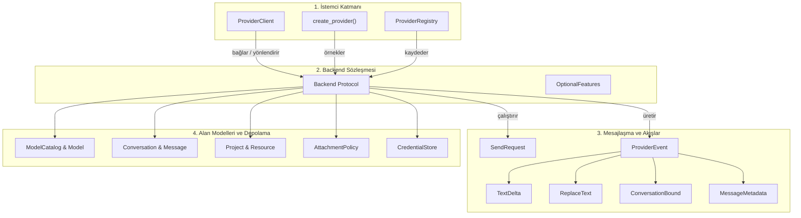
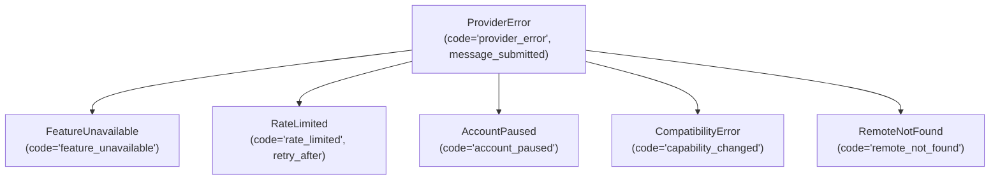

[![Sürüm: v1.2-beta][version-shield]](CHANGELOG.md)
[![Python 3.10+][python-shield]](https://www.python.org/downloads/)
[![GPL-3.0-only][license-shield]](LICENSE)

[English](README.md) | **Türkçe** | [Русский](README-RU.md)

# webai-provider

### ChatGPT, Gemini, Claude ve Grok web oturumları için yüksek performanslı ve sözleşme odaklı Python istemcisi.

`webai-provider`, Python uygulamalarınızı geliştirici API anahtarlarına, ön ödemeli bakiye yüklemelerine veya harici proxy ara yazılımlarına ihtiyaç duymadan doğrudan ChatGPT, Gemini, Claude ve Grok'un web oturumlarına bağlar. Harici tarayıcı süreçlerine (headless browser) gerek duymadan saf Python üzerinde yerel olarak çalışır; çok turlu sohbeti, canlı jeton (token) akışını, dinamik model ve efor keşfini, dosya eklerini, proje ve çalışma alanı yönetimini, mesaj düzenlemeyi ve dal (branch) devamlarını birleşik, asenkron bir arayüz arkasında sunar.

---

<a id="icindekiler"></a>
## İçindekiler

- [1. Genel Bakış ve Öne Çıkanlar](#1-genel-bakış-ve-öne-çıkanlar)
- [2. Kurulum ve Gereksinimler](#2-kurulum-ve-gereksinimler)
- [3. Desteklenen Sağlayıcılar ve Yetenek Matrisi](#3-desteklenen-sağlayıcılar-ve-yetenek-matrisi)
- [4. Eksiksiz API Referansı (Genelden Özele)](#4-eksiksiz-api-referansı-genelden-özele)
  - [4.1. Üst Düzey Yönetici: `ProviderClient`](#41-üst-düzey-yönetici-providerclient)
  - [4.2. Sağlayıcı İnşası: `create_provider` ve `ProviderRegistry`](#42-sağlayıcı-inşası-create_provider-ve-providerregistry)
  - [4.3. Birleşik Backend Protokolü: `Backend` Sözleşmesi](#43-birleşik-backend-protokolü-backend-sözleşmesi)
  - [4.4. İstekler ve Akış Olayları: `SendRequest` ve `ProviderEvent`](#44-istekler-ve-akış-olayları-sendrequest-ve-providerevent)
  - [4.5. Alan ve Durum Modelleri: `ModelCatalog`, `Conversation`, `Project` vb.](#45-alan-ve-durum-modelleri-modelcatalog-conversation-project-vb)
  - [4.6. Dosya Politikaları ve İndirme Tanımlayıcıları: `AttachmentPolicy` ve `DownloadSource`](#46-dosya-politikaları-ve-indirme-tanımlayıcıları-attachmentpolicy-ve-downloadsource)
  - [4.7. Oturumlar, Kimlik Depolama ve Geçmiş Senkronizasyonu](#47-oturumlar-kimlik-depolama-ve-geçmiş-senkronizasyonu)
  - [4.8. Tarayıcı Profili İçe Aktarma ve CDP Araçları: `profiles` ve `cdp`](#48-tarayıcı-profili-içe-aktarma-ve-cdp-araçları-profiles-ve-cdp)
  - [4.9. Telemetri ve Gönderim Zamanlama Profillemesi: `timing`](#49-telemetri-ve-gönderim-zamanlama-profillemesi-timing)
  - [4.10. Hata Yönetimi ve Hata Kodları: `ProviderError`](#410-hata-yönetimi-ve-hata-kodları-providererror)
- [5. Pratik Örnekler (Basitten İleri Düzeye)](#5-pratik-örnekler-basitten-ileri-düzeye)
  - [5.1. Örnek 1: Temel Jeton Akışı](#51-örnek-1-temel-jeton-akışı)
  - [5.2. Örnek 2: Dinamik Model Keşfi, Düşünme Eforu ve Çok Turlu Sohbet](#52-örnek-2-dinamik-model-keşfi-düşünme-eforu-ve-çok-turlu-sohbet)
  - [5.3. Örnek 3: Dosya Yükleme ve Ek Analizi](#53-örnek-3-dosya-yükleme-ve-ek-analizi)
  - [5.4. Örnek 4: Çoklu Sağlayıcı Eşzamanlı Karşılaştırma CLI](#54-örnek-4-çoklu-sağlayıcı-eşzamanlı-karşılaştırma-cli)
  - [5.5. Örnek 5: Proje ve Çalışma Alanı Kaynak Yönetimi](#55-örnek-5-proje-ve-çalışma-alanı-kaynak-yönetimi)
  - [5.6. Örnek 6: Mesaj Düzenleme, Yeniden Deneme ve Sohbet Dallandırma](#56-örnek-6-mesaj-düzenleme-yeniden-deneme-ve-sohbet-dallandırma)
  - [5.7. Örnek 7: Özel Şifrelenmiş Kimlik Depolama](#57-örnek-7-özel-şifrelenmiş-kimlik-depolama)
- [6. Çalışma Zamanı Mimarisi ve Güvenlik Garantileri](#6-çalışma-zamanı-mimarisi-ve-güvenlik-garantileri)
- [7. Geliştirme, Kalite Kontrol ve Testler](#7-geliştirme-kalite-kontrol-ve-testler)
- [8. SiopeChat ile Entegrasyon](#8-siopechat-ile-entegrasyon)
- [9. Sürüm Geçmişi ve Lisans](#9-sürüm-geçmişi-ve-lisans)

---

## 1. Genel Bakış ve Öne Çıkanlar

Modern web yapay zekâ platformları birbirinden bütünüyle farklı ve belgelenmemiş iletim protokolleri üzerinde çalışır: HTTP/2 çoklama ve Server-Sent Events (SSE) teknolojisinden Google'ın dahili `batchexecute` RPC biçimine ve bot engelleme (anti-bot) mekanizmalarına kadar geniş bir yelpaze söz konusudur. `webai-provider`, bu protokolleri temiz, tip güvenli Python sözleşmelerine dönüştürür ve şu mimari teminatları sunar:

- **Sıfır Node.js / Headless Tarayıcı Bağımlılığı:** ChatGPT Sentinel çalışma zamanı (parmak izi çıkarma, Proof of Work çözümü ve desteklenen Turnstile doğrulaması) harici tarayıcılara ihtiyaç kalmaksızın tamamen yerel Python üzerinde (`chatgpt/sentinel/`) çalışır.
- **Tembel (Lazy) Hesap Başlatma:** Paketi içe aktarmak veya hesap tanımlamak sıfır ağ turu gerektirir ve hiçbir arka plan süreci başlatmaz. İletim katmanı yalnızca işlem başladığında devreye girer.
- **Katı İptal ve Bağlantı Güvenliği:** Bir akış iptal edildiğinde veya `async for` döngüsünden çıkıldığında, ilgili iletim soketi derhal ve temiz bir şekilde kapatılır. Belirsiz POST hataları asla otomatik olarak yeniden denenmez.
- **Kusursuz Hesap Yalıtımı:** Her hesap kendi çerez deposunu, HTTP bağlantı havuzunu ve eşzamanlılık kilitlerini yönetir. Hesaplar arası kimlik veya önbellek sızıntısı meydana gelmez.
- **Tiplere Ayrılmış Çok Kanallı Çıktı:** Kullanıcıya görünen yanıt (`None`), derin düşünme/akıl yürütme izi (`analysis`), canlı özet güncellemeleri (`ReplaceText`) ve kaynak alıntıları (`MessageMetadata.sources`) birbirinden net bir biçimde ayrıştırılır.

[↑ İçindekilere Dön](#icindekiler)

---

## 2. Kurulum ve Gereksinimler

Python 3.10 veya üzeri gereklidir. Ubuntu, macOS ve Windows ortamlarında Python 3.10, 3.11, 3.12, 3.13 ve 3.14 sürümlerinde düzenli olarak test edilmektedir.

```sh
# Klonlama ve doğrudan kurulum
git clone https://github.com/TahsinCr/webai-provider.git
cd webai-provider
python -m pip install .

# İsteğe bağlı geliştirme ve test araçlarıyla kurulum
python -m pip install -e ".[dev]"
```

[↑ İçindekilere Dön](#icindekiler)

---

## 3. Desteklenen Sağlayıcılar ve Yetenek Matrisi

Kütüphane yetenekleri `Capability` numaralandırması üzerinden sunulur. Düşünme eforu veya dosya yükleme gibi özellikler aktif modele ve hesap seviyesine bağlı olduğundan, `await account.models()` ile dönen dinamik katalog her zaman nihai otoritedir.

| Yetenek (`Capability`) | ChatGPT | Gemini | Claude | Grok | Davranış ve Notlar |
| :--- | :---: | :---: | :---: | :---: | :--- |
| `CHAT` | ✅ | ✅ | ✅ | ✅ | Asenkron istem gönderme ve SSE olay akışı. |
| `TEMPORARY` | ✅ | ✅ | ✅ | ✅ | Gizli / geçici oturum modu (sohbetler sunucu geçmişine kaydedilmez). |
| `HISTORY` | ✅ | ✅ | ✅ | ✅ | Sayfalanmış sohbet listesi ve tüm sohbet turlarının geçmişini çekme. |
| `RENAME` | ✅ | ✅ | ✅ | ✅ | Sunucu üzerindeki sohbet başlıklarını güncelleme. |
| `DELETE` | ✅ | ✅ | ✅ | ✅ | Sohbetleri sunucu üzerinden kalıcı olarak silme. |
| `AUTH` | ✅ | ✅ | ✅ | ✅ | Oturum geçerliliğini doğrulama ve giriş durumunu kontrol etme. |
| `ATTACHMENTS` | ✅ | ✅ | ✅ | ✅ | İstem göndermeden önce belge, görsel ve ses/video dosyalarını yükleme. |
| `RESOURCES` | ✅ | ✅ | ✅ | ✅ | Proje ve çalışma alanlarına bağlı belge ve metin kaynaklarını yönetme. |
| `PROJECTS` | ✅ | ✅ | ✅ | ✅ | Projeleri keşfetme ve listeleme (Gemini için Notebooks, Grok için Workspaces). |
| `PROJECT_CREATE` | ✅ | ✅ | ✅ | ✅ | Yeni proje veya çalışma alanı oluşturma. |
| `PROJECT_UPDATE` | ✅ | ✅ | ✅ | ✅ | Proje başlığını, talimatlarını veya ayarlarını güncelleme. |
| `PROJECT_DELETE` | ✅ | ✅ | ✅ | ✅ | Sunucudaki projeleri veya çalışma alanlarını silme. |
| `PROJECT_MEMBERSHIP` | ✅ | ❌ | ✅ | ✅ | Sohbetleri projeye taşıma veya projeden çıkarma (Gemini Notebook sohbetleri sabittir). |
| `MODELS` | ✅ | ✅ | ✅ | ✅ | Hesaba tanımlı kullanılabilir modelleri dinamik olarak keşfetme. |
| `EFFORT` | ✅ | ✅ | ✅ | ✅ | Düşünme bütçesi / akıl yürütme eforu (modele bağlıdır; `Model.efforts` ile yapılandırılır). |
| `MESSAGE_EDIT` | ✅ | ✅ | ✅ | ✅ | Mevcut bir kullanıcı iletisini düzenleme ve yeni bir dal üretme. |
| `MESSAGE_RETRY` | ✅ | ✅* | ✅ | ✅ | Asistan yanıtını yeniden üretme (*Gemini üzerinde retry işlemi üst istem düzenlenerek yürütülür). |
| `CHAT_BRANCH` | ✅ | ✅ | ❌ | ❌ | Belirli bir turdan bağımsız yeni bir sohbet dallandırma (Claude ve Grok web API'leri desteklemez). |

> **Not:** Bir sorgu metodundan boş liste dönmesi, özelliğin desteklenmediği anlamına gelmez; sunucuda o türe ait kayıt bulunmadığını gösterir. Desteklenmeyen eylemler doğrudan `FeatureUnavailable` istisnası fırlatır.

[↑ İçindekilere Dön](#icindekiler)

---

## 4. Eksiksiz API Referansı (Genelden Özele)



---

### 4.1. Üst Düzey Yönetici: `ProviderClient`

`webai_provider.client.ProviderClient`

Çoklu sağlayıcı ve çoklu hesap yaşam döngülerini yöneten merkezi orkestratör. Her `asyncio` olay döngüsü için tek bir örnek çalıştırılacak biçimde tasarlanmıştır.

#### Metotlar
- **`__init__() -> None`**<br>
  Arka uç kayıtlarını, aktif akış görevlerini ve kapatma kalkanlarını başlatır.
- **`connect(provider_id: str, account_id: str = "default", **configuration) -> Backend`**<br>
  `create_provider` kullanarak tembel (lazy) bir sağlayıcı arka ucu oluşturur ve kaydeder. Ağ isteği yapmaz veya tarayıcı oturumu açmaz.
- **`add(backend: Backend) -> Backend`**<br>
  Önceden oluşturulmuş bir arka ucu doğrudan kaydeder. `(backend.id, backend.account_id)` çiftinin boş olmamasını ve benzersizliğini güvenceye alır.
- **`account(provider_id: str, account_id: str = "default") -> Backend`**<br>
  Belirtilen kimlik çiftine ait aktif arka ucu döndürür. Kayıtlı değilse `KeyError` fırlatır.
- **`prepare(provider_id: str, account_id: str = "default", *, for_send: bool = False) -> Backend`**<br>
  Hesabın iletim durumunu arka planda hazırlar. `for_send=True` verilirse sağlayıcıya özgü ön ısınma işlemlerini (jeton çözümleme vb.) tetikler.
- **`stream(request: SendRequest) -> AsyncIterator[ProviderEvent]`**<br>
  İsteği hedef arka uca yönlendirir, gerekli yetenekleri denetler, çalışan görevi takip eder ve tiplere ayrılmış olayları üretir. Çağırıcı döngüyü kırdığında veya görevi iptal ettiğinde iletim yineleyicisi derhal kapatılır.
- **`close() -> None`**<br>
  Sürmekte olan tüm akışları iptal eder, etkin iletim kaynaklarını serbest bırakır ve tüm hesap arka uçlarını temizce kapatır. Idempotent yapıdadır; kapanma sırasındaki geçici hatalarda güvenle yeniden çağrılabilir.
- **`async with ProviderClient() as client:`**<br>
  Güvenli ve kapsam içi yaşam döngüsü yönetimi için `__aenter__` ve `__aexit__` protokollerini uygular.

#### Özellikler (Properties)
- **`accounts -> tuple[tuple[str, str], ...]`**<br>
  Kayıtlı tüm `(provider_id, account_id)` çiftlerini demet (tuple) olarak döndürür.

[↑ İçindekilere Dön](#icindekiler)

---

### 4.2. Sağlayıcı İnşası: `create_provider` ve `ProviderRegistry`

`webai_provider.registry.create_provider`

Genel uygulama durumuna bağımlı olmaksızın yalıtılmış bir hesap arka ucu örneği inşa eder.

```python
def create_provider(
    provider_id: str,
    account_id: str = "default",
    *,
    credential_file: str | Path | CredentialStore | None = None,
    session: BrowserSession | None = None,
    profile_directory: str | Path | None = None,
    **options,
) -> Backend:
```

#### Parametreler
- **`provider_id`** (`str`): Hedef sağlayıcı tanıtıcısı: `"chatgpt"`, `"gemini"`, `"claude"` veya `"grok"`.
- **`account_id`** (`str`): Yerel hesap tanımlayıcısı (varsayılan: `"default"`).
- **`credential_file`** (`str | Path | CredentialStore | None`): Oturum JSON dosya yolu veya özel `CredentialStore` uygulaması. `session` verilmediği sürece tüm sağlayıcılar için zorunludur.
- **`session`** (`BrowserSession | None`): Mevcut `BrowserSession` nesnesi (yalnızca ChatGPT için).
- **`profile_directory`** (`str | Path | None`): ChatGPT Sentinel verileri için özel tarayıcı profil dizini. Belirtilmezse oturum dosyasının yanındaki `chrome-profile/` dizinini kullanır.
- **`**options`**: `client_factory` gibi sağlayıcı adaptörüne özgü ek parametreler.

#### `ProviderRegistry` Sınıfı
- **`register(provider: Provider, *, account_factory: Callable | None = None) -> None`**: Sağlayıcı prototipini ve hesap yapıcı fonksiyonunu kaydeder.
- **`create_account(provider_id: str, account_id: str, **configuration) -> Backend`**: Kayıtlı fabrika üzerinden yeni bir hesap örneği oluşturur.
- **`set_enabled(provider_id: str, enabled: bool) -> None`**: Bir sağlayıcının gelecekteki işlemleri kabul edip etmeyeceğini belirler.
- **`require(provider_id: str, capability: Capability) -> Provider`**: Sağlayıcının ilgili yeteneğe sahip olduğunu doğrular ve nesneyi döndürür.
- **`describe(provider_id: str) -> Coroutine[ProviderDescription]`**: Sağlayıcının özellik durumlarını sorgular.
- **`mark_unavailable(provider_id: str, capability: Capability) -> None`**: Belirli bir yeteneği geçici olarak devre dışı işaretler.
- **`restore(provider_id: str, capability: Capability) -> None`**: Önceden devre dışı bırakılmış bir yeteneği yeniden etkinleştirir.
- **`get(provider_id: str) -> Provider`**: Prototip sağlayıcı nesnesini döndürür.
- **`ids() -> tuple[str, ...]`**: Kayıtlı tüm sağlayıcı kimliklerini listeler.

[↑ İçindekilere Dön](#icindekiler)

---

### 4.3. Birleşik Backend Protokolü: `Backend` Sözleşmesi

`webai_provider.contracts.Backend`

Dört sağlayıcı adaptörünün tamamı tarafından uygulanan birleşik protokol.

#### Kimlik ve Yaşam Döngüsü
- **`id: str`**: Sağlayıcı kimliği (`"chatgpt"`, `"gemini"`, `"claude"`, `"grok"`).
- **`account_id: str`**: Hesap kimliği.
- **`capabilities: frozenset[Capability]`**: Adaptörün desteklediği yetenekler kümesi.
- **`async def prepare() -> None`**: Hesaba özgü iletim durumunu kurar.
- **`async def close() -> None`**: Bağlantı havuzlarını ve arka plan iş parçacıklarını kapatır.

#### Oturum ve Sağlık
- **`async def authenticate() -> SessionStatus`**: Kimlik doğrulama çerezlerini/belirteçlerini doğrular ve yeniler.
- **`async def login() -> SessionStatus`**: Etkileşimli veya profil tabanlı giriş sürecini tetikler.
- **`async def session_status() -> SessionStatus`**: Uzak istek yapmaksızın önbellekteki oturum durumunu döner.
- **`async def forget_session() -> SessionStatus`**: Saklanan kimlik bilgilerini siler ve durumu sıfırlar.
- **`async def describe() -> ProviderDescription`**: Desteklenen ve kullanılabilir durumdaki yetenekleri sorgular.

#### Modeller ve Üretim
- **`async def models(*, force: bool = False) -> ModelCatalog`**: Kullanılabilir modelleri listeler. `force=True` verilmediği sürece 5 dakika boyunca önbellekten yanıt verir.
- **`def stream(request: SendRequest) -> AsyncGenerator[ProviderEvent, None]`**: İsteği iletir ve akış olaylarını üretir.

#### Sohbetler ve Geçmiş
- **`async def list_chats(cursor: str | None = None, limit: int = 28) -> Page[Conversation]`**: Sohbet geçmişini sayfalanmış olarak listeler.
- **`async def get_chat(conversation_id: str) -> Conversation`**: Bir sohbetin tüm turlarını ve üst verilerini çeker.
- **`async def rename_chat(conversation_id: str, title: str) -> None`**: Sohbet başlığını günceller.
- **`async def delete_chat(conversation_id: str) -> None`**: Sohbeti sunucudan kalıcı olarak siler.
- **`async def branch_chat(conversation_id: str, message_id: str) -> Conversation`**: Bir mesaj turunu bağımsız yeni bir dala çatallar.
- **`async def conversation_attachment_count(conversation_id: str) -> int | None`**: Sohbet içinde yüklenmiş dosya sayısını döndürür.

#### Projeler ve Çalışma Alanları
- **`async def list_projects(cursor: str | None = None) -> Page[Project]`**: Projeleri/çalışma alanlarını listeler.
- **`async def get_project(project_id: str) -> Project`**: Proje ayrıntılarını ve bağlı kaynakları getirir.
- **`async def list_project_chats(project_id: str, cursor: str | None = None) -> Page[Conversation]`**: Projeye bağlı sohbetleri listeler.
- **`async def create_project(name: str, instructions: str = "", *, visibility="private", memory="default") -> Project`**: Yeni proje oluşturur.
- **`async def update_project(project: Project) -> Project`**: Proje adını veya sistem talimatlarını günceller.
- **`async def delete_project(project_id: str) -> None`**: Projeyi sunucudan siler.
- **`async def project_options(project_id: str | None = None) -> ProjectOptions`**: Desteklenen proje yapılandırma alanlarını döndürür.
- **`async def add_project_resource(project_id: str, kind: str, **values) -> Project`**: Projeye belge veya metin kaynağı ekler.
- **`async def remove_project_resource(project_id: str, resource_id: str) -> Project`**: Projeden kaynak siler.
- **`async def move_chat(conversation_id: str, project_id: str | None) -> None`**: Sohbeti bir projeye taşır veya projeden çıkarır.

#### Dosya Ekleri ve İndirme
- **`def attachment_policy() -> dict | None`**: Boyut, dosya adedi ve uzantı sınırlarını döner.
- **`async def upload_file(path: str | Path) -> dict`**: Yerel bir dosyayı sağlayıcı depolama alanına yükler.
- **`async def resolve_download(url: str, conversation_id: str | None = None, message_id: str | None = None) -> DownloadSource | None`**: Kimliği doğrulanmış indirme bağlantısını ve gerekli başlıkları çözer.

#### `confirm_deleted` Yardımcısı
- **`async def confirm_deleted(read: Callable, missing: Callable = lambda value: False) -> None`**: Yıkıcı istekleri tekrar göndermeden, üstel geri çekilme (`0s`, `0.2s`, `0.5s`, `1s`) uygulayarak silme işleminin sunucuda gerçekleştiğini teyit eder.

[↑ İçindekilere Dön](#icindekiler)

---

### 4.4. İstekler ve Akış Olayları: `SendRequest` ve `ProviderEvent`

#### `SendRequest` Parametreleri
`webai_provider.api.SendRequest(frozen=True)`

| Alan | Tür | Varsayılan | Amacı |
| :--- | :--- | :--- | :--- |
| **`provider_id`** | `str` | *Zorunlu* | Hedef sağlayıcı (`"chatgpt"`, `"gemini"`, `"claude"`, `"grok"`). |
| **`account_id`** | `str` | *Zorunlu* | Hedef hesap tanımlayıcısı. |
| **`chat_id`** | `str` | *Zorunlu* | Çağırıcının kararlı yerel sohbet kimliği (taslak takibi sağlar). |
| **`prompt`** | `str` | *Zorunlu* | Gönderilen metin veya düzenlenen ileti içeriği. |
| **`conversation_id`** | `str \| None` | `None` | Uzak sohbet kimliği (ilk turda `None`, devam turlarında dolu). |
| **`model`** | `str \| None` | `None` | Seçilen model tanımlayıcısı (`Model.id`). |
| **`effort`** | `str \| None` | `None` | Akıl yürütme eforu (`"low"`, `"medium"`, `"high"`). |
| **`project_id`** | `str \| None` | `None` | Sohbet bir projeye bağlıysa uzak proje kimliği. |
| **`temporary`** | `bool` | `False` | `True` ise gizli/geçici sohbet olarak yürütülür. |
| **`attachments`** | `tuple[dict, ...]` | `()` | `upload_file()` çıktısı olan dosya tanımlayıcıları. |
| **`action`** | `MessageAction \| None` | `None` | `MessageAction.EDIT` veya `MessageAction.RETRY`. |
| **`message_id`** | `str \| None` | `None` | Düzenleme veya yeniden denemede hedef mesaj kimliği. |
| **`branch`** | `BranchContext \| None` | `None` | Sohbet dalı devam üst verisi. |

#### İstek Doğrulama: `validate_request`
`webai_provider.api.validate_request(provider, request: SendRequest)` şu kontrolleri yürütür:
- İsteğin hedef sağlayıcı ve hesap ile uyuşması.
- `action` belirtilmişse (`EDIT` veya `RETRY`) hem `conversation_id` hem `message_id` değerlerinin bulunması.
- `branch` devamında kaynak `conversation_id` ve `message_id` bulunması; çelişkili `action` veya `temporary` bayraklarının olmaması.

#### Olay Türleri (`ProviderEvent`)
`ProviderEvent = TextDelta | ReplaceText | ResponseComplete | ConversationBound | MessageMetadata`

1. **`TextDelta(text: str, channel: str | None = None)`**<br>
   Artımlı jeton parçacığı.<br>
   - `channel=None`: Asistanın birincil yanıt metni.<br>
   - `channel="analysis"`: Akıl yürütme / düşünme süreci çıktısı.
2. **`ReplaceText(text: str, channel: str | None = None)`**<br>
   İlgili kanalda daha önce biriken metnin tamamını yenisiyle değiştirir (canlı özet revizyonlarında kullanılır).
3. **`ResponseComplete()`**<br>
   Uzak model üretiminin başarıyla sonlandığını bildirir.
4. **`ConversationBound(conversation_id: str)`**<br>
   İlk turda uzak sunucu kalıcı sohbet kimliği atadığında tetiklenir.
5. **`MessageMetadata(...)`**<br>
   Üretim tamamlandığında nihai tur üst verilerini taşır:<br>
   - `message_id: str | None`: Asistan mesaj kimliği.<br>
   - `user_message_id: str | None`: Sunucu tarafından onaylanan kullanıcı mesaj kimliği.<br>
   - `model: str | None`: Yanıtı üreten gerçek model.<br>
   - `effort: str | None`: Doğrulanan akıl yürütme eforu.<br>
   - `sources: tuple[dict, ...]`: Web kaynakları ve alıntı bağlantıları.<br>
   - `actions: tuple[str, ...]`: Bu tur için izin verilen eylemler (`"edit"`, `"retry"`).<br>
   - `files: tuple[dict, ...]`: Model tarafından üretilen çıktı dosyaları.

[↑ İçindekilere Dön](#icindekiler)

---

### 4.5. Alan ve Durum Modelleri: `ModelCatalog`, `Conversation`, `Project` vb.

`webai_provider.models`

- **`ModelCatalog`**:
  - `state: FeatureState`: `AVAILABLE`, `UNAVAILABLE`, `UNKNOWN`, `LOGIN_REQUIRED`.
  - `models: tuple[Model, ...]`: Kullanılabilir model listesi.
  - `default_model: str | None`: Sağlayıcının varsayılan model kimliği.
  - `chat_models -> tuple[Model, ...]`: Kullanıcı sohbeti için seçilebilir modeller.
  - `chat_model(model_id: str | None) -> Model | None`: Kimliğe göre model bulur.
  - `default_chat_model -> Model | None`: Varsayılan sohbet modelini çözer.
  - `effort(model_id: str, preferred: str = "medium") -> str | None`: Uyumlu efor seviyesini çözer.
  - `from_dict(value: dict) -> ModelCatalog`: Sözlükten katalog nesnesine dönüştürür.
- **`Model`**:
  - `id: str`, `title: str`, `efforts: tuple[Choice, ...]`, `default_effort: str | None`, `chat_selectable: bool`, `chat_title: str | None`.
- **`Choice`**:
  - `id: str`, `title: str`.
- **`Conversation`**:
  - `origin: Origin`: `(provider_id, account_id, remote_id)`.
  - `title: str`: Sohbet başlığı.
  - `messages: tuple[Message, ...]`: Sohbet turları dizisi.
  - `project_id: str | None`: Bağlı olduğu proje kimliği.
- **`Message`**:
  - `id: str`, `role: str` (`"user"`, `"assistant"`), `content: tuple[Content, ...]`, `channel: str | None`, `actions: tuple[str, ...]`.
- **`Content`**:
  - `kind: str` (`"text"`, `"resource"`), `text: str | None`, `resource: Resource | None`.
- **`Resource`**:
  - `id: str`, `name: str`, `media_type: str | None`, `remote_url: str | None`.
- **`Project`**:
  - `origin: Origin`, `name: str`, `instructions: str | None`, `resources: tuple[Resource, ...]`.
- **`ProjectOptions`**:
  - `fields: tuple[str, ...]`, `visibility: tuple[Choice, ...]`, `memory: tuple[Choice, ...]`, `sources: tuple[dict, ...]`, `remove_sources: bool`, `source_error: str | None`.
- **`Origin`**:
  - `provider_id: str`, `account_id: str`, `remote_id: str`.
- **`Page[T]`**:
  - `items: tuple[T, ...]`, `next_cursor: str | None`.
- **`SessionStatus`**:
  - `state: SessionState`: `UNKNOWN`, `LOGIN_REQUIRED`, `AUTHENTICATED`.
  - `saved_snapshot: bool`, `reason: str | None`.
- **`Feature`**:
  - `capability: Capability`, `state: FeatureState`, `reason: str | None`.
- **`ProviderDescription`**:
  - `id: str`, `features: tuple[Feature, ...]`.
  - `feature(capability: Capability) -> Feature`: Belirli bir yeteneğin durumunu sorgular.

[↑ İçindekilere Dön](#icindekiler)

---

### 4.6. Dosya Politikaları ve İndirme Tanımlayıcıları: `AttachmentPolicy` ve `DownloadSource`

`webai_provider.attachments` & `webai_provider.files`

#### `AttachmentPolicy`
Sağlayıcı yükleme sınırlarını tanımlar:
- `max_files: int`: İzin verilen en fazla dosya adedi.
- `max_bytes: int`: Dosya başına en yüksek bayt boyutu.
- `max_image_bytes: int | None`: Görseller için üst boyut sınırı.
- `max_spreadsheet_bytes: int | None`: Tablolar için üst boyut sınırı.
- `max_video_bytes: int | None`: Videolar için üst boyut sınırı.
- `max_total_bytes: int | None`: İstem başına toplam yükleme sınırı.
- `allowed_extensions: tuple[str, ...]`: İzin verilen dosya uzantıları beyaz listesi.
- `max_files_scope: str`: Kota kapsamı (`"prompt"` veya `"conversation"`).
- `source: str`: İnsan tarafından okunabilir kaynak açıklaması.
- `as_dict() -> dict`: Politikayı sözlük olarak serileştirir.

#### Hazır Sabitler
- **`CHATGPT_ATTACHMENTS`**: Dosya başına 512 MiB, görseller için 20 MiB, tablolar için 50 MiB, istem başına 10 dosya.
- **`GEMINI_ATTACHMENTS`**: Dosya başına 100 MiB (videolar için 2 GiB), istem başına 10 dosya.
- **`CLAUDE_ATTACHMENTS`**: Dosya başına 30 MiB, sohbet başına en fazla 20 dosya, katı uzantı beyaz listesi.
- **`GROK_ATTACHMENTS`**: Dosya başına 3 MiB, istem başına toplam 10 MiB, istem başına 10 dosya.

#### `DownloadSource`
`resolve_download()` tarafından döndürülen tanımlayıcı:
- `url: str`: İndirme adresi.
- `filename: str | None`: Önerilen yerel dosya adı.
- `force_download: bool`: İndirmenin zorlanıp zorlanmayacağı bayrağı.
- `headers: dict[str, str]`: Oturuma özgü yetkilendirme başlıkları.
- `client_factory: Callable | None`: HTTP iletim fabrikası.

#### `NativeDownloadClient`
`curl_cffi` üzerinden Chrome taklidi ile bayt akışı sağlayan bağlam yöneticisi:
- `stream(method, url, *, headers, resolved_address=None)`: Yönlendirmeleri engelleyerek etkin HTTP yanıtı sunan bağlam yöneticisi.

[↑ İçindekilere Dön](#icindekiler)

---

### 4.7. Oturumlar, Kimlik Depolama ve Geçmiş Senkronizasyonu

`webai_provider.session` & `webai_provider.history`

Oturum kimlik bilgileri, iş parçacığı kilitleri ve kısıtlı `0o600` dosya izinlerine sahip geçici dosyalar kullanılarak atomik biçimde diske yazılır.

#### `CredentialStore` Protokolü
```python
class CredentialStore(Protocol):
    def load(self) -> dict: ...
    def save(self, value: dict) -> None: ...
    def exists(self) -> bool: ...
    def delete(self) -> None: ...
```

#### Oturum Yardımcıları
- **`read_session(path: str | Path | CredentialStore) -> dict`**: Oturumu yükler; eksik veya bozuk kimlik verilerinde `AccountPaused` fırlatır.
- **`save_session(path: str | Path | CredentialStore, value: dict) -> None`**: Oturumu `0o600` izinleriyle atomik olarak kaydeder.
- **`session_exists(source: str | Path | CredentialStore) -> bool`**: Kimlik verilerinin mevcut olup olmadığını döner.
- **`delete_session(source: str | Path | CredentialStore) -> None`**: Oturum bilgilerini güvenli bir şekilde siler.
- **`cookie_header(values: dict, names: set[str]) -> str`**: Çerez sözlüğünden HTTP Cookie başlığı oluşturur.

#### Beklenen Oturum Dosyası Biçimleri
```json
// ChatGPT (~/.config/siopechat/chatgpt-session.json)
{
  "cookies": {
    "__Secure-next-auth.session-token": "eyJhbGciOi...",
    "oai-did": "12345678-..."
  }
}

// Gemini (~/.config/siopechat/gemini-session.json)
{
  "cookies": {
    "__Secure-1PSID": "g.a000...",
    "__Secure-1PSIDTS": "sidts-...",
    "SID": "..."
  }
}

// Claude (~/.config/siopechat/claude-session.json)
{
  "cookies": {
    "sessionKey": "sk-ant-sid01-...",
    "lastActiveOrg": "12345678-..."
  }
}

// Grok (~/.config/siopechat/grok-session.json)
{
  "cookies": {
    "sso": "...",
    "sso-rw": "..."
  }
}
```

#### Geçmiş Senkronizasyonu: `merge_conversation`
`webai_provider.history.merge_conversation(remote: dict, local: dict) -> dict`, yerel bekleyen turları `difflib.SequenceMatcher` kullanarak doğrulanmış sunucu geçmişiyle güvenle hizalar:
- Önceki sağlayıcı geçmişini dokunulmadan korur.
- Geçici yerel kimlikleri sunucunun onayladığı kalıcı kimliklerle değiştirir.
- Yerel doğrulanmamış düşünme süreçlerini ve kaynak eklerini muhafaza eder.
- Silinmiş veya düzenlenmiş dalları asla yeniden diriltmez.

[↑ İçindekilere Dön](#icindekiler)

---

### 4.8. Tarayıcı Profili İçe Aktarma ve CDP Araçları: `profiles` ve `cdp`

`webai_provider.profiles` & `webai_provider.cdp`

Şifre girmeye gerek kalmadan, doğrudan varsayılan tarayıcı profillerindeki etkin çerezleri içe aktararak oturum açmayı sağlar.

#### Profil Fonksiyonları (`profiles.py`)
- **`default_profile() -> BrowserProfile | None`**: Varsayılan tarayıcı çerez dizinini tespit eder (Chrome, Brave, Edge, Firefox, Safari).
- **`import_cookies(provider: str) -> tuple[str, dict]`**: `"chatgpt"`, `"gemini"`, `"claude"` veya `"grok"` çerezlerini ayıklar ve çözer. `(tarayici_ailesi, cerezler_sozlugu)` döndürür.

#### Chrome DevTools Protocol (`cdp.py`)
- **`is_devtools_available(cdp_url: str, timeout: float = 1.0) -> bool`**: Uzaktan hata ayıklama portunun açık olup olmadığını test eder.
- **`open_provider_page(cdp_url: str, provider_url: str) -> None`**: Tarayıcı sekmesinde sağlayıcı adresini açar.
- **`read_provider_cookies(cdp_url: str, provider_url: str) -> list[dict]`**: CDP aracılığıyla etkin çerezleri okur.
- **`capture_chatgpt_auth(cdp_url: str, timeout: float = 15.0) -> tuple[str, dict]`**: ChatGPT erişim belirtecini ve istek başlıklarını yakalar.

[↑ İçindekilere Dön](#icindekiler)

---

### 4.9. Telemetri ve Gönderim Zamanlama Profillemesi: `timing`

`webai_provider.timing`

İletim aşamaları boyunca içerikten bağımsız, isteğe bağlı performans takibi sağlar.

- **`use_send_timing(timing: SendTiming | None)`**: Zamanlama izleyicisini geçerli `asyncio` bağlamına bağlayan bağlam yöneticisi.
- **`current_send_timing() -> SendTiming | None`**: Etkin zamanlama izleyicisini döndürür.
- **`record_send_timing(name: str, elapsed_ns: int) -> None`**: Belirli bir aşamanın süresini nanosaniye cinsinden kaydeder.
- **`collect_send_timing(timing: SendTiming | None) -> None`**: Örneği dairesel bellek arabelleğine ekler (en fazla 256 örnek).
- **`send_timing_report(*, clear: bool = True) -> str`**: Her aşama için medyan ve p95 milisaniye değerlerini içeren biçimlendirilmiş metin raporu döner.
- **Ortam Değişkeni:** Profil kancalarını etkinleştirmek için `SIOPECHAT_SEND_TIMINGS=1` değerini tanımlayın.

[↑ İçindekilere Dön](#icindekiler)

---

### 4.10. Hata Yönetimi ve Hata Kodları: `ProviderError`

`webai_provider.errors`

Tüm özel istisnalar `ProviderError` temel sınıfından türetilmiştir.



| İstisna | `code` Değeri | Ek Alanlar | Semantik Anlamı |
| :--- | :--- | :--- | :--- |
| **`ProviderError`** | `"provider_error"` | `message_submitted: bool \| None` | Temel sınıf. `message_submitted=False` istemin sunucuya asla ulaşmadığını garanti eder. `None` belirsiz sınır durumunu gösterir (otomatik yeniden denenmemelidir). |
| **`FeatureUnavailable`** | `"feature_unavailable"` | `capability: Capability`<br>`reason: str` | İstenen işlem bu sağlayıcı veya hesap seviyesi tarafından desteklenmiyor. |
| **`RateLimited`** | `"rate_limited"` | `retry_after: float \| None` | Hesap istek limiti aşıldı. Sunucu bildirmişse `retry_after` bekleme süresini saniye cinsinden içerir. |
| **`AccountPaused`** | `"account_paused"` | - | Oturum süresi doldu veya doğrulama müdahalesi gerekiyor. |
| **`CompatibilityError`** | `"capability_changed"` | `capability: Capability` | Uzak web protokolü beklenmedik şekilde değişti. |
| **`RemoteNotFound`** | `"remote_not_found"` | - | Hedef sohbet, proje veya kaynak sunucuda mevcut değil. |

[↑ İçindekilere Dön](#icindekiler)

---

## 5. Pratik Örnekler (Basitten İleri Düzeye)

### 5.1. Örnek 1: Temel Jeton Akışı

Claude üzerinde bir istem çalıştırır ve dönen yanıt jetonlarını gerçek zamanlı olarak standart çıktıya yazdırır.

```python
import asyncio
from webai_provider import ProviderClient, ResponseComplete, SendRequest, TextDelta


async def main():
    async with ProviderClient() as client:
        account = client.connect(
            provider_id="claude",
            account_id="personal",
            credential_file="~/.config/siopechat/claude-session.json",
        )
        await account.authenticate()

        request = SendRequest(
            provider_id="claude",
            account_id="personal",
            chat_id="draft-001",
            prompt="Explain Python 3.13 free-threaded execution in two concise sentences.",
        )

        async for event in client.stream(request):
            if isinstance(event, TextDelta):
                print(event.text, end="", flush=True)
            elif isinstance(event, ResponseComplete):
                print("\n[Akış Tamamlandı]")


if __name__ == "__main__":
    asyncio.run(main())
```

[↑ İçindekilere Dön](#icindekiler)

---

### 5.2. Örnek 2: Dinamik Model Keşfi, Düşünme Eforu ve Çok Turlu Sohbet

Canlı model kataloğunu inceler, yüksek akıl yürütme eforu seçer, ilk turda `ConversationBound` yakalayarak uzak sohbet kimliğini alır ve ikinci turda diyaloğu sürdürür.

```python
import asyncio
from webai_provider import (
    ConversationBound,
    MessageMetadata,
    ProviderClient,
    ReplaceText,
    SendRequest,
    TextDelta,
)


async def main():
    async with ProviderClient() as client:
        account = client.connect(
            "chatgpt",
            "work",
            credential_file="~/.config/siopechat/chatgpt-session.json",
        )
        await account.authenticate()

        catalog = await account.models()
        target_model = catalog.chat_model("o3-mini") or catalog.default_chat_model
        effort = catalog.effort(target_model.id, preferred="high")

        print(f"Model: {target_model.title} | Efor: {effort}")

        remote_conv_id = None
        req1 = SendRequest(
            provider_id="chatgpt",
            account_id="work",
            chat_id="turn-1",
            prompt="Write an O(log n) matrix exponentiation algorithm for Fibonacci numbers in Python.",
            model=target_model.id,
            effort=effort,
        )

        async for event in client.stream(req1):
            if isinstance(event, ConversationBound):
                remote_conv_id = event.conversation_id
            elif isinstance(event, TextDelta):
                if event.channel == "analysis":
                    print(f"[Düşünce]: {event.text}", end="", flush=True)
                else:
                    print(event.text, end="", flush=True)
            elif isinstance(event, ReplaceText):
                print(f"\n[Güncellenen Düşünce]: {event.text}\n")
            elif isinstance(event, MessageMetadata):
                print(f"\nAsistan Mesaj Kimliği: {event.message_id}")

        print("\n--- 2. TUR ---")
        req2 = SendRequest(
            provider_id="chatgpt",
            account_id="work",
            chat_id="turn-2",
            conversation_id=remote_conv_id,
            prompt="Now add complete type hints and docstrings to the matrix code.",
            model=target_model.id,
        )

        async for event in client.stream(req2):
            if isinstance(event, TextDelta) and not event.channel:
                print(event.text, end="", flush=True)


if __name__ == "__main__":
    asyncio.run(main())
```

[↑ İçindekilere Dön](#icindekiler)

---

### 5.3. Örnek 3: Dosya Yükleme ve Ek Analizi

Yerel bir dosyayı `AttachmentPolicy` kurallarına göre doğrular, Gemini depolama alanına yükler ve analiz istemi yürütür.

```python
import asyncio
from pathlib import Path
from webai_provider import AttachmentPolicy, ProviderClient, SendRequest, TextDelta


async def main():
    report_file = Path("./report.pdf")
    if not report_file.exists():
        report_file.write_text("Sistem Mimarisi Raporu: v2.0 geçiş planı onaylandı.")

    async with ProviderClient() as client:
        account = client.connect(
            "gemini",
            "analyst",
            credential_file="~/.config/siopechat/gemini-session.json",
        )
        await account.authenticate()

        policy_dict = account.attachment_policy()
        if policy_dict:
            policy = AttachmentPolicy(**policy_dict)
            if report_file.stat().st_size > policy.max_bytes:
                raise ValueError("Dosya boyutu sağlayıcı sınırını aşıyor!")

        upload_payload = await account.upload_file(report_file)

        request = SendRequest(
            provider_id="gemini",
            account_id="analyst",
            chat_id="doc-chat-1",
            prompt="Summarize the key architectural decisions from this report.",
            attachments=(upload_payload,),
        )

        async for event in client.stream(request):
            if isinstance(event, TextDelta):
                print(event.text, end="", flush=True)


if __name__ == "__main__":
    asyncio.run(main())
```

[↑ İçindekilere Dön](#icindekiler)

---

### 5.4. Örnek 4: Çoklu Sağlayıcı Eşzamanlı Karşılaştırma CLI

Tek bir `ProviderClient` örneği içinde ChatGPT, Claude, Gemini ve Grok oturumlarına aynı anda paralel sorgu gönderir.

```python
import asyncio
from webai_provider import ProviderClient, SendRequest, TextDelta


async def query_provider(client, provider_id, cred_path, prompt):
    account = client.connect(provider_id, "default", credential_file=cred_path)
    await account.authenticate()

    req = SendRequest(
        provider_id=provider_id,
        account_id="default",
        chat_id=f"bench-{provider_id}",
        prompt=prompt,
    )

    full_text = []
    async for event in client.stream(req):
        if isinstance(event, TextDelta) and not event.channel:
            full_text.append(event.text)
    return provider_id, "".join(full_text)


async def main():
    prompt = "Explain the principle of Quantum Entanglement in a single concise paragraph."
    configs = [
        ("chatgpt", "~/.config/siopechat/chatgpt-session.json"),
        ("claude", "~/.config/siopechat/claude-session.json"),
        ("gemini", "~/.config/siopechat/gemini-session.json"),
        ("grok", "~/.config/siopechat/grok-session.json"),
    ]

    async with ProviderClient() as client:
        tasks = [query_provider(client, pid, path, prompt) for pid, path in configs]
        results = await asyncio.gather(*tasks, return_exceptions=True)

        for item in results:
            if isinstance(item, Exception):
                print(f"\nHATA: {item}")
            else:
                pid, text = item
                print(f"\n{'=' * 20} {pid.upper()} {'=' * 20}\n{text.strip()}\n")


if __name__ == "__main__":
    asyncio.run(main())
```

[↑ İçindekilere Dön](#icindekiler)

---

### 5.5. Örnek 5: Proje ve Çalışma Alanı Kaynak Yönetimi

Yeni bir proje açar, sistem talimatlarını tanımlar, bir metin kaynağı ekler ve bu proje kapsamına bağlı bir sohbet yürütür.

```python
import asyncio
from webai_provider import ProviderClient, SendRequest, TextDelta


async def main():
    async with ProviderClient() as client:
        account = client.connect(
            "claude",
            "lead",
            credential_file="~/.config/siopechat/claude-session.json",
        )
        await account.authenticate()

        project = await account.create_project(
            name="WebAI Provider R&D",
            instructions="You are a principal systems engineer. All code must be strictly typed.",
        )
        print(f"Oluşturulan Proje: {project.name} (Uzak ID: {project.origin.remote_id})")

        project = await account.add_project_resource(
            project_id=project.origin.remote_id,
            kind="text",
            name="guidelines.txt",
            text="Rule 1: Pure Python sentinel execution. Rule 2: Dedicated transport pools.",
        )
        print(f"Kaynak eklendi. Toplam kaynak: {len(project.resources)}")

        req = SendRequest(
            provider_id="claude",
            account_id="lead",
            chat_id="proj-chat-1",
            project_id=project.origin.remote_id,
            prompt="What are our core architectural guidelines?",
        )

        async for event in client.stream(req):
            if isinstance(event, TextDelta):
                print(event.text, end="", flush=True)


if __name__ == "__main__":
    asyncio.run(main())
```

[↑ İçindekilere Dön](#icindekiler)

---

### 5.6. Örnek 6: Mesaj Düzenleme, Yeniden Deneme ve Sohbet Dallandırma

Bir asistan yanıtını yeniden denemeyi, önceki bir istemi düzenlemeyi ve belirli bir turdan yeni bir sohbet dalı türetmeyi gösterir.

```python
import asyncio
from webai_provider import (
    BranchContext,
    ConversationBound,
    MessageAction,
    ProviderClient,
    SendRequest,
    TextDelta,
)


async def main():
    async with ProviderClient() as client:
        account = client.connect(
            "chatgpt",
            "dev",
            credential_file="~/.config/siopechat/chatgpt-session.json",
        )
        await account.authenticate()

        conv = await account.get_chat("remote-conv-123")
        last_asst_msg = next(m for m in reversed(conv.messages) if m.role == "assistant")

        # 1. Asistan yanıtını yeniden dene
        retry_req = SendRequest(
            provider_id="chatgpt",
            account_id="dev",
            chat_id="retry-turn",
            conversation_id=conv.origin.remote_id,
            prompt="",
            action=MessageAction.RETRY,
            message_id=last_asst_msg.id,
        )
        async for event in client.stream(retry_req):
            if isinstance(event, TextDelta):
                print(event.text, end="", flush=True)

        # 2. Belirli bir turdan yeni dal oluştur
        new_branch = await account.branch_chat(
            conversation_id=conv.origin.remote_id,
            message_id=last_asst_msg.id,
        )

        branch_ctx = None
        if "pending_branch" in new_branch.metadata:
            branch_ctx = BranchContext(**new_branch.metadata["pending_branch"])

        branch_req = SendRequest(
            provider_id="chatgpt",
            account_id="dev",
            chat_id="branch-first-turn",
            prompt="Continuing on new branch: implement the alternative algorithm.",
            branch=branch_ctx,
        )
        async for event in client.stream(branch_req):
            if isinstance(event, ConversationBound):
                print(f"\nYeni Dal Uzak ID: {event.conversation_id}")
            elif isinstance(event, TextDelta):
                print(event.text, end="", flush=True)


if __name__ == "__main__":
    asyncio.run(main())
```

[↑ İçindekilere Dön](#icindekiler)

---

### 5.7. Örnek 7: Özel Şifrelenmiş Kimlik Depolama

Oturum çerezlerini düz metin JSON dosyaları yerine şifrelenmiş bellekte veya güvenli sistem anahtarlığında saklamak için `CredentialStore` uygular.

```python
import asyncio
import json
from webai_provider import CredentialStore, ProviderClient


class EncryptedMemoryStore(CredentialStore):
    def __init__(self, initial_data: dict | None = None):
        self._blob = json.dumps(initial_data or {}).encode("utf-8")

    def load(self) -> dict:
        return json.loads(self._blob.decode("utf-8"))

    def save(self, value: dict) -> None:
        self._blob = json.dumps(value).encode("utf-8")
        print("[Store] Oturum verisi bellekte güvenle mühürlendi.")

    def exists(self) -> bool:
        return bool(self._blob and self._blob != b"{}")

    def delete(self) -> None:
        self._blob = b"{}"


async def main():
    vault_store = EncryptedMemoryStore({"cookies": {"session-token": "secret_abc123"}})

    async with ProviderClient() as client:
        account = client.connect(
            provider_id="claude",
            account_id="vault-user",
            credential_file=vault_store,
        )
        status = await account.session_status()
        print(f"Oturum Durumu: {status.state.value}")


if __name__ == "__main__":
    asyncio.run(main())
```

[↑ İçindekilere Dön](#icindekiler)

---

## 6. Çalışma Zamanı Mimarisi ve Güvenlik Garantileri

1. **Sıfır Parola Depolama:** Kütüphane asla hesap şifrelerini sormaz, iletmez veya saklamaz. Tüm işlemler yalnızca oturum çerezleri ve kısa ömürlü iletim belirteçleri ile yürütülür.
2. **Kimlik Bilgisi Arındırma:** İstisna metinleri, `repr()` çıktıları ve log kayıtları asla ham oturum belirteçlerini, çerezleri veya meydan okuma sırlarını içermez.
3. **SSRF ve Yönlendirme Koruması:** İkili dosya indirmeleri rastgele HTTP yönlendirmelerini kesinlikle reddeder (`follow_redirects=False`) ve yalnızca doğrulanmış sağlayıcı kök alan adlarına güvenir.
4. **Idempotency Güvenceleri:** Idempotent olmayan `POST send` istekleri, ağ kesintisi durumunda asla otomatik olarak tekrarlanmaz; böylece mükerrer istem turları önlenir.

[↑ İçindekilere Dön](#icindekiler)

---

## 7. Geliştirme, Kalite Kontrol ve Testler

Kod tabanı katı kod kalitesi standartlarını ve birim test doğrulamasını şart koşar:

```sh
# Lint ve biçimlendirme denetimleri
ruff check .
ruff format --check .

# Test paketini çalıştırma
python -m unittest discover -s tests -t . -p 'test_*.py' -v

# Dağıtım paketi doğrulaması
python -m build --sdist --wheel
python -m twine check dist/*
```

[↑ İçindekilere Dön](#icindekiler)

---

## 8. SiopeChat ile Entegrasyon

SiopeChat, `webai-provider` kütüphanesini harici bir PyPI çalışma zamanı bağımlılığı olarak kurar:
- SiopeChat Git submodule yapısı gerektirmez.
- Bağımlılık sürümleri `pyproject.toml` ve `uv.lock` içinde kilitlenir.

Yerel geliştirmeleri SiopeChat üzerinde test etmek için:
```sh
git pull --ff-only
python -m pip install --upgrade .
```

[↑ İçindekilere Dön](#icindekiler)

---

## 9. Sürüm Geçmişi ve Lisans

- **Mevcut Sürüm:** `v1.2-beta` (`1.2.0b0`)
- **Son Güncellemeler:** Grok web oturumu desteği eklendi (model keşfi, SSE akışı, kullanıcı mesajı düzenleme, düşünme özetleri, çalışma alanı kaynakları ve web kaynak alıntıları). Ayrıntılar için [CHANGELOG.md](CHANGELOG.md) dosyasına bakın.
- **Lisans:** GNU General Public License v3.0 ([GPL-3.0-only](LICENSE)). Bildirimler için [COPYRIGHT](COPYRIGHT) dosyasına bakın.

[↑ İçindekilere Dön](#icindekiler)

[version-shield]: https://img.shields.io/badge/version-v1.2--beta-b7a3e3.svg?style=for-the-badge
[python-shield]: https://img.shields.io/badge/Python-3.10%2B-3776AB.svg?style=for-the-badge&logo=python&logoColor=white
[license-shield]: https://img.shields.io/badge/license-GPL--3.0--only-blue.svg?style=for-the-badge
