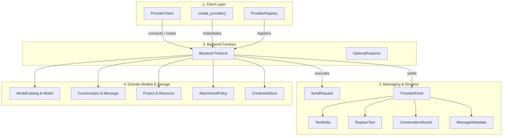
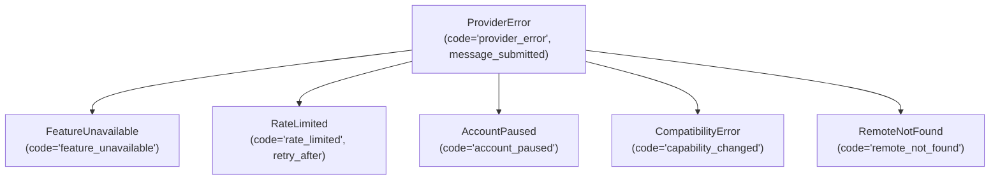

[![Version: v1.2-beta][version-shield]](CHANGELOG.md)
[![Python 3.10+][python-shield]](https://www.python.org/downloads/)
[![GPL-3.0-only][license-shield]](LICENSE)

**English** | [Türkçe](README-TR.md) | [Русский](README-RU.md)

# webai-provider

### High-performance, contract-driven Python client for ChatGPT, Gemini, Claude, and Grok web sessions.

`webai-provider` connects your Python applications directly to the web sessions of major AI providers—ChatGPT, Gemini, Claude, and Grok—without requiring developer API keys, prepaid credit balances, or proxy middleware. It runs natively in pure Python, exposing full multi-turn chat, live token streaming, dynamic model and reasoning effort discovery, file attachments, project and workspace management, message edits, and branch continuations behind a unified, asynchronous interface.

---

<a id="table-of-contents"></a>
## Table of Contents

- [1. Overview and Key Highlights](#1-overview-and-key-highlights)
- [2. Installation and Requirements](#2-installation-and-requirements)
- [3. Supported Providers and Capabilities Matrix](#3-supported-providers-and-capabilities-matrix)
- [4. Full API Reference (General to Specific)](#4-full-api-reference-general-to-specific)
  - [4.1. High-Level Orchestrator: `ProviderClient`](#41-high-level-orchestrator-providerclient)
  - [4.2. Provider Construction: `create_provider` & `ProviderRegistry`](#42-provider-construction-create_provider--providerregistry)
  - [4.3. Unified Backend Protocol: `Backend` Contract](#43-unified-backend-protocol-backend-contract)
  - [4.4. Requests & Streaming Events: `SendRequest` & `ProviderEvent`](#44-requests--streaming-events-sendrequest--providerevent)
  - [4.5. Domain & Status Models: `ModelCatalog`, `Conversation`, `Project`, etc.](#45-domain--status-models-modelcatalog-conversation-project-etc)
  - [4.6. File Policies & Download Descriptors: `AttachmentPolicy` & `DownloadSource`](#46-file-policies--download-descriptors-attachmentpolicy--downloadsource)
  - [4.7. Sessions, Credential Storage & History Synchronization](#47-sessions-credential-storage--history-synchronization)
  - [4.8. Browser Profile Import & CDP Utilities: `profiles` & `cdp`](#48-browser-profile-import--cdp-utilities-profiles--cdp)
  - [4.9. Telemetry & Send Timing Profiling: `timing`](#49-telemetry--send-timing-profiling-timing)
  - [4.10. Error Handling & Failure Codes: `ProviderError`](#410-error-handling--failure-codes-providererror)
- [5. Practical Examples (from Simple to Advanced)](#5-practical-examples-from-simple-to-advanced)
  - [5.1. Example 1: Minimal Token Streaming](#51-example-1-minimal-token-streaming)
  - [5.2. Example 2: Dynamic Model Discovery, Reasoning Effort & Multi-Turn Chat](#52-example-2-dynamic-model-discovery-reasoning-effort--multi-turn-chat)
  - [5.3. Example 3: File Uploads & Attachment Analysis](#53-example-3-file-uploads--attachment-analysis)
  - [5.4. Example 4: Multi-Provider Concurrent Comparison CLI](#54-example-4-multi-provider-concurrent-comparison-cli)
  - [5.5. Example 5: Project & Workspace Resource Management](#55-example-5-project--workspace-resource-management)
  - [5.6. Example 6: Message Editing, Retrying, and Conversation Branching](#56-example-6-message-editing-retrying-and-conversation-branching)
  - [5.7. Example 7: Custom Encrypted Credential Storage](#57-example-7-custom-encrypted-credential-storage)
- [6. Runtime Architecture & Security Guarantees](#6-runtime-architecture--security-guarantees)
- [7. Development, Quality Assurance, and Testing](#7-development-quality-assurance-and-testing)
- [8. Integration with SiopeChat](#8-integration-with-siopechat)
- [9. Changelog and License](#9-changelog-and-license)

---

## 1. Overview and Key Highlights

Modern web AI platforms run on distinct, undocumented transport protocols—ranging from HTTP/2 multiplexing and Server-Sent Events (SSE) to Google's internal `batchexecute` RPC format and custom anti-bot challenges. `webai-provider` abstracts these protocols into clean, type-safe Python contracts while guaranteeing:

- **Zero Node.js / Headless Browser Dependencies:** The complete ChatGPT Sentinel runtime (fingerprinting, Proof of Work solving, and supported Turnstile validation) runs purely in native Python (`chatgpt/sentinel/`).
- **Lazy Account Initialization:** Importing the package or configuring accounts performs zero network roundtrips and starts no background processes. Transports only open when work begins.
- **Strict Cancellation & Connection Safety:** Cancelling a stream or exiting an `async for` loop cleanly terminates the transport socket immediately. Ambiguous POST failures never trigger automatic retries.
- **Complete Account Isolation:** Every account maintains its own dedicated cookie jars, HTTP connection pools, and locks. No cross-account credential or cache leaks.
- **Typed Multi-Channel Output:** Separates visible assistant responses (`None`), thinking/reasoning traces (`analysis`), live summary updates (`ReplaceText`), and citations (`MessageMetadata.sources`).

[↑ Back to Table of Contents](#table-of-contents)

---

## 2. Installation and Requirements

Python 3.10 or higher is required. Tested continuously on Python 3.10, 3.11, 3.12, 3.13, and 3.14 across Ubuntu, macOS, and Windows.

```sh
# Clone and install
git clone https://github.com/TahsinCr/webai-provider.git
cd webai-provider
python -m pip install .

# Optional development tools (linting, testing, packaging)
python -m pip install -e ".[dev]"
```

[↑ Back to Table of Contents](#table-of-contents)

---

## 3. Supported Providers and Capabilities Matrix

The library exposes capabilities through `Capability` enums. Because features like reasoning effort or file uploads depend on the active model and account tier, the live catalog returned by `await account.models()` is always authoritative.

| Capability (`Capability`) | ChatGPT | Gemini | Claude | Grok | Behavior & Notes |
| :--- | :---: | :---: | :---: | :---: | :--- |
| `CHAT` | ✅ | ✅ | ✅ | ✅ | Asynchronous prompt submission and SSE event streaming. |
| `TEMPORARY` | ✅ | ✅ | ✅ | ✅ | Incognito / ephemeral mode (conversations are not saved in remote history). |
| `HISTORY` | ✅ | ✅ | ✅ | ✅ | Paginated chat discovery and full conversation turn history retrieval. |
| `RENAME` | ✅ | ✅ | ✅ | ✅ | Updating conversation titles on the remote server. |
| `DELETE` | ✅ | ✅ | ✅ | ✅ | Permanently removing conversations from the server. |
| `AUTH` | ✅ | ✅ | ✅ | ✅ | Verifying session validity and checking login state. |
| `ATTACHMENTS` | ✅ | ✅ | ✅ | ✅ | Uploading documents, images, and audio/video files before prompt submission. |
| `RESOURCES` | ✅ | ✅ | ✅ | ✅ | Managing documents and text resources bound to projects/workspaces. |
| `PROJECTS` | ✅ | ✅ | ✅ | ✅ | Discovering and listing projects (Notebooks for Gemini, Workspaces for Grok). |
| `PROJECT_CREATE` | ✅ | ✅ | ✅ | ✅ | Creating new projects or workspaces. |
| `PROJECT_UPDATE` | ✅ | ✅ | ✅ | ✅ | Updating project titles, instructions, or configuration options. |
| `PROJECT_DELETE` | ✅ | ✅ | ✅ | ✅ | Deleting projects/workspaces on the remote server. |
| `PROJECT_MEMBERSHIP` | ✅ | ❌ | ✅ | ✅ | Moving chats into or out of projects (Gemini Notebook chats are fixed at creation). |
| `MODELS` | ✅ | ✅ | ✅ | ✅ | Discovering available models dynamically from the account. |
| `EFFORT` | ✅ | ✅ | ✅ | ✅ | Reasoning effort / thinking budget (model-dependent; configured via `Model.efforts`). |
| `MESSAGE_EDIT` | ✅ | ✅ | ✅ | ✅ | Editing an existing user prompt and generating a new branch. |
| `MESSAGE_RETRY` | ✅ | ✅* | ✅ | ✅ | Regenerating an assistant turn (*Gemini executes retry by editing the parent prompt turn). |
| `CHAT_BRANCH` | ✅ | ✅ | ❌ | ❌ | Forking an existing turn into an independent conversation (unsupported by Claude/Grok web APIs). |

> **Note:** An empty list from a retrieval method means zero records were returned by the remote server, not that the feature is unsupported. Unsupported actions raise `FeatureUnavailable`.

[↑ Back to Table of Contents](#table-of-contents)

---

## 4. Full API Reference (General to Specific)



---

### 4.1. High-Level Orchestrator: `ProviderClient`

`providers.client.ProviderClient`

The central manager for multi-provider and multi-account lifecycles. Designed to run one instance per `asyncio` event loop.

#### Methods
- **`__init__() -> None`**<br>
  Initializes internal registries for backends, active stream tasks, and closing shields.
- **`connect(provider_id: str, account_id: str = "default", **configuration) -> Backend`**<br>
  Lazily builds a provider backend using `create_provider` and registers it. Does not perform network requests or open browser sessions.
- **`add(backend: Backend) -> Backend`**<br>
  Registers a pre-constructed backend directly. Enforces that `(backend.id, backend.account_id)` is non-empty and unique.
- **`account(provider_id: str, account_id: str = "default") -> Backend`**<br>
  Returns the active backend for the given identity tuple. Raises `KeyError` if not registered.
- **`prepare(provider_id: str, account_id: str = "default", *, for_send: bool = False) -> Backend`**<br>
  Initializes the account's transport state in the background. If `for_send=True`, invokes provider-specific pre-warm routines (such as pre-resolving tokens).
- **`stream(request: SendRequest) -> AsyncIterator[ProviderEvent]`**<br>
  Routes `request` to the target backend, validates required capabilities, tracks the running task, and yields typed events. When the caller breaks out of the loop or cancels the task, the underlying transport iterator is closed immediately.
- **`close() -> None`**<br>
  Cancels all in-flight streams, releases active transports, and closes all open account backends cleanly. Idempotent and safe to retry on transient shutdown errors.
- **`async with ProviderClient() as client:`**<br>
  Implements `__aenter__` and `__aexit__` for clean scoped lifecycle management.

#### Properties
- **`accounts -> tuple[tuple[str, str], ...]`**<br>
  Returns a tuple of all registered `(provider_id, account_id)` pairs.

[↑ Back to Table of Contents](#table-of-contents)

---

### 4.2. Provider Construction: `create_provider` & `ProviderRegistry`

`providers.registry.create_provider`

Constructs an isolated account backend instance without global application state.

```python
def create_provider(
    provider_id: str,
    account_id: str = "default",
    *,
    credential_file: str | Path | CredentialStore | None = None,
    session: BrowserSession | None = None,
    profile_directory: str | Path | None = None,
    **options,
) -> Backend:
```

#### Parameters
- **`provider_id`** (`str`): Target provider identifier: `"chatgpt"`, `"gemini"`, `"claude"`, or `"grok"`.
- **`account_id`** (`str`): Local account identifier (defaults to `"default"`).
- **`credential_file`** (`str | Path | CredentialStore | None`): Session JSON path or a custom `CredentialStore` implementation. Required for all providers unless `session` is supplied.
- **`session`** (`BrowserSession | None`): Pre-existing `BrowserSession` instance (ChatGPT only).
- **`profile_directory`** (`str | Path | None`): Custom browser profile directory for ChatGPT Sentinel data. Defaults to a sibling `chrome-profile/` directory.
- **`**options`**: Adapter-specific keyword arguments, such as `client_factory`.

#### `ProviderRegistry` Class
- **`register(provider: Provider, *, account_factory: Callable | None = None) -> None`**: Registers a provider prototype and account constructor.
- **`create_account(provider_id: str, account_id: str, **configuration) -> Backend`**: Creates an account using the registered factory.
- **`set_enabled(provider_id: str, enabled: bool) -> None`**: Toggles whether a provider can receive future operations.
- **`require(provider_id: str, capability: Capability) -> Provider`**: Asserts capability support and returns the provider.
- **`describe(provider_id: str) -> Coroutine[ProviderDescription]`**: Returns the provider's feature states.
- **`mark_unavailable(provider_id: str, capability: Capability) -> None`**: Marks a specific capability temporarily unavailable.
- **`restore(provider_id: str, capability: Capability) -> None`**: Restores a previously unavailable capability.
- **`get(provider_id: str) -> Provider`**: Gets the prototype provider object.
- **`ids() -> tuple[str, ...]`**: Returns all registered provider IDs.

[↑ Back to Table of Contents](#table-of-contents)

---

### 4.3. Unified Backend Protocol: `Backend` Contract

`providers.contracts.Backend`

The unified protocol implemented by all four adapters.

#### Identity and Lifecycle
- **`id: str`**: Provider identifier (`"chatgpt"`, `"gemini"`, `"claude"`, `"grok"`).
- **`account_id: str`**: Account identifier.
- **`capabilities: frozenset[Capability]`**: Set of capabilities supported by this adapter.
- **`async def prepare() -> None`**: Sets up account-scoped transport state.
- **`async def close() -> None`**: Closes connection pools and worker threads.

#### Authentication and Health
- **`async def authenticate() -> SessionStatus`**: Verifies and refreshes authentication cookies/tokens.
- **`async def login() -> SessionStatus`**: Initiates interactive or profile-based login.
- **`async def session_status() -> SessionStatus`**: Returns the current cached status without remote requests.
- **`async def forget_session() -> SessionStatus`**: Deletes stored credentials and resets state.
- **`async def describe() -> ProviderDescription`**: Queries supported and available features.

#### Models and Text Generation
- **`async def models(*, force: bool = False) -> ModelCatalog`**: Returns available models. Cached for 5 minutes unless `force=True`.
- **`def stream(request: SendRequest) -> AsyncGenerator[ProviderEvent, None]`**: Submits the request and yields streaming events.

#### Conversations and History
- **`async def list_chats(cursor: str | None = None, limit: int = 28) -> Page[Conversation]`**: Lists conversation history with pagination.
- **`async def get_chat(conversation_id: str) -> Conversation`**: Retrieves full turns and metadata for a conversation.
- **`async def rename_chat(conversation_id: str, title: str) -> None`**: Renames a conversation.
- **`async def delete_chat(conversation_id: str) -> None`**: Deletes a conversation remotely.
- **`async def branch_chat(conversation_id: str, message_id: str) -> Conversation`**: Forks a turn into a new branch.
- **`async def conversation_attachment_count(conversation_id: str) -> int | None`**: Returns the count of uploaded files in the conversation.

#### Projects and Workspaces
- **`async def list_projects(cursor: str | None = None) -> Page[Project]`**: Lists projects/workspaces.
- **`async def get_project(project_id: str) -> Project`**: Retrieves project details and resources.
- **`async def list_project_chats(project_id: str, cursor: str | None = None) -> Page[Conversation]`**: Lists conversations attached to a project.
- **`async def create_project(name: str, instructions: str = "", *, visibility="private", memory="default") -> Project`**: Creates a new project.
- **`async def update_project(project: Project) -> Project`**: Updates project name or instructions.
- **`async def delete_project(project_id: str) -> None`**: Deletes a project remotely.
- **`async def project_options(project_id: str | None = None) -> ProjectOptions`**: Returns supported project configuration fields.
- **`async def add_project_resource(project_id: str, kind: str, **values) -> Project`**: Adds a document or text resource to a project.
- **`async def remove_project_resource(project_id: str, resource_id: str) -> Project`**: Removes a resource from a project.
- **`async def move_chat(conversation_id: str, project_id: str | None) -> None`**: Moves a chat into or out of a project.

#### File Attachments and Downloads
- **`def attachment_policy() -> dict | None`**: Returns transport file size, count, and extension rules.
- **`async def upload_file(path: str | Path) -> dict`**: Uploads a local file to the provider's storage.
- **`async def resolve_download(url: str, conversation_id: str | None = None, message_id: str | None = None) -> DownloadSource | None`**: Resolves an authenticated download URL and headers.

#### `confirm_deleted` Utility
- **`async def confirm_deleted(read: Callable, missing: Callable = lambda value: False) -> None`**: Retries readback with exponential backoff (`0s`, `0.2s`, `0.5s`, `1s`) to confirm remote deletion without re-issuing destructive requests.

[↑ Back to Table of Contents](#table-of-contents)

---

### 4.4. Requests & Streaming Events: `SendRequest` & `ProviderEvent`

#### `SendRequest` Dataclass
`providers.api.SendRequest(frozen=True)`

| Field | Type | Default | Purpose |
| :--- | :--- | :--- | :--- |
| **`provider_id`** | `str` | *Required* | Target provider (`"chatgpt"`, `"gemini"`, `"claude"`, `"grok"`). |
| **`account_id`** | `str` | *Required* | Target account identifier. |
| **`chat_id`** | `str` | *Required* | Caller's stable local chat ID (tracks drafts across turns). |
| **`prompt`** | `str` | *Required* | Text prompt or revised message content. |
| **`conversation_id`** | `str \| None` | `None` | Remote conversation ID for continuations (`None` on turn 1). |
| **`model`** | `str \| None` | `None` | Provider model identifier (`Model.id`). |
| **`effort`** | `str \| None` | `None` | Reasoning effort string (`"low"`, `"medium"`, `"high"`). |
| **`project_id`** | `str \| None` | `None` | Remote project/workspace ID if bound to a project. |
| **`temporary`** | `bool` | `False` | When `True`, runs as an incognito/ephemeral chat. |
| **`attachments`** | `tuple[dict, ...]` | `()` | File descriptors returned by `upload_file()`. |
| **`action`** | `MessageAction \| None` | `None` | `MessageAction.EDIT` or `MessageAction.RETRY`. |
| **`message_id`** | `str \| None` | `None` | Target message ID when editing or retrying. |
| **`branch`** | `BranchContext \| None` | `None` | Branch continuation metadata when continuing from a preview. |

#### Request Validation: `validate_request`
`providers.api.validate_request(provider, request: SendRequest)` validates:
- Request belongs to the matching provider and account.
- `action` is supported (`EDIT` or `RETRY`) and has both `conversation_id` and `message_id`.
- `branch` continuation has both source `conversation_id` and `message_id`, and has no conflicting `action` or `temporary` flags.

#### Event Types (`ProviderEvent`)
`ProviderEvent = TextDelta | ReplaceText | ResponseComplete | ConversationBound | MessageMetadata`

1. **`TextDelta(text: str, channel: str | None = None)`**<br>
   Incremental token chunk.<br>
   - `channel=None`: Primary assistant output text.<br>
   - `channel="analysis"`: Thinking / reasoning trace.
2. **`ReplaceText(text: str, channel: str | None = None)`**<br>
   Replaces all previously accumulated text in the given channel (used for live summary refinements).
3. **`ResponseComplete()`**<br>
   Signals that remote generation has finished.
4. **`ConversationBound(conversation_id: str)`**<br>
   Emitted on the first turn when the remote server assigns the permanent conversation ID.
5. **`MessageMetadata(...)`**<br>
   Emitted at response completion with terminal turn metadata:<br>
   - `message_id: str | None`: Assistant message ID.<br>
   - `user_message_id: str | None`: Confirmed user prompt ID.<br>
   - `model: str | None`: Actual model that answered.<br>
   - `effort: str | None`: Confirmed reasoning effort.<br>
   - `sources: tuple[dict, ...]`: Web citations and source document links.<br>
   - `actions: tuple[str, ...]`: Allowed operations for this turn (`"edit"`, `"retry"`).<br>
   - `files: tuple[dict, ...]`: Descriptors of files generated by the model.

[↑ Back to Table of Contents](#table-of-contents)

---

### 4.5. Domain & Status Models: `ModelCatalog`, `Conversation`, `Project`, etc.

`providers.models`

- **`ModelCatalog`**:
  - `state: FeatureState`: `AVAILABLE`, `UNAVAILABLE`, `UNKNOWN`, `LOGIN_REQUIRED`.
  - `models: tuple[Model, ...]`: Tuple of available models.
  - `default_model: str | None`: Provider's default model ID.
  - `chat_models -> tuple[Model, ...]`: Models selectable for user chat.
  - `chat_model(model_id: str | None) -> Model | None`: Finds a model by ID.
  - `default_chat_model -> Model | None`: Resolves default chat model.
  - `effort(model_id: str, preferred: str = "medium") -> str | None`: Resolves matching effort.
  - `from_dict(value: dict) -> ModelCatalog`: Deserializes catalog from dictionary.
- **`Model`**:
  - `id: str`, `title: str`, `efforts: tuple[Choice, ...]`, `default_effort: str | None`, `chat_selectable: bool`, `chat_title: str | None`.
- **`Choice`**:
  - `id: str`, `title: str`.
- **`Conversation`**:
  - `origin: Origin`: `(provider_id, account_id, remote_id)`.
  - `title: str`: Chat title.
  - `messages: tuple[Message, ...]`: Sequence of turn messages.
  - `project_id: str | None`: Associated project ID.
- **`Message`**:
  - `id: str`, `role: str` (`"user"`, `"assistant"`), `content: tuple[Content, ...]`, `channel: str | None`, `actions: tuple[str, ...]`.
- **`Content`**:
  - `kind: str` (`"text"`, `"resource"`), `text: str | None`, `resource: Resource | None`.
- **`Resource`**:
  - `id: str`, `name: str`, `media_type: str | None`, `remote_url: str | None`.
- **`Project`**:
  - `origin: Origin`, `name: str`, `instructions: str | None`, `resources: tuple[Resource, ...]`.
- **`ProjectOptions`**:
  - `fields: tuple[str, ...]`, `visibility: tuple[Choice, ...]`, `memory: tuple[Choice, ...]`, `sources: tuple[dict, ...]`, `remove_sources: bool`, `source_error: str | None`.
- **`Origin`**:
  - `provider_id: str`, `account_id: str`, `remote_id: str`.
- **`Page[T]`**:
  - `items: tuple[T, ...]`, `next_cursor: str | None`.
- **`SessionStatus`**:
  - `state: SessionState`: `UNKNOWN`, `LOGIN_REQUIRED`, `AUTHENTICATED`.
  - `saved_snapshot: bool`, `reason: str | None`.
- **`Feature`**:
  - `capability: Capability`, `state: FeatureState`, `reason: str | None`.
- **`ProviderDescription`**:
  - `id: str`, `features: tuple[Feature, ...]`.
  - `feature(capability: Capability) -> Feature`: Looks up specific feature.

[↑ Back to Table of Contents](#table-of-contents)

---

### 4.6. File Policies & Download Descriptors: `AttachmentPolicy` & `DownloadSource`

`providers.attachments` & `providers.files`

#### `AttachmentPolicy`
Defines provider upload limits:
- `max_files: int`: Maximum number of files allowed.
- `max_bytes: int`: Maximum size in bytes per file.
- `max_image_bytes: int | None`: Image size ceiling.
- `max_spreadsheet_bytes: int | None`: Spreadsheet size ceiling.
- `max_video_bytes: int | None`: Video size ceiling.
- `max_total_bytes: int | None`: Total prompt attachment size ceiling.
- `allowed_extensions: tuple[str, ...]`: Whitelist of file extensions.
- `max_files_scope: str`: Scope of file quota (`"prompt"` or `"conversation"`).
- `source: str`: Human-readable source description.
- `as_dict() -> dict`: Serializes policy to dictionary.

#### Built-in Presets
- **`CHATGPT_ATTACHMENTS`**: 512 MiB per file, 20 MiB for images, 50 MiB for spreadsheets, 10 files per prompt.
- **`GEMINI_ATTACHMENTS`**: 100 MiB per file (2 GiB for video), 10 files per prompt.
- **`CLAUDE_ATTACHMENTS`**: 30 MiB per file, maximum 20 files per conversation, strict extension whitelist.
- **`GROK_ATTACHMENTS`**: 3 MiB per file, 10 MiB total per prompt, 10 files per prompt.

#### `DownloadSource`
Descriptor returned by `resolve_download()`:
- `url: str`: Download URL.
- `filename: str | None`: Suggested local filename.
- `force_download: bool`: Flag indicating forced attachment download.
- `headers: dict[str, str]`: Transient authenticated request headers.
- `client_factory: Callable | None`: HTTP transport factory.

#### `NativeDownloadClient`
Context manager for streaming bytes using Chrome impersonation via `curl_cffi`:
- `stream(method, url, *, headers, resolved_address=None)`: Context manager yielding an active HTTP response with redirect prevention.

[↑ Back to Table of Contents](#table-of-contents)

---

### 4.7. Sessions, Credential Storage & History Synchronization

`providers.session` & `providers.history`

Session credentials are saved atomically using thread locks and temporary file replacement with restricted `0o600` permissions.

#### `CredentialStore` Protocol
```python
class CredentialStore(Protocol):
    def load(self) -> dict: ...
    def save(self, value: dict) -> None: ...
    def exists(self) -> bool: ...
    def delete(self) -> None: ...
```

#### Session Utility Functions
- **`read_session(path: str | Path | CredentialStore) -> dict`**: Loads session; raises `AccountPaused` on missing or corrupt credentials.
- **`save_session(path: str | Path | CredentialStore, value: dict) -> None`**: Atomically persists session with `0o600` permissions.
- **`session_exists(source: str | Path | CredentialStore) -> bool`**: Returns `True` if credentials exist.
- **`delete_session(source: str | Path | CredentialStore) -> None`**: Removes session credentials safely.
- **`cookie_header(values: dict, names: set[str]) -> str`**: Formats an HTTP Cookie header string from a dictionary of cookie names.

#### Expected Session File Formats
```json
// ChatGPT (~/.config/siopechat/chatgpt-session.json)
{
  "cookies": {
    "__Secure-next-auth.session-token": "eyJhbGciOi...",
    "oai-did": "12345678-..."
  }
}

// Gemini (~/.config/siopechat/gemini-session.json)
{
  "cookies": {
    "__Secure-1PSID": "g.a000...",
    "__Secure-1PSIDTS": "sidts-...",
    "SID": "..."
  }
}

// Claude (~/.config/siopechat/claude-session.json)
{
  "cookies": {
    "sessionKey": "sk-ant-sid01-...",
    "lastActiveOrg": "12345678-..."
  }
}

// Grok (~/.config/siopechat/grok-session.json)
{
  "cookies": {
    "sso": "...",
    "sso-rw": "..."
  }
}
```

#### History Synchronization: `merge_conversation`
`providers.history.merge_conversation(remote: dict, local: dict) -> dict` aligns the tail of local pending turns against confirmed provider history using `difflib.SequenceMatcher`:
- Keeps earlier provider history intact.
- Replaces provisional local IDs with confirmed server IDs.
- Retains local unconfirmed thoughts and resource attachments.
- Never resurrects deleted or edited branches.

[↑ Back to Table of Contents](#table-of-contents)

---

### 4.8. Browser Profile Import & CDP Utilities: `profiles` & `cdp`

`providers.profiles` & `providers.cdp`

Allows logging into accounts without typing passwords by importing live cookies directly from default browser profiles.

#### Profile Utilities (`profiles.py`)
- **`default_profile() -> BrowserProfile | None`**: Locates default browser cookies path (Chrome, Brave, Edge, Firefox, Safari).
- **`import_cookies(provider: str) -> tuple[str, dict]`**: Extracts and decrypts cookies for `"chatgpt"`, `"gemini"`, `"claude"`, or `"grok"`. Returns `(browser_family, cookies_dict)`.

#### Chrome DevTools Protocol (`cdp.py`)
- **`is_devtools_available(cdp_url: str, timeout: float = 1.0) -> bool`**: Tests if a remote debugging port is open.
- **`open_provider_page(cdp_url: str, provider_url: str) -> None`**: Opens a provider URL in a browser tab.
- **`read_provider_cookies(cdp_url: str, provider_url: str) -> list[dict]`**: Extracts active browser cookies via CDP.
- **`capture_chatgpt_auth(cdp_url: str, timeout: float = 15.0) -> tuple[str, dict]`**: Intercepts ChatGPT access token and browser headers.

[↑ Back to Table of Contents](#table-of-contents)

---

### 4.9. Telemetry & Send Timing Profiling: `timing`

`providers.timing`

Opt-in, content-free performance tracing across transport stages.

- **`use_send_timing(timing: SendTiming | None)`**: Context manager binding a timing tracker to the current `asyncio` context.
- **`current_send_timing() -> SendTiming | None`**: Returns active send timing tracker.
- **`record_send_timing(name: str, elapsed_ns: int) -> None`**: Records an elapsed stage duration in nanoseconds.
- **`collect_send_timing(timing: SendTiming | None) -> None`**: Appends sample to circular memory buffer (max 256 samples).
- **`send_timing_report(*, clear: bool = True) -> str`**: Returns formatted text report containing median and p95 millisecond metrics for each stage.
- **Environment Variable:** Set `SIOPECHAT_SEND_TIMINGS=1` to enable profiling hooks.

[↑ Back to Table of Contents](#table-of-contents)

---

### 4.10. Error Handling & Failure Codes: `ProviderError`

`providers.errors`

All exceptions derive from `ProviderError`.



| Exception | `code` Value | Extra Fields | Semantic Meaning |
| :--- | :--- | :--- | :--- |
| **`ProviderError`** | `"provider_error"` | `message_submitted: bool \| None` | Base exception. `message_submitted=False` guarantees prompt never reached provider. `None` indicates unknown boundary (do not retry automatically). |
| **`FeatureUnavailable`** | `"feature_unavailable"` | `capability: Capability`<br>`reason: str` | The requested feature is unsupported by this provider or account tier. |
| **`RateLimited`** | `"rate_limited"` | `retry_after: float \| None` | Account rate limit exceeded. `retry_after` contains wait time in seconds if provided. |
| **`AccountPaused`** | `"account_paused"` | - | Session expired or interactive challenge required. |
| **`CompatibilityError`** | `"capability_changed"` | `capability: Capability` | Remote web contract changed unexpectedly. |
| **`RemoteNotFound`** | `"remote_not_found"` | - | Target chat, project, or resource does not exist on the server. |

[↑ Back to Table of Contents](#table-of-contents)

---

## 5. Practical Examples (from Simple to Advanced)

### 5.1. Example 1: Minimal Token Streaming

Submits a prompt to Claude and streams tokens to stdout in real time.

```python
import asyncio
from providers import ProviderClient, ResponseComplete, SendRequest, TextDelta


async def main():
    async with ProviderClient() as client:
        account = client.connect(
            provider_id="claude",
            account_id="personal",
            credential_file="~/.config/siopechat/claude-session.json",
        )
        await account.authenticate()

        request = SendRequest(
            provider_id="claude",
            account_id="personal",
            chat_id="draft-001",
            prompt="Explain Python 3.13 free-threaded execution in two concise sentences.",
        )

        async for event in client.stream(request):
            if isinstance(event, TextDelta):
                print(event.text, end="", flush=True)
            elif isinstance(event, ResponseComplete):
                print("\n[Stream Complete]")


if __name__ == "__main__":
    asyncio.run(main())
```

[↑ Back to Table of Contents](#table-of-contents)

---

### 5.2. Example 2: Dynamic Model Discovery, Reasoning Effort & Multi-Turn Chat

Inspects the account's live model catalog, selects an explicit reasoning effort, captures `ConversationBound` on the first message, and continues the conversation on turn two.

```python
import asyncio
from providers import (
    ConversationBound,
    MessageMetadata,
    ProviderClient,
    ReplaceText,
    SendRequest,
    TextDelta,
)


async def main():
    async with ProviderClient() as client:
        account = client.connect(
            "chatgpt",
            "work",
            credential_file="~/.config/siopechat/chatgpt-session.json",
        )
        await account.authenticate()

        catalog = await account.models()
        target_model = catalog.chat_model("o3-mini") or catalog.default_chat_model
        effort = catalog.effort(target_model.id, preferred="high")

        print(f"Model: {target_model.title} | Effort: {effort}")

        remote_conv_id = None
        req1 = SendRequest(
            provider_id="chatgpt",
            account_id="work",
            chat_id="turn-1",
            prompt="Write an O(log n) matrix exponentiation algorithm for Fibonacci numbers in Python.",
            model=target_model.id,
            effort=effort,
        )

        async for event in client.stream(req1):
            if isinstance(event, ConversationBound):
                remote_conv_id = event.conversation_id
            elif isinstance(event, TextDelta):
                if event.channel == "analysis":
                    print(f"[Thinking]: {event.text}", end="", flush=True)
                else:
                    print(event.text, end="", flush=True)
            elif isinstance(event, ReplaceText):
                print(f"\n[Revised Thinking]: {event.text}\n")
            elif isinstance(event, MessageMetadata):
                print(f"\nAssistant Message ID: {event.message_id}")

        print("\n--- TURN 2 ---")
        req2 = SendRequest(
            provider_id="chatgpt",
            account_id="work",
            chat_id="turn-2",
            conversation_id=remote_conv_id,
            prompt="Now add complete type hints and docstrings to the matrix code.",
            model=target_model.id,
        )

        async for event in client.stream(req2):
            if isinstance(event, TextDelta) and not event.channel:
                print(event.text, end="", flush=True)


if __name__ == "__main__":
    asyncio.run(main())
```

[↑ Back to Table of Contents](#table-of-contents)

---

### 5.3. Example 3: File Uploads & Attachment Analysis

Validates local files against `AttachmentPolicy`, uploads them to Gemini storage, and runs an analysis prompt.

```python
import asyncio
from pathlib import Path
from providers import AttachmentPolicy, ProviderClient, SendRequest, TextDelta


async def main():
    report_file = Path("./report.pdf")
    if not report_file.exists():
        report_file.write_text("System Architecture Report: v2.0 migration plan approved.")

    async with ProviderClient() as client:
        account = client.connect(
            "gemini",
            "analyst",
            credential_file="~/.config/siopechat/gemini-session.json",
        )
        await account.authenticate()

        policy_dict = account.attachment_policy()
        if policy_dict:
            policy = AttachmentPolicy(**policy_dict)
            if report_file.stat().st_size > policy.max_bytes:
                raise ValueError("File size exceeds provider limits!")

        upload_payload = await account.upload_file(report_file)

        request = SendRequest(
            provider_id="gemini",
            account_id="analyst",
            chat_id="doc-chat-1",
            prompt="Summarize the key architectural decisions from this report.",
            attachments=(upload_payload,),
        )

        async for event in client.stream(request):
            if isinstance(event, TextDelta):
                print(event.text, end="", flush=True)


if __name__ == "__main__":
    asyncio.run(main())
```

[↑ Back to Table of Contents](#table-of-contents)

---

### 5.4. Example 4: Multi-Provider Concurrent Comparison CLI

Demonstrates querying ChatGPT, Claude, Gemini, and Grok concurrently inside a single `ProviderClient` instance.

```python
import asyncio
from providers import ProviderClient, SendRequest, TextDelta


async def query_provider(client, provider_id, cred_path, prompt):
    account = client.connect(provider_id, "default", credential_file=cred_path)
    await account.authenticate()

    req = SendRequest(
        provider_id=provider_id,
        account_id="default",
        chat_id=f"bench-{provider_id}",
        prompt=prompt,
    )

    full_text = []
    async for event in client.stream(req):
        if isinstance(event, TextDelta) and not event.channel:
            full_text.append(event.text)
    return provider_id, "".join(full_text)


async def main():
    prompt = "Explain the principle of Quantum Entanglement in a single concise paragraph."
    configs = [
        ("chatgpt", "~/.config/siopechat/chatgpt-session.json"),
        ("claude", "~/.config/siopechat/claude-session.json"),
        ("gemini", "~/.config/siopechat/gemini-session.json"),
        ("grok", "~/.config/siopechat/grok-session.json"),
    ]

    async with ProviderClient() as client:
        tasks = [query_provider(client, pid, path, prompt) for pid, path in configs]
        results = await asyncio.gather(*tasks, return_exceptions=True)

        for item in results:
            if isinstance(item, Exception):
                print(f"\nERROR: {item}")
            else:
                pid, text = item
                print(f"\n{'=' * 20} {pid.upper()} {'=' * 20}\n{text.strip()}\n")


if __name__ == "__main__":
    asyncio.run(main())
```

[↑ Back to Table of Contents](#table-of-contents)

---

### 5.5. Example 5: Project & Workspace Resource Management

Creates a project, provisions system instructions, attaches a document resource, and starts a scoped conversation.

```python
import asyncio
from providers import ProviderClient, SendRequest, TextDelta


async def main():
    async with ProviderClient() as client:
        account = client.connect(
            "claude",
            "lead",
            credential_file="~/.config/siopechat/claude-session.json",
        )
        await account.authenticate()

        project = await account.create_project(
            name="WebAI Provider R&D",
            instructions="You are a principal systems engineer. All code must be strictly typed.",
        )
        print(f"Created Project: {project.name} (Remote ID: {project.origin.remote_id})")

        project = await account.add_project_resource(
            project_id=project.origin.remote_id,
            kind="text",
            name="guidelines.txt",
            text="Rule 1: Pure Python sentinel execution. Rule 2: Dedicated transport pools.",
        )
        print(f"Resource added. Total resources: {len(project.resources)}")

        req = SendRequest(
            provider_id="claude",
            account_id="lead",
            chat_id="proj-chat-1",
            project_id=project.origin.remote_id,
            prompt="What are our core architectural guidelines?",
        )

        async for event in client.stream(req):
            if isinstance(event, TextDelta):
                print(event.text, end="", flush=True)


if __name__ == "__main__":
    asyncio.run(main())
```

[↑ Back to Table of Contents](#table-of-contents)

---

### 5.6. Example 6: Message Editing, Retrying, and Conversation Branching

Demonstrates retrying an assistant response, editing an earlier prompt, and branching into an independent conversation.

```python
import asyncio
from providers import (
    BranchContext,
    ConversationBound,
    MessageAction,
    ProviderClient,
    SendRequest,
    TextDelta,
)


async def main():
    async with ProviderClient() as client:
        account = client.connect(
            "chatgpt",
            "dev",
            credential_file="~/.config/siopechat/chatgpt-session.json",
        )
        await account.authenticate()

        conv = await account.get_chat("remote-conv-123")
        last_asst_msg = next(m for m in reversed(conv.messages) if m.role == "assistant")

        # 1. Retry assistant response
        retry_req = SendRequest(
            provider_id="chatgpt",
            account_id="dev",
            chat_id="retry-turn",
            conversation_id=conv.origin.remote_id,
            prompt="",
            action=MessageAction.RETRY,
            message_id=last_asst_msg.id,
        )
        async for event in client.stream(retry_req):
            if isinstance(event, TextDelta):
                print(event.text, end="", flush=True)

        # 2. Branch conversation from a turn
        new_branch = await account.branch_chat(
            conversation_id=conv.origin.remote_id,
            message_id=last_asst_msg.id,
        )

        branch_ctx = None
        if "pending_branch" in new_branch.metadata:
            branch_ctx = BranchContext(**new_branch.metadata["pending_branch"])

        branch_req = SendRequest(
            provider_id="chatgpt",
            account_id="dev",
            chat_id="branch-first-turn",
            prompt="Continuing on new branch: implement the alternative algorithm.",
            branch=branch_ctx,
        )
        async for event in client.stream(branch_req):
            if isinstance(event, ConversationBound):
                print(f"\nNew Branch Remote ID: {event.conversation_id}")
            elif isinstance(event, TextDelta):
                print(event.text, end="", flush=True)


if __name__ == "__main__":
    asyncio.run(main())
```

[↑ Back to Table of Contents](#table-of-contents)

---

### 5.7. Example 7: Custom Encrypted Credential Storage

Implements `CredentialStore` to store session cookies in encrypted memory or secure keyrings instead of plain JSON files.

```python
import asyncio
import json
from providers import CredentialStore, ProviderClient


class EncryptedMemoryStore(CredentialStore):
    def __init__(self, initial_data: dict | None = None):
        self._blob = json.dumps(initial_data or {}).encode("utf-8")

    def load(self) -> dict:
        return json.loads(self._blob.decode("utf-8"))

    def save(self, value: dict) -> None:
        self._blob = json.dumps(value).encode("utf-8")
        print("[Store] Session payload safely sealed in memory.")

    def exists(self) -> bool:
        return bool(self._blob and self._blob != b"{}")

    def delete(self) -> None:
        self._blob = b"{}"


async def main():
    vault_store = EncryptedMemoryStore({"cookies": {"session-token": "secret_abc123"}})

    async with ProviderClient() as client:
        account = client.connect(
            provider_id="claude",
            account_id="vault-user",
            credential_file=vault_store,
        )
        status = await account.session_status()
        print(f"Session State: {status.state.value}")


if __name__ == "__main__":
    asyncio.run(main())
```

[↑ Back to Table of Contents](#table-of-contents)

---

## 6. Runtime Architecture & Security Guarantees

1. **Zero Password Storage:** The library never asks for, transmits, or stores account passwords. All operations rely exclusively on session cookies and short-lived transport tokens.
2. **Credential Sanitization:** Exception strings, `repr()` outputs, and logging calls never contain raw session tokens, cookies, or challenge secrets.
3. **SSRF and Redirect Defense:** Binary downloads explicitly reject arbitrary HTTP redirects (`follow_redirects=False`) and only trust verified provider origin domains.
4. **Idempotency Safeguards:** Non-idempotent `POST send` calls are never automatically retried upon network dropouts, eliminating duplicate prompt turns.

[↑ Back to Table of Contents](#table-of-contents)

---

## 7. Development, Quality Assurance, and Testing

The codebase enforces strict code quality and unit test verification:

```sh
# Lint and format verification
ruff check .
ruff format --check .

# Run test suite
python -m unittest discover -s tests -t . -p 'test_*.py' -v

# Validate packaging
python -m build --sdist --wheel
python -m twine check dist/*
```

[↑ Back to Table of Contents](#table-of-contents)

---

## 8. Integration with SiopeChat

SiopeChat installs `webai-provider` as an external PyPI runtime dependency:
- SiopeChat does not require Git submodules.
- Dependency pins are locked in `pyproject.toml` and `uv.lock`.

To test local changes against SiopeChat:
```sh
git pull --ff-only
python -m pip install --upgrade .
```

[↑ Back to Table of Contents](#table-of-contents)

---

## 9. Changelog and License

- **Current Release:** `v1.2-beta` (`1.2.0b0`)
- **Recent Updates:** Added Grok web session support (model discovery, SSE streaming, user message editing, thinking summaries, workspace resources, and search citations). See [CHANGELOG.md](CHANGELOG.md).
- **License:** GNU General Public License v3.0 ([GPL-3.0-only](LICENSE)). See [COPYRIGHT](COPYRIGHT) for notices.

[↑ Back to Table of Contents](#table-of-contents)

[version-shield]: https://img.shields.io/badge/version-v1.2--beta-b7a3e3.svg?style=for-the-badge
[python-shield]: https://img.shields.io/badge/Python-3.10%2B-3776AB.svg?style=for-the-badge&logo=python&logoColor=white
[license-shield]: https://img.shields.io/badge/license-GPL--3.0--only-blue.svg?style=for-the-badge
